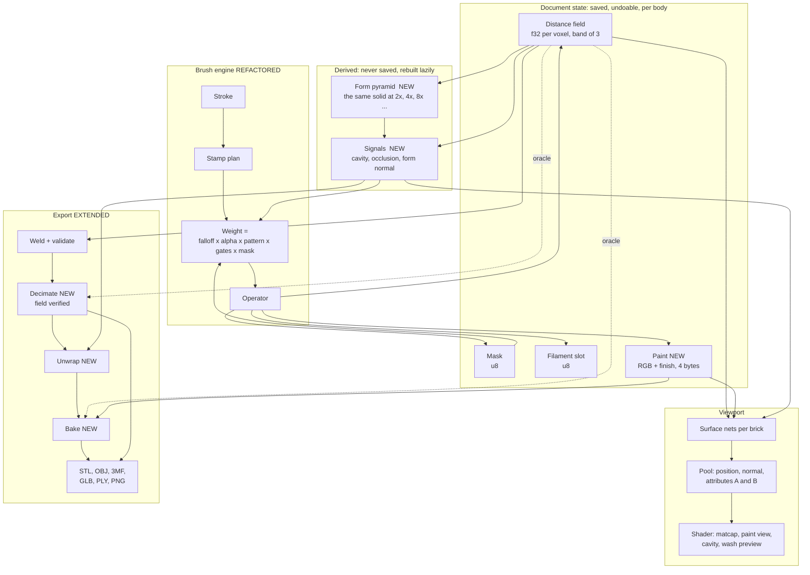
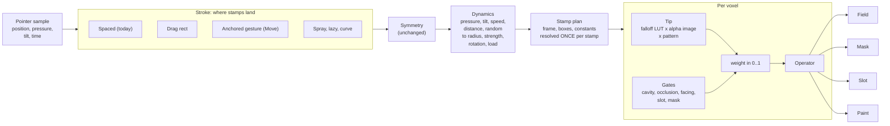
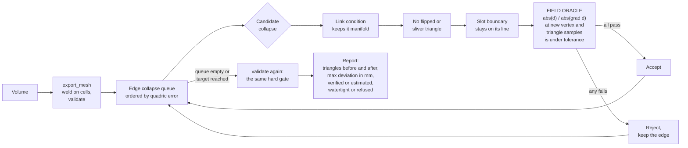
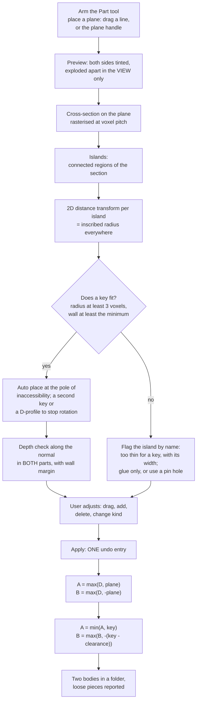
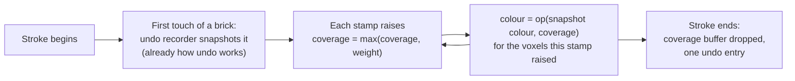
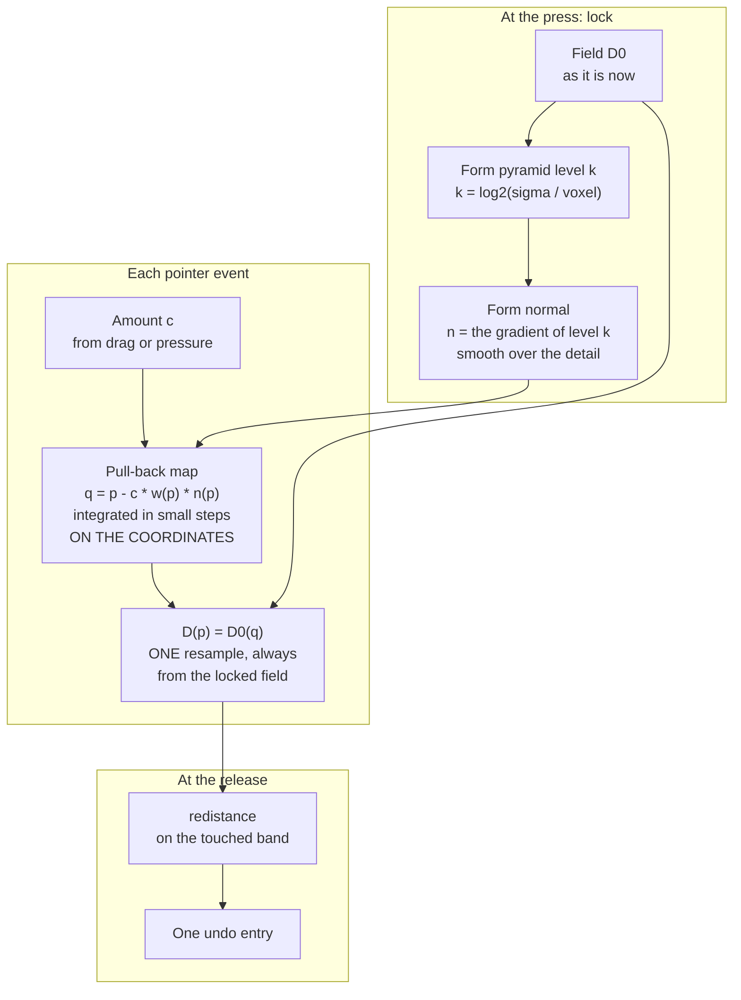
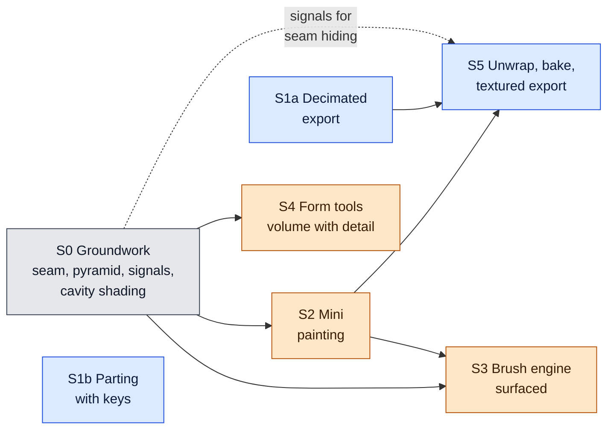
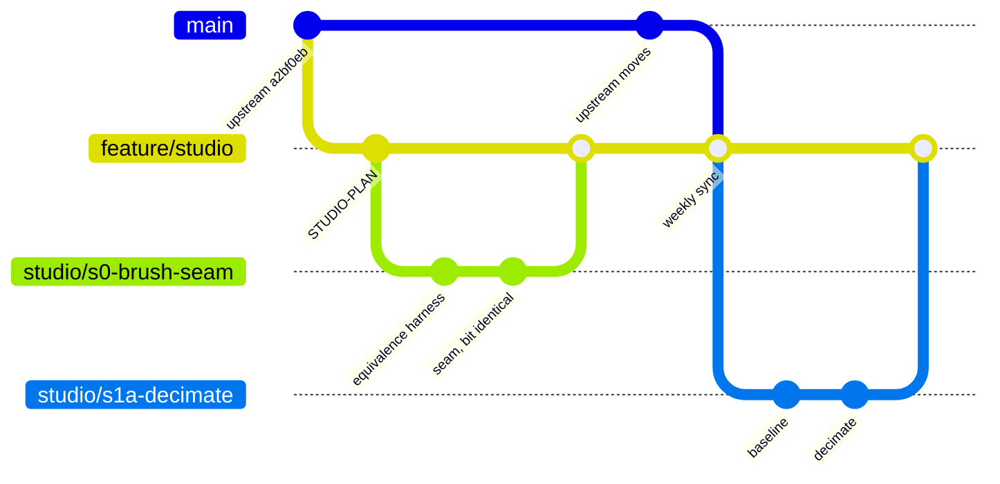

<!-- SPDX-License-Identifier: AGPL-3.0-only -->

# BrokkrSculpt: the Studio plan

Status: **proposed, 2026-11-22.** Nothing in here is built. This is the design
for the long-lived `feature/studio` branch, written before any code, in the
manner of [`CUT-TOOL-PLAN.md`](CUT-TOOL-PLAN.md).

On numbers: every figure is either **sourced** (a `file:line` in this
repository, or the README's measured tables) or explicitly labelled
**estimate**. Estimates are there to be replaced by measurements, and each
milestone starts with the measurement that replaces them.

---

## 1. The ask

Extend BrokkrSculpt from "a sculpting tool for people who print what they make"
into a full sculpt and paint application in the ZBrush mould. Six things were
named:

1. Texture unwrapping.
2. A flexible brush engine.
3. Export with feature preserving mesh decimation.
4. Parting: break a model into pieces that register with keys.
5. Adjusting volumes while preserving fine detail, *if the engine can do it*.
6. A "mini painting mode": washes (speed and contrast paint, borrowing from
   ambient occlusion), drybrush, sponge chop, and detail paint.

The short answers, before the long ones:

| Ask | Verdict | Where the engine helps | Where it fights |
|---|---|---|---|
| Decimated export | Yes, and better than a mesh tool can | The field is an O(1) oracle for "how far is this vertex from the real surface" | Nothing structural |
| Parting with keys | Yes, nearly free | `max` and `min` are exact booleans; an offset field is an exact clearance | Peak memory is 2x, as for every split |
| Mini painting | Yes | Cavity and occlusion fall out of the field; paint survives every sculpt edit | Paint resolution is tied to voxel size; RGB costs +100% per painted brick |
| Flexible brushes | Yes | Every brush is already "weight times kernel" | The stamp loop is the hottest code in the project and is gated by a benchmark |
| Volume with detail | **Yes.** See section 9 | Domain warps carry detail by construction, and the engine already prefers them | Each warp is one lossy resample; one gesture is bounded by invertibility |
| UV unwrapping | Yes, as an **export artefact only** | Baking needs no cage and no ray casts | It is the newest mathematics here, and the upstream spec forbids it |

### The north star, stated by the maintainer on 2026-11-22

> *"I still want it to be a 3d printing app but I want the sculpting and
> painting to be improved. This will then drive improvements to the printing
> part (full color printing, slicing etc.)."*

This stays a printing application. Sculpting and painting are being improved
**so that there is more worth printing**, and each improvement is expected to
pull a printing capability after it:

| Studio work | The printing work it drives |
|---|---|
| RGB paint (S2) | Full colour output: quantising paint to loaded filaments first, then formats full colour printers and services accept |
| Decimation (S1a) | Files a slicer loads in seconds; later, handing a slicer geometry sized to the process |
| Parting and keys (S1b) | Parts sized to a bed and oriented to print without support |
| Detail gain (S4) | Detail exaggerated to survive a given nozzle or layer height |
| Unwrap and bake (S5) | Textured output for full colour processes that take an atlas |

When a design choice is between a better picture on screen and a better object
off the printer, the object wins. Slicing itself stays out of this plan: the
application hands off to slicers (`README.md`, "Printing"), and whether it
should ever slice is a decision to take once full colour output shows what the
existing slicers cannot be told.

---

## 2. What is already here

Read from the code on 2026-11-22, at `a2bf0eb`.

**The field.** A sparse map of 32³ bricks (`brick.rs:12`) of `f32` signed
distance in voxel units, clamped to a band of 3 voxels either side of the
surface (`brick.rs:30`). One voxel size per document; every body shares one
lattice, so a boolean between two bodies is a brick by brick `min` or `max`
with no resampling (`body.rs`, module header). Solid interior and empty space
cost one value per brick.

**Two byte fields beside it.** A mask (`mask.rs`, 8 bits of protection) and a
filament slot (`colour.rs`, a slot index, deliberately not a colour). Both are
sparse maps *inside* `Volume` and *outside* `Brick`, each with its own undo
recorder (`volume.rs:428`), and both module headers argue that placement at
length. Those arguments are accepted here unchanged.

**Brushes.** `Brush { kind, radius, strength, falloff, pattern }`
(`brush.rs:706`) with eight hard coded kinds (`brush.rs:279`). Three blend
toward a legal target (smooth, flatten, clay); the rest are domain warps that
read the field from a shifted position, because anything with gain above one
"turns its own rounding error into visible crust" (`brush.rs:36-42`). Move is a
gesture rather than a stamp: it locks the field at the press and re-warps from
the *total* drag (`brush.rs:1851`).

**Booleans and cuts.** Plane and convex cuts as `max(field, cutter)`
(`clip.rs:647`, `clip.rs:671`); merge as `min` (`merge.rs:196`); split into
loose parts (`split.rs:677`) and split by mask (`split.rs:753`).

**Resample, warp, redistance.** `Volume::resampled` (`resample.rs:86`),
`Volume::warped` (`transform.rs:194`), and a narrow band fast sweeping pass that
restores the distance property (`redistance.rs:162`), already run after every
gizmo bake (`app.rs:3018`).

**Meshing and display.** Surface nets per brick with a one voxel apron
(`volume.rs:842`), 24 byte vertices plus one `Unorm8x4` attribute per vertex
with the mask in byte 0, the slot in byte 1, and **two bytes still free**
(`mesh_pool.rs:263`, `sculpt.wgsl:69-83`). Shading is one matcap. A painted
slot already swaps the clay albedo for a filament colour while keeping the
matcap lighting (`sculpt.wgsl:105-112`).

**Export.** A welded, validated mesh (`export.rs:333`) at full voxel density
to STL, OBJ and 3MF. No simplification of any kind: the README's 60 mm ball at
a 0.055 mm voxel is **11,216,268 triangles** (`README.md:409`).

### What is missing, stated as defects rather than wishes

1. **Export density is the voxel density.** A flat cut face is meshed at one
   vertex per voxel. Slicers do not need eleven million triangles and several
   refuse them.
2. **There is no way to make two parts that fit.** Cut discards one side; split
   keeps both but gives them a flush face and nothing to register on.
3. **Colour is a slot index.** That is correct for filament and useless for
   paint.
4. **A new brush is a new arm in one long function** (`Brush::stamp`,
   `brush.rs:1226`). There is no stamp image,
   no stroke mode but spaced dots, no way to gate a brush on geometry, and no
   preset a user can save.
5. **Inflate destroys detail.** It offsets every level set along its own
   normal, so grooves close and bumps fatten. There is no "low subdivision
   level" to step down to.
6. **Nothing knows where the crevices are except one mask recipe**
   (`generate.rs:127`), and nothing displays them.

---

## 3. The decisions

Seven decisions carry the whole plan. Each is argued in its own section; they
are collected here so that disagreeing with one is cheap.

**D1. UVs are an export artefact, never working state.** No brush, pattern or
paint operation ever consults a UV. Unwrapping happens to the *decimated export
mesh*, once, at export, and the atlas is thrown away afterwards. This is what
keeps `pattern.rs:28`'s promise (patterns are world space, no unwrap needed)
true, and it is why unwrapping cannot destabilise sculpting.

**D2. Paint is volumetric and lives in the band**, exactly as the filament
slot does: a sparse RGB plus finish field inside `Volume`. Paint therefore
survives every cut, merge, move, warp and resample, which no UV or vertex
scheme does when the topology changes under it.

**D3. One derived structure, the form pyramid, serves three features.** The
same solid at two, four, eight times the voxel size gives depth below the form
for washes, smooth base normals for detail preserving volume tools, and seam
hiding for the unwrapper. One piece of work, three customers. (First drawn as
a pyramid of coverage; see section 5.2 for why it is distance fields.)

**D4. The mini painting techniques are not special tools. They are the brush
engine with geometry gates.** A wash is a multiply brush whose deposit follows
occlusion. A drybrush is an opaque brush gated on convexity and stroke
direction. Building the gates once pays for requirements 2 and 6 together.

**D5. The field is the oracle for everything downstream of it.** Decimation
accepts a collapse by sampling the field at the new vertex. Baking finds the
true surface from a low polygon texel with one Newton step. Neither needs a
second mesh to compare against.

**D6. Add, do not modify.** This is a long-lived branch on a fork of a moving
upstream. New code goes in new modules; `app.rs` (24,047 lines) receives
dispatch hooks only; no upstream file is reformatted or refactored for taste.

**D7. Every gate upstream holds stays held.** `cargo fmt`, clippy with
`-D warnings`, the full suite, and the budget benchmark that exits non-zero.
Each milestone begins with a baseline measurement and each new byte parser
ships a fuzz with a control (`CONTRIBUTING.md`).

### What this does to the build spec

`docs/BUILD-SPEC.md:36-42` lists what the project will not build. This plan
deliberately crosses three of those lines on this branch:

| Spec entry | This plan | Why it is not the thing the entry feared |
|---|---|---|
| UV unwrapping | S5 | Export only (D1). The entry exists to keep a UV dependency out of the sculpt loop, and it still is. |
| Polypaint or vertex colours | S2 | Crossed outright. RGB per voxel, next to the slot field rather than replacing it. |
| Sculpt layers | Not built | Paint layers are deferred (section 12); recorded sculpt deltas remain out. |
| IMM / insert mesh | Not built | Keys are closed form solids, not a mesh library. |
| Auto retopology | Not built | Decimation reduces triangles; it does not produce quads or edge flow. |

Decimation, parting and the volume tools cross none of them and are candidates
to offer upstream. Painting and unwrapping are fork scope unless upstream
changes its mind.

---

## 4. The architecture, in one picture



The crate boundary does not move. Everything above except `VIEW` lives in
`brokkr-core`, which stays free of UI, windowing and GPU dependencies.

---

## 5. Shared groundwork (milestone S0)

Three pieces that every later milestone stands on. None changes what the
application does; all are proven by equivalence or measurement before anything
is built on them.

### 5.1 `SparseField<T>`

`mask.rs` (2,075 lines) and `colour.rs` (985 lines) are the same sparse map
written twice by hand: absent means default, a `Uniform` tile costs no heap, a
dense brick is `32³ x size_of::<T>()`. Paint and the per-stroke coverage buffer
would be the third and fourth copies.

A generic `SparseField<T: Pod>` is written **for the new fields only**. The
existing two are left exactly as they are (D6); folding them in is a refactor
to offer upstream, not one to carry on a fork.

### 5.2 The form pyramid

**Built 2026-11-22, and not as first drawn.** This section originally
described a pyramid of *coverage*: one byte a cell holding the fraction of it
that is solid. That was worked through before any of it was written and
dropped, for a defect on the simplest input there is. On a flat face the solid
fraction is a ramp across one cell, and a trilinear read of that ramp at the
face is not one half: it swings 0.0625 either side as the face moves across
the lattice, which is 0.125 of occlusion against about 0.5 for a real crease.
A wash painted from it would have drawn the voxel grid on every incline.

What is built instead, in `pyramid.rs`: **each level is a complete distance
field of the same solid at twice the voxel size of the one below.** The
distance to a plane is linear and trilinear interpolation reproduces a linear
function exactly, so a flat face reads zero at every level whatever its phase.

The distance band is 3 voxels deep (`brick.rs:30`), so the field alone cannot
answer any question at a scale wider than that. The cavity mask already hits
this wall: it reads curvature from a 7 point Laplacian (`generate.rs:29`),
which sees crevices a voxel or two wide and nothing broader. Level `k` of the
pyramid has its own 3 voxel band, which reaches `3 * 2^k` voxels of the
original.

- **A level is made** by taking each coarse voxel as the tent weighted mean of
  the 27 fine voxels round it (centred, so every level shares the document's
  lattice origin; exact on a plane; a low pass, so a groove narrower than the
  level is bridged instead of aliased). `redistance` then rebuilds the band
  outward, and the voxels the mean got exactly right are put back afterwards.
- **Solid interior stays one value per brick** and empty space stays absent,
  as in the field.

Three things are read from it:

| Signal | Definition | Customer |
|---|---|---|
| Relief at level `k` | The level's distance at a point on the fine surface: negative in a recess the level bridges, positive on a protrusion, zero on a flat | Washes, zenithal, seam placement |
| Form normal at level `k` | The level's gradient | Volume tools (section 9) |
| Base surface at level `k` | The level's zero set | Detail gain (section 9) |

**Measured, release build, a shared four core container:**

| | |
|---|---|
| Relief on a flat face, worst over four tilts and five phases | 0.020 voxels of the level (the coverage design: 0.125 by construction) |
| A slot 4 voxels wide and 12 deep, read at its floor | 0.0, -0.6, -3.6, -9.6 mm at levels of 2, 4, 8 and 16 voxels |
| Memory, six levels | **36% of the field** (the estimate here was 8%, for bytes; these are `f32`) |
| Build, 1,154 brick ball | 1.7 s |

The memory figure is four times the estimate and is recorded in the module with
the two ways down from it: store a built level as one byte a voxel, or drop the
first level's storage once the second has been derived from it. Neither is
taken yet.

**Freshness.** The pyramid is derived, never saved and never in an undo entry.
It is rebuilt whole by whoever needs it (entering paint mode, pressing a form
brush, exporting), never in the per-frame path. Rebuilding only what an edit
touched is the obvious next step and is not built.

### 5.3 The fine cavity signal

**Built 2026-11-22**, in `signals.rs`. The Laplacian divided by the gradient
length, as `generate.rs` computes it, made available per mesh vertex.

The open question this section used to end on is settled, and by neither of
the two answers it offered. The signal is **computed at mesh time and cached
nowhere**, at the centre of each vertex's lattice cell: the mean of the
stencil over the cell's eight corners, which comes out as a compact form over
the 4x4x4 block round the cell. Nearly all of that block is in the apron the
mesher has already gathered. Where it overhangs, by one voxel on the cells
along a brick's faces, the missing samples are read from the volume. Both
bricks either side of a seam therefore evaluate one expression over the same
32 stored values, and a test holds them to the same byte.

It costs 32 reads a vertex, so it is **off unless asked for**:
`Document::mesh_dirty_with_cavity` sits beside `mesh_dirty` and a mesh made
without it carries an empty run that every reader takes as flat.

One byte, 128 for flat, on a square root curve so that the nearly flat part of
the range, which is most of a real surface, gets most of the levels.

Brushes will evaluate the same measurement per voxel from the stamp snapshot,
which is already grown by one voxel for this purpose (`region.rs:12`). That
arrives with the first brush that gates on it.

### 5.4 The first visible payoff: crease shading

**Built 2026-11-22.** A view toggle, *show creases*, that darkens creases and
lifts edges, the way ZBrush's cavity matcaps and Blender's viewport cavity do.
It is a view, like the mask tint: it changes nothing a stroke does, no voxel,
no undo entry, and it does not dirty the document.

- The cavity byte travels in byte 2 of the per-vertex attribute, which was
  free. Byte 3 is still free, and is where the broad relief from the pyramid
  goes when paint mode needs it.
- The setting is a feature size in millimetres (1.0, the finest thing a
  filament printer resolves), so it means the same thing at every voxel size.
- Switching it on or off remeshes every body, because the signal is in the
  mesh. That is the one way it differs from the mask and paint toggles, which
  are a uniform write.
- An offscreen pixel test holds it: creases darker, edges lighter, flats
  unchanged, strength zero byte for byte the picture without it. Six shader
  mutations were run against that test; two survived its first version (the
  sign of the curvature backwards, and the strength ignored) and the test was
  strengthened until both were caught.

### 5.5 The brush seam

The engine of section 6, landed with **no new behaviour**: the six stamping
kinds implemented a second time in `brush/engine.rs` and pinned bit for bit
against the untouched original, in the idiom `Skipping::On` against
`Skipping::Off` already uses (`brush.rs:1221-1225`). A ratio benchmark,
`benches/engine.rs`, is the second gate: the engine may not be slower than the
brush it stands beside.

**Amended 2026-11-22, when this was built.** The first draft of this section
said the existing kinds would be *routed through* the new pipeline. They are
not, and that is deliberate. `brush.rs` is left exactly as upstream wrote it,
apart from one line declaring the child module, and the old stamp path is the
**live oracle** the new one is compared against. Two things follow. Upstream
changes to `brush.rs` merge without conflict (D6). And when upstream changes
what a brush does, the equivalence test fails and names the brush, which is the
moment to bring the engine back into step on purpose. The application keeps
calling `Brush` for the classic brushes; new operators, gates and tips exist
only in the engine. Move and Paint have no engine form: Move is a gesture, and
Paint writes another channel that arrives with S2.

---

## 6. The brush engine (S0 seam, S3 surface)

### 6.1 The shape

Today a brush is an enum variant. In ZBrush a brush is a *composition*, and the
composition is the flexibility. The same split, in this engine's terms:



```rust
/// A brush as data. Serialisable, user-saveable, composed of orthogonal parts.
pub struct BrushDef {
    pub stroke: StrokeMode,   // how stamps are placed along the gesture
    pub tip: Tip,             // falloff curve, optional alpha image, pattern
    pub op: Operator,         // what one weighted voxel does, and to which channel
    pub dynamics: Dynamics,   // input to parameter curves, resolved per stamp
    pub gates: Gates,         // geometry and channel conditions on the weight
    pub scale: FormScale,     // Detail, or Form { sigma_mm }: see section 9
}
```

The existing `Brush` struct stays as it is and converts into a `BrushDef`. The
application, the benchmarks and every test in the 5,568 line `brush.rs` keep
calling what they call today.

### 6.2 The rules new operators must obey

These are `brush.rs`'s own, restated because every new operator is a chance to
break them:

1. **The weight stays in 0..=1** (`pattern.rs:12`). Gates and alphas multiply; nothing adds.
2. **A field operator either blends toward a legal distance or warps where the
   field is read from.** Nothing multiplies a difference from a local average
   inside a stamp loop.
3. **One stamp moves the surface at most one voxel** (`brush.rs:89`).
4. **Read reach is declared**, because a read outside the snapshot clamps
   silently instead of failing (`brush.rs:44-55`).
5. **Dispatch happens once per stamp, not per voxel.** The operator is a
   generic parameter of the inner loop, so the loop monomorphises exactly as
   the match arms do now.

### 6.3 What gets added, in order of value

| Part | Addition | Notes |
|---|---|---|
| Gates | Cavity range, occlusion range, facing, slot filter | Built in S0 with the signals; the paint brushes of S2 are the first customers |
| Operator | Paint operators (section 8) | S2 |
| Operator | Scrape (flatten, remove only), Fill (flatten, add only), Crease (pinch plus inverted draw in one warp) | Each is a clamp or a composition of something that exists |
| Tip | Alpha image: a greyscale stamp, bilinear sampled in the stamp frame | 16 bit PNG, decoded in `brokkr-app` and handed to core as `&[f32]`; core stays free of file formats |
| Stroke | Drag rect: one stamp placed at the press, sized and turned by the drag | The natural partner of an alpha |
| Operator | Displace: draw whose depth is the alpha's value | Scales, runes, stitches as stamps |
| Dynamics | Curves from pressure, tilt, speed and stroke distance to radius, strength, rotation | Resolved per stamp; costs nothing per voxel |
| Stroke | Lazy (stabilised), spray (jittered), curve (along a drawn spline) | |
| Operator | Gesture warps on the `MoveStroke` machinery: twist, elastic grab (regularised Kelvinlets) | Volume preserving by construction |
| Operator | Layer: draw capped at a fixed height above the stroke's starting surface | Needs a stroke long locked region; memory to be measured first |
| Presets | One flat `key = value` file per brush under the config directory | The format `palette.rs` and `printer.rs` already use |

The digit keys keep meaning the classic brushes in the order they have always
had (`brush.rs:344`, "Appended and never reordered").

**Drift.** More operators means more gradient drift. `redistance` is band
restricted and gates on measured drift (`redistance.rs:137`), so S3 measures
running it at stroke end on the touched bricks only, and adopts it if the
budget allows.

---

## 7. Print pipeline (milestone S1)

Two independent features that cross no line in the build spec and could go
upstream as they are.

### 7.1 Decimated export



**The control is a tolerance in millimetres, not a percentage.** "No point of
this file is more than 0.02 mm from what you sculpted" is a statement about a
print; "keep 6%" is not. Presets are named for the process: resin, 0.4 mm
nozzle, draft. A target triangle count is the secondary control, for people
exporting to a renderer.

**Why the field makes this better than a mesh tool can do it.** A mesh
decimator has to estimate deviation by accumulating quadrics, because its only
reference is the mesh it is destroying. This engine can simply *ask*: the
distance from a proposed vertex to the true surface is one trilinear sample.
Quadrics order the queue; the field accepts or rejects. Dividing by the
gradient length corrects for brush drift in the same way `generate.rs` already
does.

**The honest limit:** the oracle is only valid inside the band, so a verified
tolerance cannot exceed about 2 voxels. Looser than that, the decimator falls
back to accumulated quadric error and **the report says "estimated" instead of
"verified"**.

**What "feature preserving" means here, concretely:**

- Sharp edges survive because a quadric built from two differently oriented
  plane sets is steep across the edge and flat along it. That is the algorithm,
  not an add-on.
- Flat regions collapse to almost nothing. A cut face goes from one vertex per
  voxel to a handful of triangles.
- **Filament slot boundaries do not move.** A painted boundary is already cut
  exactly by `split_paint_boundaries` (`mesh.rs:255`). Its edges get boundary
  quadrics and its vertices may only collapse along it. A slot is an index:
  a boundary that drifts prints in the wrong filament.
- No collapse may create a degenerate or flipped triangle. The build spec names
  this failure from SindriCAD's history (`BUILD-SPEC.md:177`) and the
  post-decimation `validate` is the gate that proves it did not recur.

**Build or depend.** In house, in `brokkr-core/src/export/decimate.rs`,
**estimated at 800 to 1,200 lines with tests.** The algorithm is thirty years
old and well documented; the two things that make this version worth having
(the field oracle and the slot constraint) are not available in any library's
API. Candidates that exist and are **unverified by this plan**:
`meshopt` (C++ bindings), `meshopt-pure` and `baby_shark` (pure Rust). The
first day of the milestone evaluates one of them as a **dev-dependency used
only as a differential test oracle**, which costs the shipped binary nothing.

**Cost, estimate:** tens of seconds single threaded at eleven million
triangles. It runs in an iced `Task` with progress and cancel, never on the
drawing thread. If measurement says it must be faster, bricks give a natural
parallel pre-pass: decimate each brick's interior with its seam vertices
locked, then run one global pass over what is left.

### 7.2 Parting with keys



**The split.** Both halves, from one plane: `A = max(D, plane)` and
`B = max(D, -plane)`. Exact, closed, and flat faced as a property of the
arithmetic, which is `clip.rs`'s whole argument.

**The keys.** A key is a closed form solid: a tapered cylinder, a D-cut or hex
profile for anti-rotation, a magnet pocket, a pin hole. Closed form distance
functions are 1-Lipschitz, so the brick classification `primitive.rs:14-29`
uses carries over, and no interior brick is promoted dense.

- The peg is a union: `A = min(A, key)`.
- The socket is a subtraction of the **offset** key:
  `B = max(B, -(key - clearance))`. Subtracting a constant from a true distance
  function *is* the exact offset solid, so the clearance is correct everywhere
  including round the chamfer, with no second modelling step.
- Magnet pockets and pin holes subtract from both.

| Key kind | Parts | For |
|---|---|---|
| Peg and socket | Male on A, female on B | The default. Tapered so it prints without support and self-centres |
| D-profile or hex peg | Same | A single key on an island too small for two |
| Pin hole | Hole in both | Pinning with rod or a filament offcut, the miniature painter's habit |
| Magnet pocket | Pocket in both | Swappable parts. Sized by magnet diameter and height |

**Clearance** is per side, in millimetres, and belongs to the printer rather
than the model, so it is stored the way `palette.rs` stores filaments.
Defaults (estimates from common practice, to be tuned): 0.2 mm for filament,
0.08 mm for resin. A later increment generates a **tolerance coupon**: one
printable strip of pegs and sockets at five clearances, so the user measures
their own printer instead of trusting a default.

**What the lattice can and cannot hold.** A surface position is sub-voxel, so
a clearance of 0.4 voxels on a flat or gently curved face is represented
accurately. A sharp edge is not: it rounds at about a voxel. Keys are therefore
chamfered by design, and the tool **refuses a key narrower than 3 voxels**
(the same floor `README.md:365` gives brushes) and names the voxel size that
would allow it.

**New core surface.** One generalisation: `clip` currently takes planes. It
gains a `Cutter` trait (a distance function plus a Lipschitz bound), so a
plane, a convex set of planes and an oriented key are the same classified
`max`. Union with a closed form solid is the mirror image. Both mark dirty by
voxel range grown by one, which is the trap `merge.rs:32-39` documents.

**Memory.** Two outputs while history holds the original is a 2x peak, as for
every split (`split.rs:97`, "The uncomfortable thing"). The existing guard
predicts it and refuses by name.

**The exploded preview is a view, not a transform.** `body.rs` is emphatic
that a body has no transform and that adding one gives away the lattice
property. The preview is a per-body offset uniform in the renderer, in the same
category as the mask tint.

**Deferred:** freeform parting surfaces (through `split_masked`, which needs a
crisp boundary rather than a feathered one), dovetails, a "fit to bed"
assistant that proposes a grid of planes from the printer's bed
(`slicer.rs:329`), embossed part marks, and hollowing with drain holes.

---

## 8. Mini painting (milestone S2)

### 8.1 What a miniature painter actually does

The mode is modelled on the bench, not on Photoshop, because the bench
techniques are what was asked for and they are all *geometry driven*:

| Step at the bench | What the paint physically does | The signal that reproduces it |
|---|---|---|
| Prime, often zenithal (dark from below, light from above) | Spray lands where the nozzle can see | Normal against a direction, times directional occlusion |
| Basecoat | Opaque colour, area by area | Plain brush; later, a fill that stops at creases |
| Wash or shade | Thin pigment runs off high points and pools in recesses | Cavity and occlusion |
| Contrast or speed paint | The same, with enough pigment to tint the flats too | The same, with a stain term |
| Drybrush | A nearly dry brush catches only raised edges, in streaks along the stroke | Convexity, facing against the stroke, streak noise, a load that runs out |
| Sponge or stipple | Random speckle, heavier on exposed edges | Per-stamp cellular noise, optional convexity bias |
| Edge highlight | A fine light line on sharp edges | Strong fine convexity |
| Detail | Small opaque marks | Plain brush at small radius, stabilised |

"Slapchop" (prime black, drybrush grey then white, contrast paint over the
top) becomes three clicks and a few strokes, which is the point of the mode.

### 8.2 Storage

`PaintField = SparseField<[u8; 4]>`: sRGB red, green, blue and a **finish**
byte (0 bare, then matte, satin, gloss, metallic; high bits reserved).

It follows the slot field's rules word for word, because `colour.rs` argues
each one from a measured failure:

- Inside `Volume`, outside `Brick`, with its own undo recorder.
- Written only where the field is in band (`colour.rs:233`); read only at mesh
  vertices.
- Carried through `rotated`, `shifted`, `resampled`, `warped`, merge, split,
  duplicate and Move, **each with a test that fails without it.** That sweep is
  the single largest piece of S2 and the one most likely to be skimped.
- Saved as a new per-body stream behind a `FIELD_VERSION` bump from 3 to 4
  (`project.rs:142`), which is the route the mask and the slot both took. The
  reader gets a mutation fuzz with a control.

**Cost, sourced:** a dense paint brick is 131,072 bytes, +100% of a dense field
brick (`colour.rs:8`). **Priming is free**: one uniform tile per brick, no
heap. Bricks go dense as they are painted. Every global operation predicts its
demand before it runs and is refused by name over the 6 GiB ceiling
(`project.rs:245`), following `generated_mask_demand` (`generate.rs:244`).

**The slot field stays.** Filament slots and paint are different facts: one is
a print instruction, the other is a picture. A bridge operation,
*Paint to filament slots*, quantises paint to the loaded filaments
(`palette.rs`) and writes the slot field, so a speed painted model can go
straight to a multi-colour print through the 3MF writer that already exists.

### 8.3 The paint operators

All colour arithmetic is done in linear light and stored as sRGB. With base
colour `b`, paint colour `c`, brush weight `w`, signed cavity `k` (positive in
a crevice), occlusion `o`, normal `n` and stroke tangent `t`:

| Operator | Result | Parameters |
|---|---|---|
| Opaque | `lerp(b, c, w)` | opacity |
| Glaze | `lerp(b, b * c, w)` | opacity |
| **Wash** | thickness `T = stain + flow * (a*max(k,0) + (1-a)*o) - edge * max(-k,0)`, clamped at 0; then `lerp(b, b * c^T, w)` | stain, flow, edge, scale mix `a` |
| Drybrush | `g = ridge(-k) * facing(n, t) * streak(p, t) * load(distance)`; then `lerp(b, c, w * g)` | ridge threshold, streak, load length |
| Sponge | `g = cell_noise(p, stamp_seed) > 1 - density`, optionally times `ridge(-k)`; then `lerp(b, c, w * g)` | density, grain, edge bias |
| Zenithal | `g = max(0, n . L)^e * (1 - o_L)`; opaque | direction, spread |
| Edge highlight | `g = ridge(-k)` at the finest scale; opaque | width |

**The wash is Beer-Lambert, and that one line is the whole "abuse of ambient
occlusion".** A film of pigment of thickness `T` transmits `c^T` of the light
that reaches the surface under it. Where the film is thin (a ridge, `T` near 0)
the base shows through nearly untouched: that is the highlight. On a flat it
transmits about `c^stain`: the tint. In a crevice (`T` of 2 or 3) it
transmits `c^3`: deeper *and more saturated*, which is exactly how a contrast
paint behaves and exactly what a multiply by a grey ramp gets wrong. A wash and
a contrast paint are the same operator at two settings of `stain`.

**One stroke is one coat.** A stroke lays hundreds of overlapping stamps, and a
multiplicative operator applied per stamp would darken unevenly wherever they
happened to overlap. So a paint stroke accumulates **coverage** in a scratch
`SparseField<u8>` and applies its operator from the *stroke-start* colour:



The snapshot is the one undo already takes on first touch, so the coat rule
costs one byte per touched voxel for the duration of a stroke and nothing
after. Two strokes are two coats, as at the bench.

### 8.4 Whole-body operations and their preview

Every operator above also runs as a **whole-body operation** with the mask as
its only weight: prime, zenithal, wash everything, drybrush everything, edge
highlight everything. They are the "speed" in speed paint.

**The preview is free and is the same formula.** The shader already has cavity
and occlusion per vertex (S0) and paint per vertex (S2), so a pending wash is
drawn live from four uniforms while the sliders move. *Apply* then runs the
same arithmetic on the CPU and writes the field. One formula in two languages
is a known hazard here, and the repository already has the remedy: a test that
evaluates both on a table of inputs, in the manner of
`the_base_luma_the_shader_divides_by_is_the_clays`.

**Undo for a whole-body operation** replaces the entire paint field, which can
exceed the 256 MiB stroke budget (`undo.rs:96`) on its own. It is recorded as a
whole-field replacement charged to the reclaim budget (`undo.rs:121`), the
category that exists for "the entry is the only copy" (`undo.rs:54`, "Two
counters, one deque").

### 8.5 The paint view

- **Lit:** paint albedo times the matcap's lighting term. This is the filament
  path that already exists (`sculpt.wgsl:105-112`) reading a vertex colour
  instead of a palette entry. It needs a second `Unorm8x4` attribute buffer and
  almost no new shader.
- **Flat:** albedo only. A wash paints shading *into* the colour, so a painter
  has to be able to see the paint without the viewport's own lighting on top.
- **Finish** (later in S2): gloss and metallic read a second matcap.

Tools around it: colour picker, eyedropper, a paint rack of named swatches
saved beside the filament palette, fill (body, mask, slot region), and later a
**crease-bounded fill** that floods an area and stops at cavity lines, which is
what makes basecoating by region one click per region.

### 8.6 The honest limits

- **Paint resolution is the voxel size.** A 32 mm figure at 0.1 mm is 320
  paint cells tall. That is close to what a physical brush resolves at 1:1 and
  it looks coarse zoomed in on a monitor. The existing answer applies: resample
  finer (down to 0.03 mm). The named way out is a paint lattice at twice the
  field's resolution, deferred until someone needs it more than they need the
  memory.
- **No paint layers in the first version** (section 12).
- **No pigment flow simulation.** The wash is a transfer function of geometry,
  not a fluid. Gravity pooling is a possible extra term, not a solver.

---

## 9. Volume with detail preserved (milestone S4)

> *"Some way to adjust volumes while preserving fine details (is this possible
> with Brokkr's engine?)"*

**Yes.** And the reason is already written in `brush.rs`.

### 9.1 Why inflate loses detail and move does not

Inflate subtracts a constant from the field. Every level set moves along **its
own** normal, and a fine groove's two walls have normals that point at each
other, so they meet and the groove is gone. That is a morphological dilation,
and no parameter fixes it.

Move reads the field from a displaced position: `D'(p) = D(p - u(p))`. Whatever
was at `p - u` arrives at `p`, detail included, because nothing about the
detail is recomputed. `brush.rs:40` says it in one line: warping where the
field is read from "cannot introduce detail that was not there". It also cannot
remove any, provided the displacement field `u` is **smooth compared with the
detail**.

ZBrush gets the same effect by stepping down subdivision levels: edit the
coarse cage, and the fine displacement rides along. This engine has no levels.
It has something equivalent: **a displacement field computed from the form and
applied to everything.**

### 9.2 The mechanism



Three details in that picture are load bearing:

1. **The normal comes from the pyramid, not from the field.** `sigma` is the
   user's statement of what counts as detail, in millimetres: features smaller
   than it ride along, features larger than it are the form being changed. In
   millimetres, so it means the same thing at every voxel size, which is the
   argument `generate.rs:51-60` makes for the cavity slider.
2. **Large amounts are integrated on the coordinates, and the field is sampled
   once.** A warp stops being invertible when its gradient reaches one, which
   is why `Brush::max_drag` exists (`brush.rs:764`). Going further by repeating
   the warp would resample the field each time and blur it each time. Composing
   the *map* in small steps and reading the locked field once at the end costs
   vector arithmetic per voxel and exactly one interpolation.
3. **It is a gesture, locked at the press**, on the `MoveStroke` pattern.
   Thirty adjustments within one gesture cost one resample, which is the rule
   `transform.rs:45-52` already states for the gizmo.

### 9.3 The tools this gives

| Tool | What it does | Mechanism |
|---|---|---|
| **Bulk / Slim** | Thicken or thin a mass; scales, pores and wrinkles survive | The warp above, as a brush |
| **Bulk body** | The same over a whole body or everything unmasked | The warp above, global, with a millimetre amount |
| **Form smooth** | Relax the big shape, keep the surface texture | `D' = D + w * (smooth(B) - B)` where `B` is the base at scale `sigma`: a low frequency term added to the field. Blend type, no gain |
| **Posed transform** | Gizmo plus mask: rotate, move or scale the unmasked part, blended across the mask's feather | Per point blended similarity, inverse by fixed point iteration, one resample, then `redistance` as `app.rs:3018` does now |
| **Detail gain** | One slider: soften the detail and keep the form, or exaggerate the detail | `D' = B + g * (D - B)`, once, from a locked field |
| **Form scale on any brush** | The `FormScale` switch in `BrushDef` | Blend brushes apply their edit to `B` and add the difference; warp brushes take their direction from the form normal |

Detail gain above one looks like the thing `brush.rs` forbids (amplifying a
difference from an average). The prohibition is about doing it *per stamp*,
where rounding error compounds across a stroke. Done once from a locked field
it is a single linear operation, clamped and redistanced. It is also directly
useful for print: fine detail that a 0.4 mm nozzle would erase can be
exaggerated on purpose before export.

Posing is worth singling out: gizmo plus mask is how a ZBrush figure is posed,
and `mask.rs:53-54` already guarantees the precondition, since "every path
that writes the mask writes a feathered edge, never a step" was written to keep
exactly this kind of warp invertible.

### 9.4 The limits, stated before anyone finds them

- **Detail is carried, not regenerated.** Where a surface grows, its detail
  stretches with it. That is also what subdivision levels do.
- **One gesture is bounded** by the curvature radius of the form and the width
  of the falloff. The map integration extends the range; it does not remove
  the bound, and past it the surface stops following rather than tearing.
- **One warp is one trilinear resample**, and trilinear interpolation
  attenuates features near the voxel scale. **S4 begins by measuring that**:
  the amplitude of a 4 voxel ripple after one warp. If the loss is visible, the
  gesture warps get a cubic sampler. Estimate: it will be needed for detail
  under about 5 voxels.
- **Detail at the limit of resolution is fragile under anything**, here as in
  every other operation (`README.md:365`).

---

## 10. Unwrap, bake and textured export (milestone S5)

Last, because it needs decimation (S1) and paint (S2) to have anything to do.

### 10.1 Unwrap

On the **decimated** mesh, at export, and never anywhere else (D1).

- **Charts** by region growing over faces. The cost of adding a face to a
  chart is its normal deviation from the chart's proxy plane plus a
  compactness term, **minus a reward for ending the chart in a crevice**: the
  occlusion signal says where a seam will not be seen. Masked faces refuse
  seams, which gives the user ZBrush UV Master's "protect" with the tool they
  already have.
- **Flattening, first version:** orthographic projection onto the chart's
  proxy plane with the normal cone capped at 60 degrees, which bounds stretch
  at 2 with no solver at all. **Second version:** least squares conformal maps
  with an in-house conjugate gradient, which allows larger charts and fewer
  seams.
- **Packing** with a skyline packer at uniform texel density, with a gutter
  sized for the bake.

Texel density is derived, not chosen: one texel per voxel captures the paint
losslessly, and a 3,000 mm² miniature at 0.1 mm is 300,000 texels, which fits
a 1024 atlas with room for gutters. **(Estimate from area; measured in S5.)**

**Build or depend.** `xatlas` is the standard and is C++. A pure Rust crate in
its spirit, `uvunwrap`, exists and is **unverified by this plan**. The
milestone's first day evaluates it. The projection charts above are the
fallback, and they are small enough to be the differential oracle either way.

### 10.2 Bake

For each texel inside a chart triangle, take its world position `p` on the low
polygon triangle and step to the true surface:

```text
p* = p - d(p) * grad d(p) / |grad d(p)|^2
```

One or two steps, valid because decimation kept `p` inside the band. Then read:

| Map | Source at `p*` |
|---|---|
| Base colour | Paint field |
| Normal (tangent space) | Field gradient, in the triangle's frame |
| Occlusion | Occlusion signal |
| Height | `d(p)` itself, in millimetres, signed |
| Metallic and roughness | Finish byte |
| Slot id | Slot field |

**No cage, no ray casts, no "the rays missed" artefacts.** On a mesh pipeline
baking is its own craft. Here the question "where is the real surface from this
point" is the question the data structure exists to answer.

### 10.3 Formats

- **OBJ + MTL + PNG**, the lowest common denominator.
- **GLB** (binary glTF), with base colour, normal, occlusion and
  metallic-roughness. The JSON is small and `serde_json` is already in the
  graph (`Cargo.lock:3236`).
- **PLY with vertex colours**, which several full colour print services take,
  and which S2 can ship early since it needs no atlas.
- PNG writing through the `png` crate, already in the lockfile
  (`Cargo.lock:2779`). **To verify at implementation:** that naming it directly
  adds no new crate to the build, which is the bar `Cargo.toml`'s comments set.

The 3MF writer keeps writing filament slots. That is still the right contract
with a slicer.

---

## 11. Priorities

### 11.1 The order

Ranked by value to the sculpt, print, paint loop, times certainty, over cost,
subject to what depends on what. Sizes are **estimates in working weeks for one
person with AI assistance**, and each is replaced by a phased plan with
measured baselines when its milestone opens.

| Rank | Milestone | What ships | Size | Why here |
|---|---|---|---|---|
| 1 | **S0 Groundwork** | Brush engine (no behaviour change), `SparseField`, form pyramid, signals, cavity shading toggle, branch and CI hygiene | 2 to 3 | Everything stands on it. Zero user-facing risk. Cavity shading is a visible win by itself |
| 2 | **S1a Decimated export** | Tolerance in mm, field verified, slot boundaries held, report | 2 | Smallest, independent, fixes a pain that exists today, prerequisite for S5, upstream candidate |
| 3 | **S1b Parting with keys** | Plane part, four key kinds, auto placement, clearance, preview | 2 to 3 | Independent. The engine makes it nearly free. Upstream candidate |
| 4 | **S2 Mini painting** | Paint field and view, prime, opaque and glaze, wash and contrast, drybrush, sponge, zenithal, edge highlight, whole-body versions, paint to slots, PLY | 5 to 7 | The headline. Largest. Needs S0's signals and gates |
| 5 | **S3 Brush engine, surfaced** | Alphas, drag rect, displace, dynamics curves, new operators, presets | 3 to 4 | The refactor is done in S0 and exercised by S2; this exposes it |
| 6 | **S4 Form tools** | Bulk and slim, form smooth, posed transform, detail gain | 3 | Needs the pyramid. High value, one real unknown (resample blur) |
| 7 | **S5 Unwrap and bake** | Charts, packing, bake, OBJ+PNG, GLB | 3 to 4 | Needs S1a and S2. Newest mathematics. Only matters once there is paint to carry |
| | **S6 Backlog** | Section 12 | | |

**About 21 to 26 weeks in sequence (estimate).** S1 and S2 do not depend on
each other, so with two streams of work the print track and the surface track
run side by side after S0.



Grey is groundwork, blue is the print track (and upstream friendly, except S5),
orange is the surface track. S1a and S1b have no arrow into them from S0: they
can start on day one.

### 11.2 Why not painting first

It is the feature with the most words in the request, and it is ranked fourth.
Three reasons:

1. **It cannot start without S0**, and S1a and S1b can. They are useful weeks
   that are otherwise idle.
2. **S1 is where the risk is lowest and the proof is cheapest.** Decimation and
   parting are verified by counting edges and measuring millimetres. Painting
   is verified by looking, which this repository has learned to be careful
   about (`CONTRIBUTING.md`, "a green-but-dead interaction twice").
3. **S1 is the part upstream might take.** Landing it first, cleanly, on new
   files, keeps that door open and keeps the fork's diff small while the larger
   work is still moving.

If the preference is the headline first, S2 moves up to rank 2 and nothing else
changes; the dependency graph allows it.

### 11.3 The first three increments

1. **The brush engine, held to the brush.** *Done, 2026-11-22.* Every stamping
   kind, falloff, pattern, direction, pressure, mask state and mirror through
   both paths, same field and same undo entry bit for bit; eight mutations of
   the engine run against the test, six caught and two shown to be equivalent.
   A recorded hash was the first idea and was dropped: the patterns take roots,
   so a hash is a statement about one machine.
2. **The form pyramid, the cavity signal and crease shading.** *Done,
   2026-11-22* (sections 5.2 to 5.4). The pyramid is distance fields rather
   than coverage; the cavity signal is measured at mesh time and cached
   nowhere; *show creases* is the first thing in this plan a user can see.
3. **Decimation phase 0:** measure what export costs today (triangles, bytes,
   seconds, slicer load time) at three voxel sizes, so the milestone's claims
   have a baseline.

---

## 12. What this plan deliberately does not do

Each with the reason, and the trigger that would reopen it.

- **Paint layers.** A full coverage layer costs as much memory as the geometry
  it sits on (+100% of the field, section 8.2), so a six layer stack on a real
  model is past the ceiling. The first version is one buffer, as a real
  miniature is, with a deep undo. *Trigger:* a measured compact paint brick
  (surface cells only, estimated at 20x smaller) makes layers affordable.
- **Sculpt layers.** Still out, for the build spec's reasons.
- **A paint lattice finer than the field.** Section 8.6. *Trigger:* someone
  painting freehand detail on a body whose geometry does not need the voxels.
- **Adaptive extraction straight from the field** (octree dual contouring)
  instead of decimating a uniform mesh. It could recover the sharp edge of a
  cut that surface nets rounds. Crack free adaptive contouring is intricate,
  and decimation gets most of the triangle saving for a fraction of the risk.
  *Trigger:* cut edges that measure visibly rounded in a print.
- **Quad remeshing and edge flow.** Not what decimation is.
- **Pigment flow simulation.** Section 8.6.
- **Hollowing with drain holes.** It needs distances deeper than the band,
  which is a separate piece of machinery. Adjacent to parting and worth doing;
  not in this plan.
- **Insert mesh brushes.** Alphas and drag rect cover stamped surface detail.
  Stamped *solids* stay out.
- **Radial symmetry, GPU compute for edits, tablet builds.** Unrelated to the
  six asks.

---

## 13. The branch, and living beside upstream



- **`main` mirrors upstream** (`MakerViking/brokkrsculpt`) and carries nothing
  of this plan.
- **`feature/studio` is the long-lived integration branch.** It is merged into,
  never rebased, because it is published and other branches hang off it.
- **Each increment is a topic branch** (`studio/<milestone>-<name>`, or a
  session branch) merged into `feature/studio` by pull request.
- **`main` is merged into `feature/studio` weekly.** Small and often: a fork
  that syncs monthly does not sync.

**CI.** `ci.yml` runs on pull requests and on pushes to `main`
(`.github/workflows/ci.yml:4-7`), so a pull request into `feature/studio` is
checked with no change. `release.yml` fires only on `main`
(`.github/workflows/release.yml:28-30`), so this branch can never publish a
build to the beta channel by accident.

**Keeping the diff mergeable (D6), as rules:**

- New features are new files: `export/decimate.rs`, `part.rs`, `paint.rs`,
  `pyramid.rs`, `signals.rs`, `sparse.rs`, `uv.rs`, `bake.rs`, and in the
  application `app/paint.rs`, `app/part.rs`, `app/export_panel.rs`.
- `app.rs`, `volume.rs` and `brush.rs` take the smallest hooks that work.
  Where a hook into a hot upstream file is unavoidable (paint must be read by
  `mesh_brick`; the sweep through `rotated`, `shifted`, `warped`), it is one
  call into a new module.
- No reformatting, renaming or refactoring of upstream code for taste.
- House conventions hold: SPDX header on every new file, no em-dashes in
  prose, fish for any shell command, warnings before command blocks.

---

## 14. Risks and open questions

| Risk | Likelihood | What contains it |
|---|---|---|
| The brush seam costs the stamp budget | Medium | Equivalence and the benchmark gate land before anything depends on the seam. If it cannot hold 4 ms it is redesigned, not waved through |
| Paint memory surprises a user on a large model | High | Demand predicted and refused by name before every global operation; priming is free; the limit is documented |
| The paint sweep misses one transform and silently drops colour | Medium | One failing-without-it test per transform, the discipline `colour.rs` already records |
| Trilinear blur makes the form tools disappointing | Medium | Measured first in S4; cubic sampler is the planned fallback |
| Upstream refactors `app.rs` or `brush.rs` under the branch | Certain, eventually | Weekly sync, additive files, thin hooks |
| The shader preview and the CPU bake of a wash disagree | Medium | One table driven test evaluating both |
| Unwrap quality is poor on organic shapes | Medium | It only has to be good enough for a bake nobody edits by hand; a library is evaluated first |
| The plan's estimates are wrong | Certain | Each milestone opens with a phased plan and a measured baseline that replaces them |

**Questions for the maintainer of this fork.** None blocks S0; the plan
proceeds on the stated default for each.

1. **Upstream.** Offer S1 (and later S4) to `MakerViking/brokkrsculpt` as pull
   requests, or keep everything on the fork? *Default: build them so they could
   be offered, and decide when S1a is done.*
2. **Order.** Print track first, as ranked, or painting first (section 11.2)?
   *Default: as ranked.*
3. **Build or depend** for decimation and unwrapping. *Default: in house, with
   an external crate as a test oracle only.*
4. **One paint buffer, no layers, in the first version.** *Default: yes.*
5. **Paint resolution tied to the voxel size in the first version.** *Default:
   yes.*
6. **Names.** `feature/studio`, milestones S0 to S6, "Studio" for the effort.
   *Default: as written; all three are one search and replace.*
