<!-- SPDX-License-Identifier: AGPL-3.0-only -->

# HaniSculpt: the Studio plan

Status: **proposed, 2026-11-22.** Nothing in here is built. This is the design
for the long-lived `feature/studio` branch, written before any code, in the
manner of [`CUT-TOOL-PLAN.md`](CUT-TOOL-PLAN.md).

## Where it stands

Kept current as milestones land. Each row links to the section that says what
was built and what was measured.

| Milestone | State | What a user gets |
|---|---|---|
| S0 Groundwork | **Done**, 2026-11-22 (sections 5 and 6) | *show creases* in the viewport. The rest is foundations |
| S1a Decimated export | **Done**, 2026-11-22 (section 7.1) | A *Detail* choice on export: Full, Fine, Standard, Draft |
| S1b Parting with keys | **Done but for a preview**, 2026-11-23 (section 7.2) | Cut tool with **alt** held: the body becomes two, with pegs and sockets. *Print a fit test…* writes a plate of sockets and a peg, to find the clearance a printer needs |
| S1c Overhang view | **Done**, 2026-11-23 (section 7.3). Not in the first plan | *show overhangs* on the export panel: what leans past the angle a printer manages is tinted, and an export says how much |
| S2 Mini painting | **Done but for broad occlusion**, 2026-11-23 (section 8), which waits for S4. Its painting by filament slot and *Mix paints* were removed on 2026-11-25 at the maintainer's word; the colour paint and the paint rack (`PAINT-RACK.md`) are what paints now | Paint brush: *Mix paints* (removed), then a rack of paints, each with a wash, an edge highlight and a zenithal undercoat; *Loaded*, *Drybrush*, *Sponge* and *Fill*; a flat view; export as PLY in colour, and 3MF by the filament each paint prints in |
| S3 Brush engine, surfaced | **Mostly done**, 2026-11-23 (section 6.3). A textured tip and the gesture warps remain. Its Crease button and PRESETS block became the palette of milestone B | *Stamp* with six images or any picture, one at a time or in a row *Along the stroke*, *Lazy*, *Size from pressure* |
| S4 Form tools | **Begun**, 2026-11-23 (section 9): bulk the body and the detail gain. The bulk brush and form smooth remain. Posing is not planned (section 9.3) | A FORM block: thicken or thin a body by millimetres, soften or exaggerate its detail, with the surface texture kept |
| S5 Unwrap and bake | **Done**, 2026-11-23 (sections 10.4 and 10.5), and the occlusion and normal maps on 2026-11-26 (10.6 and 10.7): unwrap, the base colour bake, OBJ with a picture, and GLB with occlusion, roughness, metal and normals | Export as *OBJ+PNG* or *GLB*: the paint, washes and all, as a texture that stays sharp however far the mesh is decimated |
| P Painting engine | **Usable**, 2026-11-23 (section 15): the storage, the view and the brush. Painted colour is on screen, in the project file and in every export that carries colour | The paint brush lays a colour: *Paint*, *Glaze* or *Erase*, put on *Loaded*, as a *Wash*, with a *Drybrush* or a *Sponge*, at any opacity, with a soft edge. *Pick from model* takes a colour back off it |
| B A brush is its settings | **Done but for B5**, 2026-11-23 (section 16): files in the right directories, one generic brush, the palette, a picture across the tip, build-up on or off, lines or dabs. Brushes that stamp a shape (B5) are a later stage | BRUSHES: twenty-one that come with the application, upstream's six among them, and the user's own, a file each. *What it does* shows a brush as five amounts to change. *Profile*: five shapes and a flat middle. *Picture across the tip*, *Builds up* or *One layer*, and *Set down* as a line or every so many widths |
| M Reading sizes | **Done**, 2026-11-23 (section 17) | A scale bar in the corner of the viewport that follows the zoom, and *Measure*: two clicks on the model, and the straight-line distance between them drawn and read out |
| C Brushes to hand | **Done**, 2026-11-24 (section 18): the palette at the pointer, brush files, insert brushes, cables, the workbench, thirty-six brushes on the palette in three groups, the ones that add among them, each with a picture of its stroke on its button, a true pinch, a fillet of up to eight voxels where an insert meets the body, and vector displacement brushes, read from OpenEXR files | `p` brings every brush up under the pointer. *Import* takes brush files in. ADD: a ball, box, cylinder, cone or ring, or a copy of any body, set down by a drag; a cable laid along the model or hung between two points; each baked in or left a body of its own. WORKBENCH: the model is set aside and a ball, or a copy of the body in hand, takes its place to try a brush on |
| B Brushes as settings | **Begun**, 2026-11-23 (section 16): where the files go, and the generic brush in the engine. The palette and build-up follow | Settings, brushes and autosave each in the folder the operating system keeps for them |
| U Workspaces | **U1 to U4 done, U5 in part, then R1 to R3**, 2026-11-26. The design, the maintainer's decisions and each stage are in [`WORKSPACES.md`](WORKSPACES.md) | Every block of the panel under a heading that folds, every slider a number that takes typing, every icon-only button named on hover, one text size for controls, Inter shipped with the application. Edit and View menus, a status bar, Preferences, and every key on one card (`?`). A context bar over the viewport with the right-click menu built from it, a rail of tool kinds, and keys 1 to 8 on the palette's first eight. Four modes (Sculpt, Transform, Paint, Print), each with its own rail, bar, palette on P, keys and settings, switched in the title bar, by Ctrl and 1 to 4, and back by Tab; the bodies list in every mode. The falloff and the pressure curve drawn. Over the bodies list, *Explode* (the parts drawn apart to pick one, travelling apart and back) and *Show only the active body* (R3, 2026-11-26), and *The others see-through* (every body but the active one screened to glass and left out of the pick, 2026-11-26) |
| Paint rack | **Done**, all six stages (layers; the index and racks; brush sizes and the airbrush; the sponge and the one-click coats; stamps and decals; varnish), 2026-11-25: [`PAINT-RACK.md`](PAINT-RACK.md) | *Varnish*, matte, satin or gloss, coated over a body or brushed on a Varnish layer, drawn as a highlight in the viewport and exported as a GLB's roughness. A *Decal* touch: a picture pressed on, dragged to size and turned, as a decal in its own colours or a stamp in the paint in hand, on a decal layer, from six that come with the application or any picture taken in. COATS: a *Base coat*, a *Zenithal* (from a light set once, two or three primers, a cone, shadows) and a *Spongechop* (dark, middle, light and a contrast) in one press each, on layers of their own; a sponge that keeps out of recesses and can prefer the light, in fine, coarse or torn foam. An *Airbrush* touch that builds while held, with flow, overspray and a spot that widens with distance; brush sizes from Detail to Large. Racks of paints in Paint's library, filled from an index of 9,909 hobby paints from 34 brands searched by name or by nearest colour, colours of the user's own made in a paint designer (name, kind, hex, channels, a mixer), each paint shown on a slapchopped ball, the first eight on the keys; a paint chosen chooses its touch, and a wash, stain or contrast gets a layer of its blend. LAYERS in the Paint mode: up to sixteen a body, each with a name, a blend (Normal, Multiply, Screen, Glaze, Wash, Contrast), an opacity, an eye and a lock; new, duplicate, move, merge down, flatten, delete, every one an undo; kept in the project file; carried by Move, Bulk, a split and every transform. |
| Ring cut | **Done**, all four stages, 2026-11-26: [`CUT-RING.md`](CUT-RING.md), issue 105 | Drag a ring round what to cut; a cut proposed across it, drawn as a band on the surface; *Split in two* makes that piece a body and leaves the rest alone. Handles slide, tilt and size the cut, the band following, and the rest of the model goes see-through while it is adjusted. *Part with pegs* keys the two, the pegs draggable on the cut face. Eight points on the band drag up or down the part and the cut bends through them, a collar's line; *Flat* puts it back. *Line* is the cut through everything |
| Modelling tools | **Done**, 2026-11-26: [`MODELLING-TOOLS.md`](MODELLING-TOOLS.md). Not in the first plan; asked for by the maintainer | *Shell* in FORM: a body hollowed to a wall. EXTRACT: the masked surface thickened into a body of its own, with a thickness, a share inward and an offset, as a *New part* that leaves the body as it was or peeled off it. DEFORM in Transform: *Twist*, *Bend* or *Taper* along X, Y or Z. REVOLVE in Transform: a line drawn beside an upright axis on the screen, spun round it into a new body |
| Name and welcome screen | **Done**, 2026-11-26, at the maintainer's word: *Eitri Sculpt* first, then **HaniSculpt** with Haniko the same day ([`HANIKO.md`](HANIKO.md)) | The application is *HaniSculpt* in its title bar, wordmark (Haniko's badge beside it, and as the window's icon), About line, dialogs and messages (and, from the same day's second pass, everywhere else: the crates are `hani-core`, `hani-gpu` and `hani-app`, the binary is `hanisculpt`, a sculpt is saved as `.hani` with new magic bytes while a `.brokkr` file still opens, and the settings, brushes and autosave folders move to `hanisculpt` on first start). The welcome screen opens with the HaniSculpt lockup and has no links to TinkerAtlas: its articles, its sign-in and its Join and Visit buttons are gone, and with them the requests they made; the keys took their place |
| Web version | **Runs, and opens and saves**, 2026-11-26: [`WEB.md`](WEB.md). Not in the first plan; asked for by the maintainer | The application in a browser on WebGPU, sculpting included, published to GitHub Pages from `main` through the `pages` branch. *Save* keeps a sculpt in the browser's IndexedDB, *Sculpts in this browser…* lists them to open, download or delete, *Save to computer* and every export download a file, and *Open…* and *Import and replace…* read one from the computer. It runs on one core and has no autosave |
| Help | **Done**, 2026-11-26. Not in the first plan; asked for by the maintainer | A **?** in the title bar, before the window buttons, and *Help* in the Help menu, open a card of three pages kept as Markdown in `docs/help/`: *What it is*, *Getting around* and *How it works*, one a tab, with links between them. A search box finds the parts of every page that hold every word typed, and a result opens its page. Every heading of the panel, and each tab of the help, says what it is for when the pointer rests on it. The welcome screen and *What it is* link to the repository |
| Snip and report | **Done** on the desktop, 2026-11-26. Not in the first plan; asked for by the maintainer | **Ctrl ?**, or Help, *Snip and report…*: the window frozen, a part of it dragged out, drawn on in orange, white or black, a title and a comment, then *Copy picture*, *Save picture…* or *Open an issue on GitHub*, which opens the new-issue page with the title and comment in it and the picture on the clipboard (`app/snip.rs`). Not in a browser, where iced's screenshot cannot read the frame back |
| Timeline removed | **Done**, 2026-11-27, at the maintainer's word (*"Pull it out"*). Upstream's, from 2026-08-25 | Nothing above the viewport now. The strip of stored views and its play button are gone; a file saved with keys opens with them dropped, and a save writes the keys' trailer empty, so older builds read it |
| Performance | **Under way**, since 2026-11-24. Not a milestone of this plan: its tickets, its measurements and what each change did are in [`PERFORMANCE.md`](PERFORMANCE.md) | Two lines of phase timings behind the Info toggle, and a stroke that can be recorded and replayed for a table of what it cost |

On numbers: every figure is either **sourced** (a `file:line` in this
repository, or the README's measured tables) or explicitly labelled
**estimate**. Estimates are there to be replaced by measurements, and each
milestone starts with the measurement that replaces them.

---

## 1. The ask

Extend HaniSculpt from "a sculpting tool for people who print what they make"
into a full sculpt and paint application in the ZBrush mould. Six things were
named:

1. Texture unwrapping.
2. A flexible brush engine.
3. Export with feature preserving mesh decimation.
4. Parting: break a model into pieces that register with keys.
5. Adjusting volumes while preserving fine detail, *if the engine can do it*.
6. A "mini painting mode": washes (speed and contrast paint, borrowing from
   ambient occlusion), drybrush, sponge chop, and detail paint.

The short answers, before the long ones:

| Ask | Verdict | Where the engine helps | Where it fights |
|---|---|---|---|
| Decimated export | Yes, and better than a mesh tool can | The field is an O(1) oracle for "how far is this vertex from the real surface" | Nothing structural |
| Parting with keys | Yes, nearly free | `max` and `min` are exact booleans; an offset field is an exact clearance | Peak memory is 2x, as for every split |
| Mini painting | Yes | Cavity and occlusion fall out of the field; paint survives every sculpt edit | Paint resolution is tied to voxel size; a voxel holds one paint, so no soft blends (section 8.2) |
| Flexible brushes | Yes | Every brush is already "weight times kernel" | The stamp loop is the hottest code in the project and is gated by a benchmark |
| Volume with detail | **Yes.** See section 9 | Domain warps carry detail by construction, and the engine already prefers them | Each warp is one lossy resample; one gesture is bounded by invertibility |
| UV unwrapping | Yes, as an **export artefact only** | Baking needs no cage and no ray casts | It is the newest mathematics here, and the upstream spec forbids it |

### The north star, stated by the maintainer on 2026-11-22

> *"I still want it to be a 3d printing app but I want the sculpting and
> painting to be improved. This will then drive improvements to the printing
> part (full color printing, slicing etc.)."*

This stays a printing application. Sculpting and painting are being improved
**so that there is more worth printing**, and each improvement is expected to
pull a printing capability after it:

| Studio work | The printing work it drives |
|---|---|
| Paints (S2) | Full colour output: each paint names the filament it prints in (done), and a PLY with a colour a vertex for full colour processes (done); a textured file follows in S5 |
| Decimation (S1a) | Files a slicer loads in seconds; later, handing a slicer geometry sized to the process |
| Parting and keys (S1b) | Parts sized to a bed and oriented to print without support |
| Overhang view (S1c) | Seeing, while sculpting, what will need support, and how much of it an export has |
| Detail gain (S4) | Detail exaggerated to survive a given nozzle or layer height |
| Unwrap and bake (S5) | Textured output for full colour processes that take an atlas: OBJ with a picture (done), GLB (done) |

When a design choice is between a better picture on screen and a better object
off the printer, the object wins. Slicing itself stays out of this plan: the
application hands off to slicers (`README.md`, "Printing"), and whether it
should ever slice is a decision to take once full colour output shows what the
existing slicers cannot be told.

---

## 2. What is already here

Read from the code on 2026-11-22, at `a2bf0eb`.

**The field.** A sparse map of 32³ bricks (`brick.rs:12`) of `f32` signed
distance in voxel units, clamped to a band of 3 voxels either side of the
surface (`brick.rs:30`). One voxel size per document; every body shares one
lattice, so a boolean between two bodies is a brick by brick `min` or `max`
with no resampling (`body.rs`, module header). Solid interior and empty space
cost one value per brick.

**Two byte fields beside it.** A mask (`mask.rs`, 8 bits of protection) and a
filament slot (`colour.rs`, a slot index, deliberately not a colour). Both are
sparse maps *inside* `Volume` and *outside* `Brick`, each with its own undo
recorder (`volume.rs:428`), and both module headers argue that placement at
length. Those arguments are accepted here unchanged.

**Brushes.** `Brush { kind, radius, strength, falloff, pattern }`
(`brush.rs:706`) with eight hard coded kinds (`brush.rs:279`). Three blend
toward a legal target (smooth, flatten, clay); the rest are domain warps that
read the field from a shifted position, because anything with gain above one
"turns its own rounding error into visible crust" (`brush.rs:36-42`). Move is a
gesture rather than a stamp: it locks the field at the press and re-warps from
the *total* drag (`brush.rs:1851`).

**Booleans and cuts.** Plane and convex cuts as `max(field, cutter)`
(`clip.rs:647`, `clip.rs:671`); merge as `min` (`merge.rs:196`); split into
loose parts (`split.rs:677`) and split by mask (`split.rs:753`).

**Resample, warp, redistance.** `Volume::resampled` (`resample.rs:86`),
`Volume::warped` (`transform.rs:194`), and a narrow band fast sweeping pass that
restores the distance property (`redistance.rs:162`), already run after every
gizmo bake (`app.rs:3018`).

**Meshing and display.** Surface nets per brick with a one voxel apron
(`volume.rs:842`), 24 byte vertices plus one `Unorm8x4` attribute per vertex
with the mask in byte 0, the slot in byte 1, and **two bytes still free**
(`mesh_pool.rs:263`, `sculpt.wgsl:69-83`). Shading is one matcap. A painted
slot already swaps the clay albedo for a filament colour while keeping the
matcap lighting (`sculpt.wgsl:105-112`).

**Export.** A welded, validated mesh (`export.rs:333`) at full voxel density
to STL, OBJ and 3MF. No simplification of any kind: the README's 60 mm ball at
a 0.055 mm voxel is **11,216,268 triangles** (`README.md:409`).

### What is missing, stated as defects rather than wishes

1. **Export density is the voxel density.** A flat cut face is meshed at one
   vertex per voxel. Slicers do not need eleven million triangles and several
   refuse them.
2. **There is no way to make two parts that fit.** Cut discards one side; split
   keeps both but gives them a flush face and nothing to register on.
3. **Colour is a slot index.** That is correct for filament and useless for
   paint.
4. **A new brush is a new arm in one long function** (`Brush::stamp`,
   `brush.rs:1226`). There is no stamp image,
   no stroke mode but spaced dots, no way to gate a brush on geometry, and no
   preset a user can save.
5. **Inflate destroys detail.** It offsets every level set along its own
   normal, so grooves close and bumps fatten. There is no "low subdivision
   level" to step down to.
6. **Nothing knows where the crevices are except one mask recipe**
   (`generate.rs:127`), and nothing displays them.

---

## 3. The decisions

Seven decisions carry the whole plan. Each is argued in its own section; they
are collected here so that disagreeing with one is cheap.

**D1. UVs are an export artefact, never working state.** No brush, pattern or
paint operation ever consults a UV. Unwrapping happens to the *decimated export
mesh*, once, at export, and the atlas is thrown away afterwards. This is what
keeps `pattern.rs:28`'s promise (patterns are world space, no unwrap needed)
true, and it is why unwrapping cannot destabilise sculpting.

**D2. Paint is volumetric and lives in the band, as a paint number a voxel
and a table of recipes a document.** The number is the slot byte upstream
already has; the recipe is a base coat, a wash and a highlight. Paint
therefore survives every cut, merge, move, warp and resample, which no UV or
vertex scheme does when the topology changes under it, and it does so
through code that already exists and is already tested. (First drawn as an
RGB field of its own; section 8.2 says why that was dropped before it was
built.)

**D3. One derived structure, the form pyramid, serves three features.** The
same solid at two, four, eight times the voxel size gives depth below the form
for washes, smooth base normals for detail preserving volume tools, and seam
hiding for the unwrapper. One piece of work, three customers. (First drawn as
a pyramid of coverage; see section 5.2 for why it is distance fields.)

**D4. The mini painting techniques are not special tools. They are the brush
engine with geometry gates.** A wash is a multiply brush whose deposit follows
occlusion. A drybrush is an opaque brush gated on convexity and stroke
direction. Building the gates once pays for requirements 2 and 6 together.

**D5. The field is the oracle for everything downstream of it.** Decimation
accepts a collapse by sampling the field at the new vertex. Baking finds the
true surface from a low polygon texel with one Newton step. Neither needs a
second mesh to compare against.

**D6. Add, do not modify.** This is a long-lived branch on a fork of a moving
upstream. New code goes in new modules; `app.rs` (24,047 lines) receives
dispatch hooks only; no upstream file is reformatted or refactored for taste.

Set aside by the maintainer on 2026-11-24 for the performance work, which
cannot be done from outside the loops it is about: *"The code is ours, so do
what needs to be done."* It still holds for new features. See
[`PERFORMANCE.md`](PERFORMANCE.md).

**D7. Every gate upstream holds stays held.** `cargo fmt`, clippy with
`-D warnings`, the full suite, and the budget benchmark that exits non-zero.
Each milestone begins with a baseline measurement and each new byte parser
ships a fuzz with a control (`CONTRIBUTING.md`).

### What this does to the build spec

`docs/BUILD-SPEC.md:36-42` lists what the project will not build. This plan
deliberately crosses three of those lines on this branch:

| Spec entry | This plan | Why it is not the thing the entry feared |
|---|---|---|
| UV unwrapping | S5 | Export only (D1). The entry exists to keep a UV dependency out of the sculpt loop, and it still is. |
| Polypaint or vertex colours | S2 | Crossed, and more narrowly than first drawn: no colour is stored per voxel or per vertex. The slot byte upstream already has names a paint recipe (section 8.2). |
| Sculpt layers | Not built | Paint layers are deferred (section 12); recorded sculpt deltas remain out. |
| IMM / insert mesh | Not built | Keys are closed form solids, not a mesh library. |
| Auto retopology | Not built | Decimation reduces triangles; it does not produce quads or edge flow. |

Decimation, parting and the volume tools cross none of them and are candidates
to offer upstream. Painting and unwrapping are fork scope unless upstream
changes its mind.

---

## 4. The architecture, in one picture

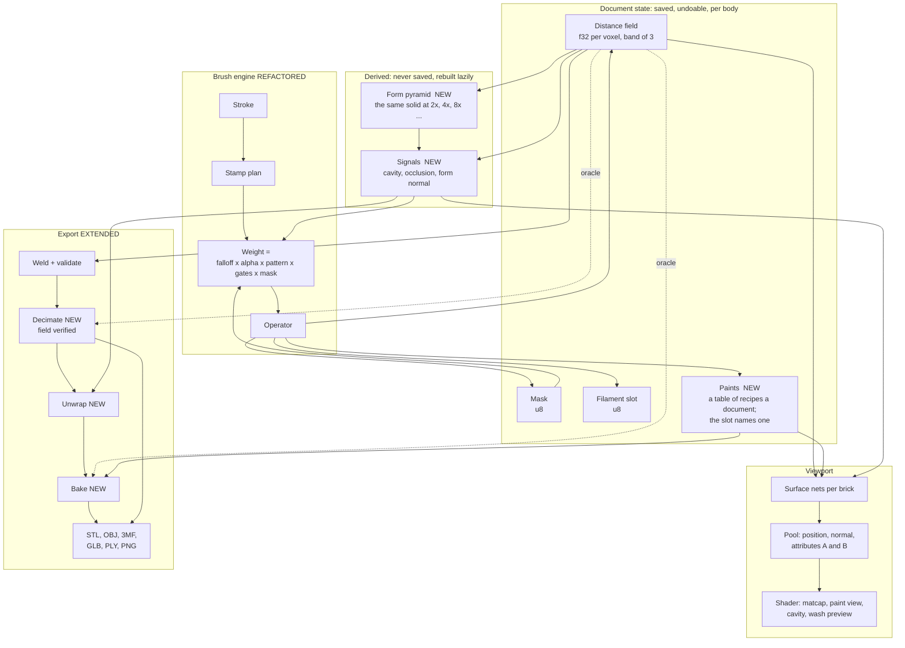

The crate boundary does not move. Everything above except `VIEW` lives in
`hani-core`, which stays free of UI, windowing and GPU dependencies.

---

## 5. Shared groundwork (milestone S0)

Three pieces that every later milestone stands on. None changes what the
application does; all are proven by equivalence or measurement before anything
is built on them.

### 5.1 `SparseField<T>`

`mask.rs` (2,075 lines) and `colour.rs` (985 lines) are the same sparse map
written twice by hand: absent means default, a `Uniform` tile costs no heap, a
dense brick is `32³ x size_of::<T>()`. The first draft of painting would have
made a third and a fourth copy. The recipe design of section 8.2 needs
neither, so this is not built until something needs a new field.

A generic `SparseField<T: Pod>` is written **for the new fields only**. The
existing two are left exactly as they are (D6); folding them in is a refactor
to offer upstream, not one to carry on a fork.

### 5.2 The form pyramid

**Built 2026-11-22, and not as first drawn.** This section originally
described a pyramid of *coverage*: one byte a cell holding the fraction of it
that is solid. That was worked through before any of it was written and
dropped, for a defect on the simplest input there is. On a flat face the solid
fraction is a ramp across one cell, and a trilinear read of that ramp at the
face is not one half: it swings 0.0625 either side as the face moves across
the lattice, which is 0.125 of occlusion against about 0.5 for a real crease.
A wash painted from it would have drawn the voxel grid on every incline.

What is built instead, in `pyramid.rs`: **each level is a complete distance
field of the same solid at twice the voxel size of the one below.** The
distance to a plane is linear and trilinear interpolation reproduces a linear
function exactly, so a flat face reads zero at every level whatever its phase.

The distance band is 3 voxels deep (`brick.rs:30`), so the field alone cannot
answer any question at a scale wider than that. The cavity mask already hits
this wall: it reads curvature from a 7 point Laplacian (`generate.rs:29`),
which sees crevices a voxel or two wide and nothing broader. Level `k` of the
pyramid has its own 3 voxel band, which reaches `3 * 2^k` voxels of the
original.

- **A level is made** by taking each coarse voxel as the tent weighted mean of
  the 27 fine voxels round it (centred, so every level shares the document's
  lattice origin; exact on a plane; a low pass, so a groove narrower than the
  level is bridged instead of aliased). `redistance` then rebuilds the band
  outward, and the voxels the mean got exactly right are put back afterwards.
- **Solid interior stays one value per brick** and empty space stays absent,
  as in the field.

Three things are read from it:

| Signal | Definition | Customer |
|---|---|---|
| Relief at level `k` | The level's distance at a point on the fine surface: negative in a recess the level bridges, positive on a protrusion, zero on a flat | Washes, zenithal, seam placement |
| Form normal at level `k` | The level's gradient | Volume tools (section 9) |
| Base surface at level `k` | The level's zero set | Detail gain (section 9) |

**Measured, release build, a shared four core container:**

| | |
|---|---|
| Relief on a flat face, worst over four tilts and five phases | 0.020 voxels of the level (the coverage design: 0.125 by construction) |
| A slot 4 voxels wide and 12 deep, read at its floor | 0.0, -0.6, -3.6, -9.6 mm at levels of 2, 4, 8 and 16 voxels |
| Memory, six levels | **36% of the field** (the estimate here was 8%, for bytes; these are `f32`) |
| Build, 1,154 brick ball | 1.7 s |

The memory figure is four times the estimate and is recorded in the module with
the two ways down from it: store a built level as one byte a voxel, or drop the
first level's storage once the second has been derived from it. Neither is
taken yet.

**Freshness.** The pyramid is derived, never saved and never in an undo entry.
It is rebuilt whole by whoever needs it (entering paint mode, pressing a form
brush, exporting), never in the per-frame path. Rebuilding only what an edit
touched is the obvious next step and is not built.

### 5.3 The fine cavity signal

**Built 2026-11-22**, in `signals.rs`. The Laplacian divided by the gradient
length, as `generate.rs` computes it, made available per mesh vertex.

The open question this section used to end on is settled, and by neither of
the two answers it offered. The signal is **computed at mesh time and cached
nowhere**, at the centre of each vertex's lattice cell: the mean of the
stencil over the cell's eight corners, which comes out as a compact form over
the 4x4x4 block round the cell. Nearly all of that block is in the apron the
mesher has already gathered. Where it overhangs, by one voxel on the cells
along a brick's faces, the missing samples are read from the volume. Both
bricks either side of a seam therefore evaluate one expression over the same
32 stored values, and a test holds them to the same byte.

It costs 32 reads a vertex, so it is **off unless asked for**:
`Document::mesh_dirty_with_cavity` sits beside `mesh_dirty` and a mesh made
without it carries an empty run that every reader takes as flat.

One byte, 128 for flat, on a square root curve so that the nearly flat part of
the range, which is most of a real surface, gets most of the levels.

Brushes will evaluate the same measurement per voxel from the stamp snapshot,
which is already grown by one voxel for this purpose (`region.rs:12`). That
arrives with the first brush that gates on it.

### 5.4 The first visible payoff: crease shading

**Built 2026-11-22.** A view toggle, *show creases*, that darkens creases and
lifts edges, the way ZBrush's cavity matcaps and Blender's viewport cavity do.
It is a view, like the mask tint: it changes nothing a stroke does, no voxel,
no undo entry, and it does not dirty the document.

- The cavity byte travels in byte 2 of the per-vertex attribute, which was
  free. Byte 3 is still free, and is where the broad relief from the pyramid
  goes when paint mode needs it.
- The setting is a feature size in millimetres (1.0, the finest thing a
  filament printer resolves), so it means the same thing at every voxel size.
- Switching it on or off remeshes every body, because the signal is in the
  mesh. That is the one way it differs from the mask and paint toggles, which
  are a uniform write.
- An offscreen pixel test holds it: creases darker, edges lighter, flats
  unchanged, strength zero byte for byte the picture without it. Six shader
  mutations were run against that test; two survived its first version (the
  sign of the curvature backwards, and the strength ignored) and the test was
  strengthened until both were caught.

### 5.5 The brush seam

The engine of section 6, landed with **no new behaviour**: the six stamping
kinds implemented a second time in `brush/engine.rs` and pinned bit for bit
against the untouched original, in the idiom `Skipping::On` against
`Skipping::Off` already uses (`brush.rs:1221-1225`). A ratio benchmark,
`benches/engine.rs`, is the second gate: the engine may not be slower than the
brush it stands beside.

**Amended 2026-11-22, when this was built.** The first draft of this section
said the existing kinds would be *routed through* the new pipeline. They are
not, and that is deliberate. `brush.rs` is left exactly as upstream wrote it,
apart from one line declaring the child module, and the old stamp path is the
**live oracle** the new one is compared against. Two things follow. Upstream
changes to `brush.rs` merge without conflict (D6). And when upstream changes
what a brush does, the equivalence test fails and names the brush, which is the
moment to bring the engine back into step on purpose. The application keeps
calling `Brush` for the classic brushes; new operators, gates and tips exist
only in the engine. Move and Paint have no engine form: Move is a gesture, and
Paint writes another channel that arrives with S2.

---

## 6. The brush engine (S0 seam, S3 surface)

### 6.1 The shape

Today a brush is an enum variant. In ZBrush a brush is a *composition*, and the
composition is the flexibility. The same split, in this engine's terms:

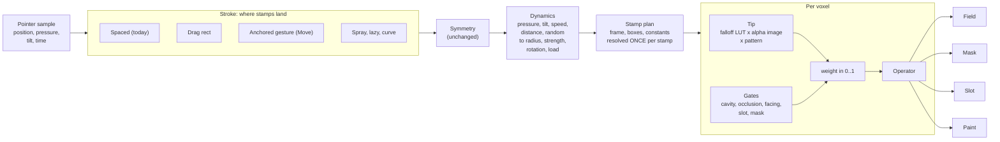

```rust
/// A brush as data. Serialisable, user-saveable, composed of orthogonal parts.
pub struct BrushDef {
    pub stroke: StrokeMode,   // how stamps are placed along the gesture
    pub tip: Tip,             // falloff curve, optional alpha image, pattern
    pub op: Operator,         // what one weighted voxel does, and to which channel
    pub dynamics: Dynamics,   // input to parameter curves, resolved per stamp
    pub gates: Gates,         // geometry and channel conditions on the weight
    pub scale: FormScale,     // Detail, or Form { sigma_mm }: see section 9
}
```

The existing `Brush` struct stays as it is and converts into a `BrushDef`. The
application, the benchmarks and every test in the 5,568 line `brush.rs` keep
calling what they call today.

### 6.2 The rules new operators must obey

These are `brush.rs`'s own, restated because every new operator is a chance to
break them:

1. **The weight stays in 0..=1** (`pattern.rs:12`). Gates and alphas multiply; nothing adds.
2. **A field operator either blends toward a legal distance or warps where the
   field is read from.** Nothing multiplies a difference from a local average
   inside a stamp loop.
3. **One stamp moves the surface at most one voxel** (`brush.rs:89`).
4. **Read reach is declared**, because a read outside the snapshot clamps
   silently instead of failing (`brush.rs:44-55`).
5. **Dispatch happens once per stamp, not per voxel.** The operator is a
   generic parameter of the inner loop, so the loop monomorphises exactly as
   the match arms do now.

### 6.3 What gets added, in order of value

| Part | Addition | Notes |
|---|---|---|
| Gates | Cavity range, occlusion range, facing, slot filter | Built in S0 with the signals; the paint brushes of S2 are the first customers |
| Operator | Paint operators (section 8) | S2 |
| Operator | Crease (pinch plus inverted draw in one warp) | **Built** (S3.1). Scrape and Fill were listed here too and are not needed: upstream's Clay blends toward a plane held just off the surface and keeps only the half that adds, and inverted it is a plane just under the surface keeping only the half that removes. That is a fill and a scrape already |
| Tip | Alpha image: a greyscale stamp, bilinear sampled in the stamp frame | The image type and its reading are **built** (S3.2), decoded in `hani-app` and handed to core as heights. As a tip on ordinary strokes it is not wired yet |
| Stroke | Drag rect: one stamp placed at the press, sized and turned by the drag | **Built** (S3.2), as a gesture |
| Operator | Displace: draw whose depth is the alpha's value | **Built** (S3.2), inside the gesture and not as a kernel: a kernel is held to one voxel a stamp |
| Dynamics | Curves from pressure, tilt, speed and stroke distance to radius, strength, rotation | Pressure to radius **built** (S3.1), as one share. Pressure to strength and tilt to lean were upstream's already. The rest follows the alpha, which is what rotation is for |
| Stroke | Lazy (stabilised), spray (jittered), curve (along a drawn spline) | Lazy **built** (S3.1). A row of stamps along the stroke **built** (S3.4) |
| Operator | Gesture warps on the `MoveStroke` machinery: twist, elastic grab (regularised Kelvinlets) | Volume preserving by construction |
| Operator | Layer: draw capped at a fixed height above the stroke's starting surface | Needs a stroke long locked region; memory to be measured first |
| Presets | One flat `key = value` file per brush under the config directory | **Built** (S3.3), as one file with a line a brush. The format `palette.rs` and `printer.rs` already use |

The digit keys keep meaning the classic brushes in the order they have always
had (`brush.rs:344`, "Appended and never reordered").

#### Built, 2026-11-23 (S3.4): the stamp, along the stroke

With the stamp up, *Along the stroke* turns one stamp sized by the drag
into a row of them at the brush's size: rivets down a seam, stitches,
scales, the links of a chain. A slider sets how far apart, from half a
stamp's width (overlapping, a rope) to four.

This is the "alpha as a tip on ordinary strokes" of the table above, done
the other way round. An image multiplied into a brush that stamps every
quarter radius is a smear of that image. What a row of rivets wants is the
image whole, at intervals, facing the way the row runs, and the stamp
gesture already presses an image whole. So a row is that gesture, begun
and ended once for each stamp, and the core did not change.

- **A stamp is laid a step behind the pointer**, because until the pointer
  has gone a step on there is no telling which way the stamp should face.
  The first is at the press, and a press with no drag lays nothing.
- **Where a step ends is looked for on the screen and not in space.** The
  straight line from one stamp toward the pointer cuts under a curved
  surface: by 3 mm for a 12 mm step on the starting ball. The first
  version stepped along that line and dropped the point back onto the
  surface down the field's gradient, and a test of a long step found that
  it cannot: three voxels under the surface the field is flat and has no
  gradient to follow. What is always on the surface is whatever is under a
  pixel. So the next stamp's place is the point under the line the pointer
  drew, from the last stamp's pixel to where the pointer is now, that is
  one step from the last stamp, found by halving. On the test's ball the
  second stamp of a 12 mm step lands 12.15 mm round it where 12.08 is
  exact, and is as tall as the first.
- **A row is a stroke**: it can be led by the lazy brush, it mirrors, it
  engraves when inverted, and it is one undo.
- A preset holds the spacing (`along:1.5`), and *Rivet row* is one of the
  starting five.

Tested by cutting a profile through the model along the drag and counting
the bumps: as many as the drag is steps long, a step apart, the brush's
size, and for a bar (which is longer one way than the other) the same
length along a row dragged up the view as along one dragged across it.

#### Built, 2026-11-23 (S3.3): presets

*Superseded the same day by the palette of section 16 (stage B3): the
five starting presets became brushes that come with the application, the
one file became a file a brush, and Crease became a brush like the rest.
What follows is what was built first.*

`hani-app/src/app/presets.rs`, and a PRESETS block above the STUDIO one:
a button for each brush kept, a small one beside it that forgets it, and a
box to name the brush in hand and keep it.

A brush here is a dozen settings in two places: the classic brush's (which
brush, how big, how hard, which falloff) and the studio block's (an
operator or the stamp, the lazy stroke, size from pressure). A preset is
all of them at once. A machine with no file starts with five, which are
there to show what the studio block is for: *Fine crease*, *Long line*,
*Rivets*, *Rivet row* and *Clay build*.

**The file** is `brushes.conf` in the config directory:

```text
Fine crease = brush:Draw, size:1.5, strength:0.3, falloff:Smooth, studio:Crease, lazy:12
Rivets = brush:Draw, size:3, strength:0.15, falloff:Smooth, stamp:Rivet, height:0.35
```

Those are two of the starting five as the application writes them. A line
written by hand may leave out whatever it does not care about.

One file with a line a brush, where the table above said a file a brush:
a line is a brush already, and one file is one thing to copy to another
machine. It is the user's to edit, so it is read forgivingly. A setting
that makes no sense is left at its default and the rest of the line kept,
a number out of range is brought into it, and a name is made one the file
can hold (no `=`, no `#`, no line ends) by dropping what it cannot.

**Taking a preset goes through the doors the panel's own controls use**,
and the one that mattered is strength. Each brush remembers its own, and
with the mask tool up the strength in hand is the mask's. A preset taken
then puts its strength in the brush's own slot, where it waits until the
mask is put down, and a preset kept then keeps the brush's and not the
mask's.

**What a preset does not hold:** a stamp picture read from a file (the
preset says "the stamp, with the picture in hand"), a surface pattern, and
the paint brush's touch, which belongs to the paint rack.

#### Built, 2026-11-23 (S3.2): the stamp

`hani-core/src/brush/alpha.rs` and `brush/stamp.rs`. A *Stamp* button in
the STUDIO block. With it up, a drag on the model presses one image into the
surface: press where it goes, drag to size it and to turn it, let go. The
top of the image points along the drag. Inverted, it engraves. Six images
come with it (dome, rivet, bolt, scale, star, bar) and any PNG or JPEG can
be one, its brightness read as height, sixteen bits of it where the file has
them.

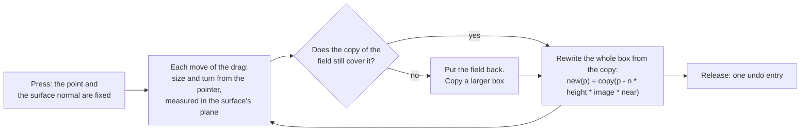

**It is a gesture and not a stroke**, on the terms upstream's Move sets out.
A stroke's stamps each move the surface by no more than a voxel because they
overlap and compound. A rivet is one image as tall as it is, so every event
of the drag is worked out from the surface as it was at the press, and a
stamp dragged out and back in is the stamp it ended as, to the bit.

**Only the near side moves.** The plain warp shifts the whole column under a
texel, all the way through the model: a rivet on a breastplate would dent
the inside by as much as it raised the outside. So the shift is whole down
to a band under the surface, where it is exact, and then fades to nothing
over twice the stamp's height. A plate's far side is untouched to the bit
when the plate is thicker than that. Thinner, it is not, and cannot be: the
material has to come from somewhere.

**Mirrors** each have their own copy, and where two overlap across the plane
both take the higher stamp at every voxel, so the order they are written in
does not show. A mirror image's `right` is reflected and not recomputed,
because a cross product turns a left hand back into a right and would press
the image the wrong way round on the far side.

**Limits.** A stamp's box is at most 320 voxels a side, which at a quarter
millimetre is a stamp about 25 mm across; larger is refused and the field
put back. The side of a stamp is steeper than the field's gradient is
supposed to be, as after a Move, until the field is redistanced. And the
image is not yet a tip for ordinary strokes: a textured brush is the same
image as one more factor on the weight, and is the next thing here.

#### Built, 2026-11-22 (S3.1): the engine, where a user can reach it

Under the classic brush's own controls, a STUDIO block:

- **Crease.** A groove cut and pinched in one stamp, or inverted a pinched
  ridge. Its kernel is Pinch's warp and Draw's shift, the other way round,
  in one read of the field: 60% of Draw's depth, so a groove is cut over a
  few stamps and can be stopped part way. It has no upstream brush to be held
  to, so it is held to a slow reference written from its definition, a hash
  lookup a sample with no snapshot and no plan, and to the kernel rules: one
  stamp moves the field no more than a voxel, nothing outside the brush
  moves by a bit, nothing under full protection moves.
- **Lazy.** The brush trails the pointer on a lead of up to 80 pixels. Inside
  the lead nothing moves; past it the brush is pulled straight toward the
  pointer and stops a lead short. For panel lines, seams and lettering, and
  it leads the paint brush and the Fill as well as the sculpt brushes.
- **Size from pressure.** One share from 0 to 1: at 1 a pen at half pressure
  is half the brush. A mouse reports full pressure and is not affected.

**A studio operator borrows a classic brush's settings.** Upstream's brushes
are an enum with a digit key each, a remembered strength each and a button
each. An operator added to that enum is a change to upstream's hottest file
and to every `match` on it. So Crease is chosen BESIDE the classic brush: the
radius, strength, falloff and pattern are still the classic brush's, and the
operator replaces only what one weighted voxel does. Choosing any classic
brush puts it away, and shift still smooths. The panel's heading says
CREASE; the tool strip still lights the classic brush, which is the honest
picture of whose settings are in use and is also the part most likely to
want revisiting.

Upstream's files took one field, one message arm, one line in the brush
chooser, and four changed lines in the two strokes.

**Drift.** More operators means more gradient drift. `redistance` is band
restricted and gates on measured drift (`redistance.rs:137`), so S3 measures
running it at stroke end on the touched bricks only, and adopts it if the
budget allows.

---

## 7. Print pipeline (milestone S1)

Two independent features that cross no line in the build spec and could go
upstream as they are.

### 7.1 Decimated export

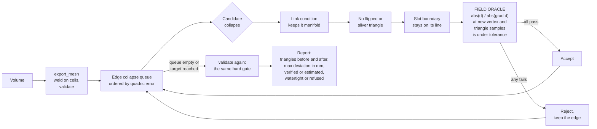

**The control is a tolerance in millimetres, not a percentage.** "No point of
this file is more than 0.02 mm from what you sculpted" is a statement about a
print; "keep 6%" is not. Presets are named for the process: resin, 0.4 mm
nozzle, draft. A target triangle count is the secondary control, for people
exporting to a renderer.

**Why the field makes this better than a mesh tool can do it.** A mesh
decimator has to estimate deviation by accumulating quadrics, because its only
reference is the mesh it is destroying. This engine can simply *ask*: the
distance from a proposed vertex to the true surface is one trilinear sample.
Quadrics order the queue; the field accepts or rejects. Dividing by the
gradient length corrects for brush drift in the same way `generate.rs` already
does.

**The honest limit:** the oracle is only valid inside the band, so a verified
tolerance cannot exceed about 2 voxels. Looser than that, the decimator falls
back to accumulated quadric error and **the report says "estimated" instead of
"verified"**.

**What "feature preserving" means here, concretely:**

- Sharp edges survive because a quadric built from two differently oriented
  plane sets is steep across the edge and flat along it. That is the algorithm,
  not an add-on.
- Flat regions collapse to almost nothing. A cut face goes from one vertex per
  voxel to a handful of triangles.
- **Filament slot boundaries do not move.** A painted boundary is already cut
  exactly by `split_paint_boundaries` (`mesh.rs:255`). Its edges get boundary
  quadrics and its vertices may only collapse along it. A slot is an index:
  a boundary that drifts prints in the wrong filament.
- No collapse may create a degenerate or flipped triangle. The build spec names
  this failure from SindriCAD's history (`BUILD-SPEC.md:177`) and the
  post-decimation `validate` is the gate that proves it did not recur.

**Build or depend.** In house, in `hani-core/src/export/decimate.rs`,
**estimated at 800 to 1,200 lines with tests.** The algorithm is thirty years
old and well documented; the two things that make this version worth having
(the field oracle and the slot constraint) are not available in any library's
API. Candidates that exist and are **unverified by this plan**:
`meshopt` (C++ bindings), `meshopt-pure` and `baby_shark` (pure Rust). The
first day of the milestone evaluates one of them as a **dev-dependency used
only as a differential test oracle**, which costs the shipped binary nothing.

**Cost, estimate:** tens of seconds single threaded at eleven million
triangles. It runs in an iced `Task` with progress and cancel, never on the
drawing thread. If measurement says it must be faster, bricks give a natural
parallel pre-pass: decimate each brick's interior with its seam vertices
locked, then run one global pass over what is left.


#### Built, 2026-11-22, and what building it found

`hani-core/src/export/decimate.rs`, and a *Detail* choice in the export
panel: **Full** (every triangle, the default, and byte for byte what an export
was), **Fine** (0.01 mm), **Standard** (0.03 mm), **Draft** (0.1 mm).

**Measured**, release build, one thread, a 60 mm ball:

| voxel | full mesh | at 0.01 mm | at 0.03 mm | at 0.1 mm | time |
|---|---|---|---|---|---|
| 0.5 | 135,324 | 24,464 | 8,146 | 2,466 | about 2 s |
| 0.25 | 542,556 | 24,830 | 8,520 | 2,658 | about 7 s |
| 0.125 | 2,170,860 | 26,632 | 9,294 | 2,788 | 30 s |

The result barely depends on the voxel size, which is the claim that the
tolerance belongs to the shape and the print. A cube of 18,252 triangles comes
back as the 12 triangles of a cube, with every corner nearer its true place
than the full mesh has it.

Five things in the design above turned out wrong or incomplete, each found by a
test and each recorded in the module:

1. **The field can judge one direction only.** "The new surface is near the
   sculpt" does not imply "the sculpt is near the new surface", and the
   difference is a corner: the first version took a cube to 12 triangles with
   one corner 0.84 of a voxel out and every check passing. Each collapse is now
   held the other way too, through four witness points per vertex.
2. **The mesher and the field disagree about where the surface is**, by up to
   a third of a voxel (surface nets averages; the field interpolates). Every
   vertex is stood on the field before anything is collapsed, or a tight
   tolerance could collapse nothing.
3. **A triangle has to be sampled densely.** Its middle and the middles of its
   edges are enough when it is a voxel across and not when it is twenty. An
   independent reading found results 16% past the tolerance until triangles
   were sampled every half voxel.
4. **The distance correction for brush drift may only go one way.** Dividing by
   a slope above one flatters the result; two estimates of such a slope
   disagreed by 60% at a kink.
5. **It is not fast.** About 14 microseconds a triangle of input, almost all
   of it item 3: the eleven million triangle case would take two and a half
   minutes. The estimate above said tens of seconds. Parallelising over bricks
   is the next thing to do to it.

Taking the witness check OUT again was also tried, when a cube and two balls
said it had stopped mattering. A cone said otherwise: without it a sharp tip
lost up to 156% of the tolerance.

Every check in the decimator has a test that fails without it: fifteen
mutations were run against the suite, and the suite was extended until all
fifteen were caught. Halving the witnesses to save memory let three of those
checks be deleted unnoticed, which is how the tests' slack came down from a
twentieth to a fiftieth.

**Still to do here:** the export runs on the update thread, as every export
already did, so a large decimation freezes the window for its length. Moving
exports to a task is its own piece of work and is the first thing owed.

### 7.2 Parting with keys

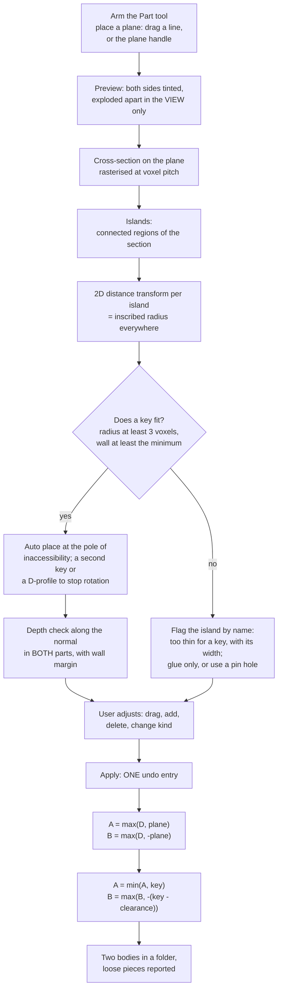

**The split.** Both halves, from one plane: `A = max(D, plane)` and
`B = max(D, -plane)`. Exact, closed, and flat faced as a property of the
arithmetic, which is `clip.rs`'s whole argument.

**The keys.** A key is a closed form solid: a tapered cylinder, a D-cut or hex
profile for anti-rotation, a magnet pocket, a pin hole. Closed form distance
functions are 1-Lipschitz, so the brick classification `primitive.rs:14-29`
uses carries over, and no interior brick is promoted dense.

- The peg is a union: `A = min(A, key)`.
- The socket is a subtraction of the **offset** key:
  `B = max(B, -(key - clearance))`. Subtracting a constant from a true distance
  function *is* the exact offset solid, so the clearance is correct everywhere
  including round the chamfer, with no second modelling step.
- Magnet pockets and pin holes subtract from both.

| Key kind | Parts | For |
|---|---|---|
| Peg and socket | Male on A, female on B | The default. Tapered so it prints without support and self-centres |
| D-profile or hex peg | Same | A single key on an island too small for two |
| Pin hole | Hole in both | Pinning with rod or a filament offcut, the miniature painter's habit |
| Magnet pocket | Pocket in both | Swappable parts. Sized by magnet diameter and height |

**Clearance** is per side, in millimetres, and belongs to the printer rather
than the model, so it is stored the way `palette.rs` stores filaments.
Defaults (estimates from common practice, to be tuned): 0.2 mm for filament,
0.08 mm for resin. A later increment generates a **tolerance coupon**: one
printable strip of pegs and sockets at five clearances, so the user measures
their own printer instead of trusting a default.

**What the lattice can and cannot hold.** A surface position is sub-voxel, so
a clearance of 0.4 voxels on a flat or gently curved face is represented
accurately. A sharp edge is not: it rounds at about a voxel. Keys are therefore
chamfered by design, and the tool **refuses a key narrower than 3 voxels**
(the same floor `README.md:365` gives brushes) and names the voxel size that
would allow it.

**New core surface.** One generalisation: `clip` currently takes planes. It
gains a `Cutter` trait (a distance function plus a Lipschitz bound), so a
plane, a convex set of planes and an oriented key are the same classified
`max`. Union with a closed form solid is the mirror image. Both mark dirty by
voxel range grown by one, which is the trap `merge.rs:32-39` documents.

**Memory.** Two outputs while history holds the original is a 2x peak, as for
every split (`split.rs:97`, "The uncomfortable thing"). The existing guard
predicts it and refuses by name.

**The exploded preview is a view, not a transform.** `body.rs` is emphatic
that a body has no transform and that adding one gives away the lattice
property. The preview is a per-body offset uniform in the renderer, in the same
category as the mask tint.

#### Built, 2026-11-22

`hani-core/src/part.rs`, and one gesture: **the cut tool with alt held**.
The same straight drag as a cut, read at the release like ctrl and shift.
Instead of a side going, the active body becomes two bodies named A and B,
with pegs on the first and sockets in the second. The tool card reads
*PART, KEEP BOTH* while alt is down. One undo puts the body back.

What the engine does, each with a test:

- **Both halves**, closed and printable, whose volumes add up to the body's
  less the clearance round each socket.
- **The clearance is the clearance.** Measured as the gap between a peg's
  side and its socket's wall: within 0.3 of a voxel of what was asked.
- **Islands.** A plane through two separate masses finds two cut faces and
  keys each.
- **A second key** on any island with room for one well clear of the first,
  the same size as the first, to stop the parts turning.
- **A key is checked against the solid it lives in**, on its axis and round
  the rim of its socket's wall: shortened where the second part is thin, left
  out and the island named where it is too thin or too narrow.
- **Three kinds**: peg and socket, pin hole, magnet pocket.
- **The lattice floor**: a key narrower than 3 voxels is refused.

Thirteen mutations were run against its tests. Five survived the first pass
and each was answered with a test; one of those tests found a real fault. A
body parted under Mask All came back as **two whole copies of itself**,
because the call that was meant to take the mask off a half leaves an empty
mask *of the same polarity*, and an empty inverted mask protects everything.
No test had a masked fixture until a mutation that deleted the unmasking
turned out to change nothing.

**Owed, in the order it is worth doing:**

1. ~~Settings in the panel.~~ **Done.** Kind, radius, depth and clearance
   are in the EXPORT section, under *Parting keys*, and a test holds that
   they reach what gets cut.
2. **A preview before the release**: the cut faces, the keys, and what could
   not be keyed, drawn while the line is being dragged. Today the status line
   says it afterwards and undo is the way back.
3. **The exploded view**, as a view-only offset.
4. ~~The tolerance coupon.~~ **Done**, 2026-11-23: see below.

#### Built, 2026-11-23: the fit test

*Print a fit test…* under the clearance slider writes a small STL: a
plate with six sockets, cut at clearances from 0.05 to 0.40 mm, and one
peg to try in them. The socket the peg goes into the way its owner wants
is the clearance to set. For a pin hole or a magnet pocket there is no peg
in the file: the pin or the magnet is the peg.

The clearance belongs to the printer, the filament and the day, and no
number in a panel is right for all of them. The comment over the slider
has said since it was written that "a test print is the only real answer",
and until now the application left the making of that test to its user.

**It can be trusted because it is the thing itself.** The sockets and the
peg are cut by the lines that cut a real part's (`Key::solid`, and the
socket as that solid grown by the clearance), for the key as it is set in
the panel, at the document's own voxel size. Measured on the plate: each
socket is wider than the peg by its own clearance to within 0.3 of a
voxel, at the height they meet.

**Telling the sockets apart.** The plate has one corner cut off, at the
tight end, and the sockets loosen in order from there. No letters: any
small enough to fit would not survive the lattice or the nozzle.

Nothing in the document changes. The pieces are made beside it and go to
the file, standing on the bed as they print: sockets opening upward, the
peg pointing up.

**Deferred:** freeform parting surfaces (through `split_masked`, which needs a
crisp boundary rather than a feathered one), dovetails, a "fit to bed"
assistant that proposes a grid of planes from the printer's bed
(`slicer.rs:329`), embossed part marks, and hollowing with drain holes.

### 7.3 Overhangs

Not in the first plan. It is here because of the north star: the question
"will this print as it stands" is asked of a sculpt while it is being
sculpted, by a chin, an arm, the underside of a cloak, and nothing in the
application answered it.

#### Built, 2026-11-23 (S1c)

*show overhangs* on the export panel, with one setting: how steep a lean
from upright the printer manages, 20 to 80 degrees, 45 to begin with. What
leans further and faces down is drawn in a red-orange nothing else in the
viewport is. With the view on, an export also says how much of what it
wrote overhangs.

**The rule** is `hani_core::overhang`: a surface leaning `a` from upright
and facing down has a normal whose downward part is `sin(a)`, so the test
is one comparison, and it is the same comparison in the shader, which is
handed the sine and not the angle. Up is +Y, as it stands in the viewport
and as the export writes it.

**The plate.** The underside of a model resting on the bed faces straight
down and needs no support, so nothing counts within one first layer
(0.3 mm) of the lowest point. Only that: the underside of a ball is a real
overhang a hair above the point it stands on, and is drawn as one.

Finding the lowest point took two goes. The bounds the engine already kept
of "voxels near the surface" reach three voxels under the surface, and a
plate three voxels too low is under the whole model: every flat underside
would have been called an overhang. A test of where the plate is found it,
half a millimetre low. `Volume::lowest_point` reads the lowest layer of
those voxels for how far each is from the surface, and the least of them
is the distance up to the lowest point: right to 0.15 of a voxel on balls
at three voxel sizes.

It is a scan of the model, and the shader wants the plate every frame, so
it is kept and found again only when the undo history's counters or the
document's rough bounds have changed. A test counts the searches.

**Checked against geometry and not against itself.** The overhanging share
of a ball has a closed form, `(1 - sin a) / 2`, and the mesh measure is
within 0.01 of it at 30, 45 and 60 degrees. The render test works out,
for every pixel of a ball seen from below, which point of the ball it
shows and whether the rule calls that an overhang, and compares that with
whether the pixel came out tinted: 99% of the ones that should be, none of
the ones that should not, with a band a few degrees wide left out either
side of the line.

**Limits.** It judges the model as it stands; turned over in the slicer it
is another print. It knows nothing of bridges, which a printer spans
without support between two walls, so a short bridge is drawn as an
overhang. And it is a view of the surface, not a support generator.

---

## 8. Mini painting (milestone S2)

### 8.1 What a miniature painter actually does

The mode is modelled on the bench, not on Photoshop, because the bench
techniques are what was asked for and they are all *geometry driven*:

| Step at the bench | What the paint physically does | The signal that reproduces it |
|---|---|---|
| Prime, often zenithal (dark from below, light from above) | Spray lands where the nozzle can see | Normal against a direction, times directional occlusion |
| Basecoat | Opaque colour, area by area | Plain brush; later, a fill that stops at creases |
| Wash or shade | Thin pigment runs off high points and pools in recesses | Cavity and occlusion |
| Contrast or speed paint | The same, with enough pigment to tint the flats too | The same, with a stain term |
| Drybrush | A nearly dry brush catches only raised edges, in streaks along the stroke | Convexity, facing against the stroke, streak noise, a load that runs out |
| Sponge or stipple | Random speckle, heavier on exposed edges | Per-stamp cellular noise, optional convexity bias |
| Edge highlight | A fine light line on sharp edges | Strong fine convexity |
| Detail | Small opaque marks | Plain brush at small radius, stabilised |

"Slapchop" (prime black, drybrush grey then white, contrast paint over the
top) becomes three clicks and a few strokes, which is the point of the mode.

### 8.2 Storage: a paint is a recipe, and a voxel names one

**This section was first written as a second field of four bytes a voxel:**
red, green, blue and a finish, deposited by brushes. It was redrawn on
2026-11-22, before any of it was built, once the engine had been read with
that field in mind. Three things were against it.

- **The slot field is woven through everything.** Rotating, shifting,
  resampling, warping, merging, splitting, the Move brush, undo and the
  project file each carry it, and each has a test that fails without it:
  about 350 mentions across 17 files (counted with `grep` over
  `crates/hani-core/src`). A second field is that sweep again, in
  upstream's hottest files, on a fork that has to keep merging them. It is
  the opposite of D6.
- **It doubles the memory of a painted model.** +100% of the field
  (`colour.rs:8`), against the +25% a slot costs, which `colour.rs` gives as
  the reason a slot is an index in the first place.
- **A wash painted into colour is dead the moment it lands.** It is right for
  the surface as it was. Sculpt a fold deeper afterwards and the shadow stays
  where the old fold used to be.

What was built instead is in `hani-core/src/paint.rs`:

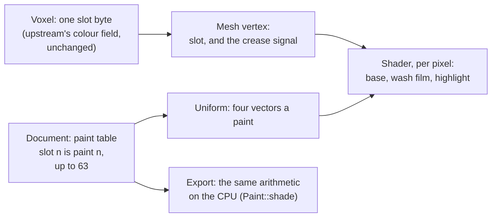

A **paint** is a base coat, a wash and a highlight:

| Part | What it holds | What it does |
|---|---|---|
| Base | sRGB colour, finish | The colour of the paint |
| Wash | pigment colour; `stain`, `flow`, `edge` | A film of thickness `T = stain + flow * recess - edge * edge_amount`, never below 0, that passes `pigment^T` of the light |
| Highlight | colour; `amount`, `start` | Mixed in on edges sharper than `start`, up to `amount` at a full edge |

`recess` and `edge_amount` are the two halves of the crease signal of section
5.3, scaled by the view's gain so that "a full crease" is a size in
millimetres whatever the voxel size.

**The wash is Beer-Lambert, and that one line is the whole "abuse of ambient
occlusion".** Where the film is thin (an edge, `T` near 0) the base shows
through nearly untouched: that is the highlight a contrast paint leaves by
itself. On a flat it passes about `pigment^stain`: the tint. In a crease (`T`
of 2 or 3) it passes `pigment^3`: darker *and more saturated*, which is how a
contrast paint behaves and what a multiply by a grey ramp gets wrong. A shade
wash and a contrast paint are the same recipe at two settings of `stain`.

**What this buys, beyond not doing the sweep:**

- **Nothing new per voxel.** A painted model costs what a filament-painted one
  costs today, and every transform, the undo and the project file already
  carry the byte without knowing what it now means.
- **Non-destructive, everywhere at once.** Changing a wash's colour or how far
  it flows recolours every voxel wearing that paint in the same frame, and
  touches no voxel. There is no "apply", so there is no preview that can
  disagree with the result.
- **Washes follow the sculpt.** The film is worked out from the surface each
  time the surface is drawn. A fold cut after painting gets its shadow.
- **The print bridge is short.** A paint can name the filament it prints in,
  and then the slot field already IS the multi-colour print instruction the
  3MF writer consumes.

**What it costs, and it is real:**

- **No blends.** A voxel is one paint or another, so the boundary between two
  paints is an edge and never a gradient. Speckle, stipple and a drybrush's
  broken edge are all things an index holds well. A soft airbrushed fade from
  one colour to another is not something it can hold at all. Section 8.6 has
  the way out if that turns out to matter.
- **63 paints a document**, because the shader is handed the whole table: four
  vectors a paint, 4 KiB of uniform.

**Saved** as an optional tagged trailer after the timeline keys: the eight
bytes `BRKPAINT`, a length, the table. Written only when the document has
paints, so a file without them is byte for byte what upstream writes and
`CONTAINER_VERSION` did not move. (Bumping it to 4 with a mandatory trailer
was tried first and broke 28 of upstream's project tests, which pin the
bytes.) The reader is forgiving in one direction only: a damaged paint table
gives back the sculpt with no paints, and never refuses the file. It has a
mutation fuzz with a control.

### 8.3 The techniques, as recipes and as gated strokes

Each row of the table in 8.1 lands in one of two places. If the technique is
"everywhere the geometry says", it is a term of the recipe and costs no
stroke. If it is "where I put the brush, and only on what the geometry says",
it is the paint brush with a gate from the brush engine (D4), writing a paint
number.

| Technique | Where it lives | State |
|---|---|---|
| Basecoat, detail | The paint brush, writing a slot | Built (upstream's brush, the rack on top) |
| Wash, shade | Recipe: the wash | **Built** |
| Contrast or speed paint | Recipe: the wash with a stain, over a pale base | **Built**, one click |
| Edge highlight, overall drybrush | Recipe: the highlight | **Built** |
| Drybrush as a stroke | Gated brush: writes the paint in hand only on what stands up, more on the side the brush comes at, in bristle streaks, until it runs out | **Built** (S2.2) |
| Sponge or stipple | Gated brush: a speckle covering a set share of the surface, optionally more on edges. With the eraser it chips paint off | **Built** (S2.2) |
| Zenithal prime | Recipe term: lighten by normal against a direction, times broad occlusion | After S4, which makes the pyramid incremental |
| Fill: by area, bounded by the model's creases and edges; the whole body | A flood on the surface shell, and one pass over the body | **Built** (S2.4) |

"Slapchop" is then a paint: pale base, contrast wash, a near-white highlight
with a low `start`. One click on *Contrast* and one slider.

**One stroke is one coat**, which the first draft needed a coverage buffer to
guarantee, is free for a loaded brush: writing a slot twice is writing it
once. For a gated brush it is a rule the gate has to keep. A voxel under a
stroke is under eight or so overlapping stamps, and if each rolled its own
dice a sponge set to cover a tenth of the surface would cover more than half.
So nothing in a gate is random per stamp: whether a voxel is caught is a
function of where it is, of the shape there, and of a seed fixed from the
press to the release. Two stamps over one voxel agree. A second stroke has a
second seed and adds to the first, as a second pass with a real sponge does.

### 8.4 The two copies of the arithmetic

`Paint::shade` on the CPU and `sculpt.wgsl` on the GPU compute the same
colour. One formula in two languages is a known hazard, and the repository's
remedy is used: `the_shader_shades_a_paint_the_way_the_engine_does` pins the
shader's lines and evaluates a Rust transcription of them against
`Paint::shade` over a table of paints and creases, in the manner of
`the_base_luma_the_shader_divides_by_is_the_clays`. An export bakes with the
CPU copy, so what is exported is what was on screen.

### 8.5 The paint view

- **Lit:** the paint's colour times the matcap's lighting term. This is the
  filament path that already existed, reading a recipe where there is one and
  the palette where there is not.
- **Flat** (built): the paint's colour alone, because a wash is shading and
  a painter has to be able to see it without the viewport's own light on
  top. A plain paint drawn flat is one colour over the whole body, to the
  byte.
- **Finish** (later): gloss and metallic read a second matcap. The finish is
  saved with a paint today so that paints mixed now keep it.
- **Thumbnails** draw a painted body with its washes, at the viewport's gain.

**The rack.** With the Paint brush chosen, the panel offers the filament
slots and a *Mix paints* button. Mixing makes one plain paint per filament
slot, in the filament's colour, so nothing already painted changes colour;
from then on the panel shows the rack and an editor for the paint in hand:
name, then one coat at a time (base, wash, highlight), each with a range of
24 starting colours, three channel sliders and its own amounts. The wash has
three ready-made kinds: None, Shade (the base's own hue, darker, in the
recesses) and Contrast (the colour moves into the wash over a pale
undercoat).

### 8.6 The honest limits

- **No blends**, as 8.2 says. The named way out is a second, optional field
  of blend weights between a voxel's paint and one neighbour paint, which is
  one more byte and not three, and is not built until a painter asks for it.
- **Paint resolution is the voxel size.** A 32 mm figure at 0.1 mm is 320
  paint cells tall. The boundary between two paints is cut at half-triangle
  precision by the mesher (`mesh.rs`), which is finer than the cells, and a
  wash is shaded per pixel from an interpolated signal, which is finer again.
- **Fill needs a line it can see, and so does the eye.** Seen on a screen on
  2026-11-23 (section 13): on rivets 3 mm in radius at a quarter millimetre
  a fill stops at each rivet's bevel and leaves it as a ring. On rivets
  1 mm in radius, which stand 1.4 voxels tall, the bevel is hardly a line
  at all and some fills come out with ragged, spilling edges. And the edge
  of any paint is stepped at the size of a voxel, which at a close zoom is
  several pixels. Detail at the limit of resolution is fragile under paint
  as under everything else; the cure is the same, a finer voxel.
- **The wash sees fine creases only.** It reads the fine cavity signal of
  section 5.3, a few voxels wide. The broad occlusion that darkens the inside
  of a cloak comes from the pyramid, through the one free attribute byte.
  That waits for S4, because the pyramid is rebuilt whole today and a wash
  that lagged a second behind every stroke would be worse than none.
- **No pigment flow simulation.** The wash is a transfer function of
  geometry, not a fluid. Gravity pooling is a possible extra term, not a
  solver.
- ~~Editing a paint is not in the undo history yet, and a paint cannot be
  removed.~~ Both built on 2026-11-23: see S2.5 below.

#### Built, 2026-11-23 (S2.6): the zenithal undercoat

*Lit from above* on a paint's base coat, 0 to 1: the paint is lighter
where the surface faces up and darker where it faces down, as on a model
primed dark from below and light from above before its colours go on.

```text
undercoat = 1 + amount * (0.35 * up - 0.55 * down)
```

`up` and `down` are the two halves of the normal's vertical part, so a
surface that faces sideways is left alone and a paint's own colour is the
colour of its upright faces, which is what the rack shows. Uneven for the
reason a crease is darkened further than an edge is lifted: a shadow can
go most of the way to black and still read as that paint, and a light
lifted as far would clip.

It is under everything, in the painter's order: the base coat is lifted or
darkened first, the wash is a film over that, and the highlight is laid on
last and shaded by neither.

**Where it earns its place is the exports.** In the viewport the matcap
already lights the model. A texture, a PLY and a full colour print have no
light of their own, and a model with its shading painted in reads as a
solid thing where a flatly coloured one does not. The bake reads the way
the MODEL faces, from the field, and not the normals a decimated mesh
happens to carry.

Table 8.1 drew this as "normal against a direction, times
directional occlusion". This is the first half. The second, that spray
does not land where the nozzle cannot see, is the broad occlusion that
still waits for the pyramid.

One more float a paint in the file, which is table version 3. Versions 1
and 2 still read, with no undercoat.

**Checked.** The shader and the engine agree on 980 cases of paint, crease
and facing. A render test compares every pixel of a ball in one paint,
drawn flat, with the recipe's colour for the normal of the point of the
ball that pixel shows: within 4 levels of 255, all of them. A cube bakes
to exactly the recipe's top, bottom and side colours on its top, bottom
and side faces, with the mesh's own normals deliberately wrong.

#### Built, 2026-11-23 (S2.5): paints in the history, and a paint removed

A **Remove** button beside *Add a paint*, and ctrl+Z for everything the
rack does: the document's first paints, a paint added, a paint edited, a
paint removed.

**The paint table moved into the document** (`Document::paints`), out of
the application, and the history gained one change for it
(`Change::Paints`, the whole table, as `Change::WholeMask` is the whole
mask). It was the application's because that was the smallest hook into
upstream's types when paints began. Removing a paint is what made that
wrong: a removal changes the table and the voxels together, and they have
to come back together.

**Why removing a paint touches the model.** A voxel names its paint by
number. Take paint 2 out of a table and paint 3 is paint 2, so every voxel
that said 3 has to say 2, on every body, hidden ones too, or the model
changes colour from that paint on. `hani_core::paint::remove` does both
halves: the voxels of the paint removed are bare, the voxels of every
later paint are a number down, and a number past the end of the table,
which is a filament slot and never was a paint, is left alone. The table
and each body's renumbered bricks are one undo entry.

Two things were tried on paper and dropped before any code:

- **Leaving the number alone and marking the paint dead.** No voxel
  changes, and it sounded cheap. But a slot with no paint already means "a
  filament slot" to the shader, the bake and the 3MF writer, so a dead
  paint would have been a third thing for each of the three to know, a new
  byte in the file, and a number that could not safely be given to the
  next paint added while any voxel still held it.
- **Undo in the application, beside the history.** The history does not
  say which entry is on top, so the application would have had to guess
  when its removal had been undone from a count of entries, and a count
  moves for other reasons.

**A slider is one step.** A slider sends a message for every pixel it
moves, and a drag is one undo step and not two hundred. An edit is merged
into the entry before it when that entry was the same setting of the same
coat of the same paint and nothing has been pushed, undone or dropped
since. What is chosen and not dragged (a swatch, a finish, a kind of wash)
is a step each time.

**Limits.** The renumbering goes through the recorded way into the colour
field, which opens only the voxels a brush could have painted. A voxel
that was painted and has since been buried deeper than the band keeps its
old number: nothing draws it and no export reads it, but if the surface is
carved back down to it, it shows as whichever paint has that number then.
And undoing a removal is refused while a body it touched is hidden, as
undoing a stroke on that body would be.

#### Built, 2026-11-22 (S2.4): fill, coat, and the flat view

`hani-core/src/paint/fill.rs`. A fourth touch beside Loaded, Drybrush and
Sponge: **Fill** pours the paint in hand where the pointer is, and it runs
until one of the model's own lines stops it. Two checkboxes say which lines
count, creases and edges, and a slider says how sharp a line has to be.

- Click a panel and the panel is painted, up to the middle of the lines
  round it.
- Click IN a groove and the fill runs along the groove and stays in it. That
  is panel lining, which at the bench is a fine brush and a steady hand.
- A fill replaces the paint it starts on and spreads only through that
  paint, and the mask stops it, as for every paint stamp.
- *Coat the body* paints all of the active body in one pass, for a model
  with no lines to stop at. *Flat colour* draws paint with no light on it,
  so a wash can be judged without the viewport's shading on top.

**Three versions, and what each one got wrong.** This was expected to be a
flood fill with a threshold, and it was the hardest thing in the milestone.

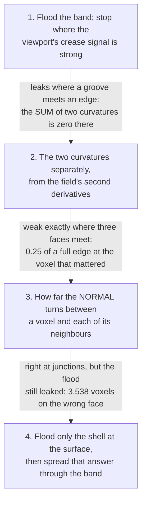

The last leak was not about the signal at all. Paint is in the whole band,
and inside a sharp convex edge NO voxel's nearest surface point is the edge:
those on one side of the diagonal are nearest one face and those on the
other the other. A flood through the band stepped from the first to the
second without ever meeting the line. So the flood runs in the shell, the
voxels within one of the surface, where a line is a row of voxels it has to
cross. Every other voxel of the band then takes the answer of the shell
voxel it leads down to.

Two smaller things the tests found: a field cut by a plane is flat along the
diagonal inside a concave corner, so "the face neighbour nearer the surface"
does not exist there and 242 voxels were left bare until all 26 neighbours
were asked; and along a straight edge three neighbours in a row are equally
near, and taking the first made a voxel beside the mask follow a masked one.

**Cost, measured** (release, one core): 66 ms to fill a ball of 43,290
voxels, about a microsecond and a half a voxel painted. One click is capped
at 150,000 voxels of surface, which is about a second and a half at worst.

**Limit.** A fill is only as good as the lines. A groove that fades out, or
a gap of a voxel in one, lets it through, and the answer is the sharpness
slider, the mask, or a brush. *Show creases* shows the lines it will read.

#### Built, 2026-11-22 (S2.3): a painted model in a file

A paint is worked out on screen and stored nowhere, and a file has to hold
something. There are two things it can hold, for two kinds of machine, and
`hani-core/src/paint/bake.rs` makes both for one export and throws them
away. Neither changes the document.

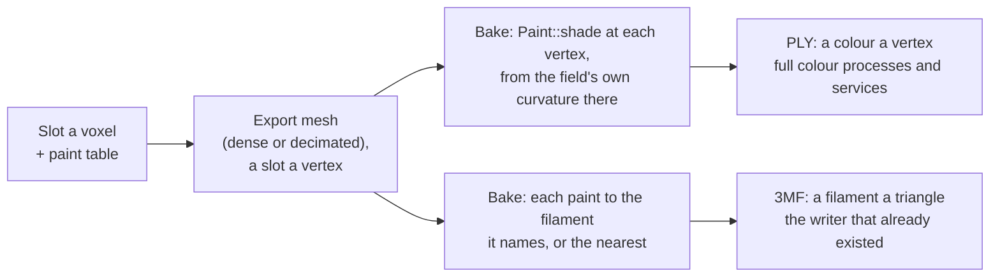

- **PLY, in colour** (`export/ply.rs`, the fourth export button). Binary,
  little endian, in the layout MeshLab writes. Each vertex is the engine's
  own `Paint::shade` of the curvature at that vertex, at the viewport's
  gain, so a wash pools in the file where it pooled on screen. A body
  painted by filament slot with no paints mixed is exported in its
  filaments' colours. Unpainted surface is a clay grey.
- **3MF, by filament.** A paint number is not a filament number, and with
  paints in use the 3MF writer was being handed paint numbers. Each paint
  now names the filament it prints in (*Prints in*, on the base coat), or
  names none and takes the loaded filament nearest its colour on a flat.
  Paints mixed from the filament slots name the slot they came from, so a
  model painted by slot prints exactly as it did. A document with no paints
  is not touched by any of this and writes the file it always wrote.

The paint table's format went to version 2 for the filament byte. Version 1
is still read.

**Limits.** A colour belongs to a vertex and is blended across a triangle,
so the edge between two paints is one triangle wide in a PLY where in a 3MF
it is exact. Doubling the vertices along it would keep it sharp and open the
mesh, which a print service checks first. And a decimated mesh has fewer
vertices to hold a wash in: for a wash in a PLY, export at *Full* until S5
bakes paint into a texture. A wash cannot survive a filament printer at all;
the machine has four colours.

#### Built, 2026-11-22 (S2.2): drybrush and sponge

`hani-core/src/paint/touch.rs`. Three buttons over the rack: *Loaded*,
*Drybrush*, *Sponge*, each of the last two with its sliders. They work on
filament slots too, without any paints mixed.

- **Loaded** is upstream's paint stamp, called and not copied.
- **Drybrush** catches a voxel when `raised * (0.5 + 0.5 * facing) * load`
  is more than `(1 - catch) + streak * (bristle - 0.5)`. `raised` is the
  crease signal's convex half at the viewport's gain, so the brush catches
  what *show creases* lights. `facing` is 1 where the surface faces into the
  stroke. `bristle` is noise sampled twelve times more slowly along the
  stroke than across it. `load` runs from 1 to 0 over a set distance. A flat
  is never caught, whatever the sliders say.
- **Sponge** catches where smooth noise falls under the density. The noise is
  passed through its own measured distribution first, so the density is a
  share of area: 30% asked for covers 30% of a flat, to within the 8 points
  the test allows on a patch of about 250 specks.

Three things building it found, each now a test:

- **Noise on a lattice plane is different noise.** A flat face along the
  world's axes can cut value noise exactly on one of its lattice planes,
  where it is a blend of four numbers and not eight. A sponge at 60% covered
  50% of the test cube's top. The texture is now turned by a fixed rotation
  before it is sampled.
- **"The cell above" is not mirror-symmetric.** The gate asks its question at
  the surface point nearest each voxel, in the cell that holds the point. A
  point exactly on a lattice plane is in two cells, on a lattice point in
  eight. Picking one made a mirrored drybrush differ from its twin by one
  voxel in 29 along a cube's edge. Such a point now takes the mean of every
  cell it is in, summed in sorted order because a mirror visits them in
  another.
- **The gate is asked at the surface, for the whole band.** Paint is written
  through the band so it survives the surface moving a voxel. Every voxel on
  a line through the band gets the answer of the surface point under it, so
  the speckle at depth is the same speckle.

**Cost, measured** (`what_a_gated_stamp_costs`, release, one core of the
build container): on a brush 12 voxels in radius, 0.4 ms a stamp against
0.04 ms loaded. On a brush 40 voxels in radius, 5.5 ms against 0.7 ms. That
is under one frame a stamp at any brush size a painter is likely to hold,
and over one for two or three stamps of the largest. It is all on the stroke
path, per voxel, single threaded, and has not been optimised.

#### Built, 2026-11-22 (S2.1)

- `hani-core/src/paint.rs`: `Paint`, `Wash`, `Highlight`, `PaintTable`,
  `Paint::shade`, the table's byte format and its reader.
- `hani-core/src/project.rs`: the optional `BRKPAINT` trailer. All 71
  project tests pass unchanged apart from eight fixtures that gained
  `..ProjectState::default()`.
- `hani-gpu/src/paints.rs`: `PaintBlock`, the table as the shader reads it.
  The uniform grew by 4,096 bytes.
- `sculpt.wgsl`: 14 lines in the paint branch.
- `hani-app/src/app/paints.rs`: the rack, the editor, the handlers. Upstream
  files received two fields, four message arms, two call sites and three
  one-line hooks.

**Measured in pixels, on the real shader** (`tests/offscreen.rs`, a cube with
a slot cut in it, drawn by lavapipe): a plain paint is a filament of its
colour to the byte; a shade with no stain darkens the slot's inside corner by
more than 10 levels of luma and leaves the flat and the edge exactly as they
were; a contrast paint's saturation falls in the order crease, flat, edge;
a highlight reaches the edge and neither the flat nor the crease.

---

## 9. Volume with detail preserved (milestone S4)

> *"Some way to adjust volumes while preserving fine details (is this possible
> with Hani's engine?)"*

**Yes.** And the reason is already written in `brush.rs`.

### 9.1 Why inflate loses detail and move does not

Inflate subtracts a constant from the field. Every level set moves along **its
own** normal, and a fine groove's two walls have normals that point at each
other, so they meet and the groove is gone. That is a morphological dilation,
and no parameter fixes it.

Move reads the field from a displaced position: `D'(p) = D(p - u(p))`. Whatever
was at `p - u` arrives at `p`, detail included, because nothing about the
detail is recomputed. `brush.rs:40` says it in one line: warping where the
field is read from "cannot introduce detail that was not there". It also cannot
remove any, provided the displacement field `u` is **smooth compared with the
detail**.

ZBrush gets the same effect by stepping down subdivision levels: edit the
coarse cage, and the fine displacement rides along. This engine has no levels.
It has something equivalent: **a displacement field computed from the form and
applied to everything.**

### 9.2 The mechanism

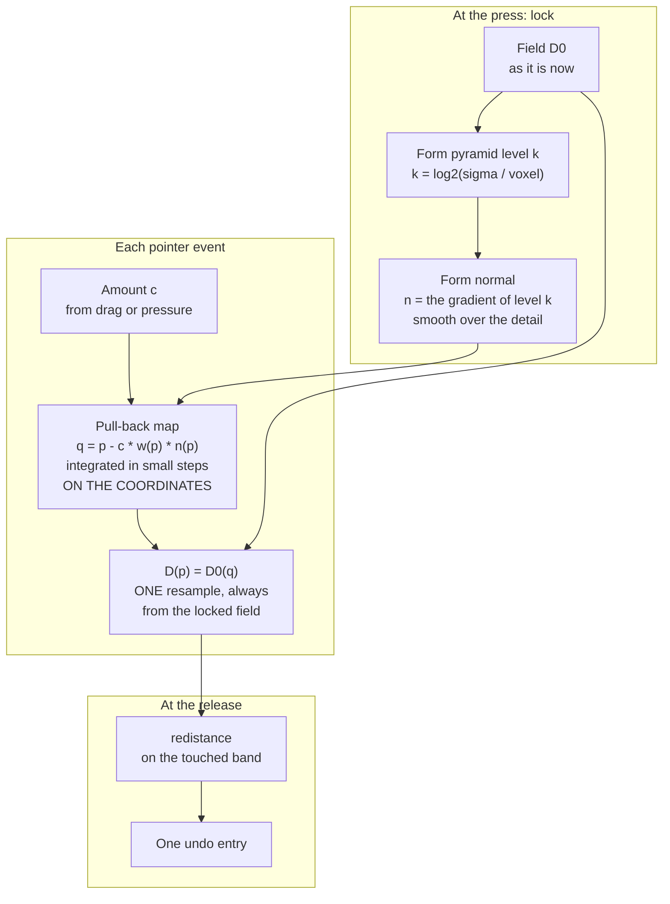

Three details in that picture are load bearing:

1. **The normal comes from the pyramid, not from the field.** `sigma` is the
   user's statement of what counts as detail, in millimetres: features smaller
   than it ride along, features larger than it are the form being changed. In
   millimetres, so it means the same thing at every voxel size, which is the
   argument `generate.rs:51-60` makes for the cavity slider.
2. **Large amounts are integrated on the coordinates, and the field is sampled
   once.** A warp stops being invertible when its gradient reaches one, which
   is why `Brush::max_drag` exists (`brush.rs:764`). Going further by repeating
   the warp would resample the field each time and blur it each time. Composing
   the *map* in small steps and reading the locked field once at the end costs
   vector arithmetic per voxel and exactly one interpolation.
3. **It is a gesture, locked at the press**, on the `MoveStroke` pattern.
   Thirty adjustments within one gesture cost one resample, which is the rule
   `transform.rs:45-52` already states for the gizmo.

### 9.3 The tools this gives

| Tool | What it does | Mechanism |
|---|---|---|
| **Bulk / Slim** | Thicken or thin a mass; scales, pores and wrinkles survive | The warp above, as a brush |
| **Bulk body** | The same over a whole body or everything unmasked | The warp above, global, with a millimetre amount |
| **Form smooth** | Relax the big shape, keep the surface texture | `D' = D + w * (smooth(B) - B)` where `B` is the base at scale `sigma`: a low frequency term added to the field. Blend type, no gain |
| **Posed transform** | Gizmo plus mask: rotate, move or scale the unmasked part, blended across the mask's feather | Per point blended similarity, inverse by fixed point iteration, one resample, then `redistance` as `app.rs:3018` does now |
| **Detail gain** | One slider: soften the detail and keep the form, or exaggerate the detail | `D' = B + g * (D - B)`, once, from a locked field |
| **Form scale on any brush** | The `FormScale` switch in `BrushDef` | Blend brushes apply their edit to `B` and add the difference; warp brushes take their direction from the form normal |

Detail gain above one looks like the thing `brush.rs` forbids (amplifying a
difference from an average). The prohibition is about doing it *per stamp*,
where rounding error compounds across a stroke. Done once from a locked field
it is a single linear operation, clamped and redistanced. It is also directly
useful for print: fine detail that a 0.4 mm nozzle would erase can be
exaggerated on purpose before export.

Posing is worth singling out: gizmo plus mask is how a ZBrush figure is posed,
and `mask.rs:53-54` already guarantees the precondition, since "every path
that writes the mask writes a feathered edge, never a step" was written to keep
exactly this kind of warp invertible.

**Not planned, 2026-11-23.** The posed transform was this plan's own addition
and was never one of the six things asked for (section 1). The maintainer
said so when it came up, and it is not being built. The row stays in the
table above as a record of what the form pyramid could carry, and no more.

#### Built, 2026-11-23 (S4.1): bulk the body, and the detail gain

`hani-core/src/form.rs`, and a FORM block on the panel: a detail size in
millimetres, a *Bulk* amount with its Apply, and a *Detail* multiplier with
its Apply. Both work on the whole of the active body, less what the mask
protects, and each is one undo entry.

**The measurement the plan said to make first**, on a ball 40 voxels in
radius with a ripple 8 voxels from crest to crest and 0.8 of a voxel high:

| | Surface moved | Ripple left |
|---|---|---|
| Bulk by 3 voxels | 2.999 | 96% |
| Bulk by 9 voxels | 8.995 | 98% |
| Thin by 6 voxels | 6.008 | 94% |
| Inflate by 3 voxels | 3.19 | 80% |
| Inflate by 6 voxels | 6.30 | 61% |
| Inflate by 9 voxels | 9.36 | 49% |

A bulk keeps the detail by about the same however far it goes, the few
percent being its one trilinear read. Offsetting the field loses it as it
goes. So the cubic sampler the plan thought might be needed for detail under
5 voxels is not needed at 8, and has not been measured below that.

**The detail gain** is `new = form + gain * (old - form)`, once, from a field
nobody is editing. At a gain of nothing the ripple is 13% of what it was, at
a half 55%, at two 1.97 times.

**The form of a ball is a smaller ball**, and this was the part that took
three goes. Smoothing pulls a surface toward its centre of curvature, so a
level of the pyramid sits inside every bulge, and scaling detail about it
would change the model's size too. On a ball 30 mm in radius at a quarter
millimetre, taking all the detail off moved the surface in by 0.05 mm on
average at a detail size of 2 mm and 0.22 mm at 4.

1. Estimating that from the next coarser level (Richardson) fixed the small
   test ball and made the real one worse at two sizes of four: the coarser
   level is the one least able to hold the model.
2. Smoothing the form itself again by the same steps and adding back what
   that took off is right on average to 0.008 mm, and bringing the form back
   to full resolution to do it cost 45 seconds at a detail size of 8 mm.
3. Bringing it back two halvings only, which is fifteen sixteenths of the
   smoothing, is what is built: under a second at every size, and the
   average within 0.013 mm up to a detail size of 4 mm.

The first measurement of the uncorrected form was along one axis and said
0.017 mm where 300 directions say 0.22. The lattice flatters its own axes.
The table in the module is the 300.

**Cost, measured** (release, the starting ball at a quarter millimetre): the
pyramid 0.5 s, a bulk of 1 mm 0.8 s, the redistance after it 0.5 s, a detail
gain 0.3 s. On the update thread, which is owed a task, as export is.

**One step, not many.** The plan drew the pull-back as a walk in small
steps, re-reading the form's normal at each. A mutant that took one step
where the code took three survived every test, and it was right to: the form
is a distance field, the lines its gradient follows are straight, and the
normal a point starts with is the normal all the way back. The walk is gone.

**And a NaN in the test fixture.** The rippled ball's centre voxel divided
nothing by nothing. Every surface measurement passed, because none of them
looked inside the ball, and the NaN was quietly switching off the
redistance the fixture was supposed to have had. A test that checked the
far field of a bulk, written to kill another mutant, read it.

**Not built yet from the table above:** the bulk as a brush, form smooth,
the posed transform, and the form scale on any brush.

### 9.4 The limits, stated before anyone finds them

- **Detail is carried, not regenerated.** Where a surface grows, its detail
  stretches with it. That is also what subdivision levels do.
- **One gesture is bounded** by the curvature radius of the form and the width
  of the falloff. The map integration extends the range; it does not remove
  the bound, and past it the surface stops following rather than tearing.
- **One warp is one trilinear resample**, and trilinear interpolation
  attenuates features near the voxel scale. **S4 begins by measuring that**:
  the amplitude of a 4 voxel ripple after one warp. If the loss is visible, the
  gesture warps get a cubic sampler. Estimate: it will be needed for detail
  under about 5 voxels.
- **Detail at the limit of resolution is fragile under anything**, here as in
  every other operation (`README.md:365`).

---

## 10. Unwrap, bake and textured export (milestone S5)

Last, because it needs decimation (S1) and paint (S2) to have anything to do.

### 10.1 Unwrap

On the **decimated** mesh, at export, and never anywhere else (D1).

- **Charts** by region growing over faces. The cost of adding a face to a
  chart is its normal deviation from the chart's proxy plane plus a
  compactness term, **minus a reward for ending the chart in a crevice**: the
  occlusion signal says where a seam will not be seen. Masked faces refuse
  seams, which gives the user ZBrush UV Master's "protect" with the tool they
  already have.
- **Flattening, first version:** orthographic projection onto the chart's
  proxy plane with the normal cone capped at 60 degrees, which bounds stretch
  at 2 with no solver at all. **Second version:** least squares conformal maps
  with an in-house conjugate gradient, which allows larger charts and fewer
  seams.
- **Packing** with a skyline packer at uniform texel density, with a gutter
  sized for the bake.

Texel density is derived, not chosen: one texel per voxel captures the paint
losslessly, and a 3,000 mm² miniature at 0.1 mm is 300,000 texels, which fits
a 1024 atlas with room for gutters. **(Estimate from area; measured in S5.)**

**Build or depend.** `xatlas` is the standard and is C++. A pure Rust crate in
its spirit, `uvunwrap`, exists and is **unverified by this plan**. The
milestone's first day evaluates it. The projection charts above are the
fallback, and they are small enough to be the differential oracle either way.

### 10.2 Bake

For each texel inside a chart triangle, take its world position `p` on the low
polygon triangle and step to the true surface:

```text
p* = p - d(p) * grad d(p) / |grad d(p)|^2
```

One or two steps, valid because decimation kept `p` inside the band. Then read:

| Map | Source at `p*` |
|---|---|
| Base colour | Paint field |
| Normal (tangent space) | Field gradient, in the triangle's frame |
| Occlusion | Occlusion signal |
| Height | `d(p)` itself, in millimetres, signed |
| Metallic and roughness | Finish byte |
| Slot id | Slot field |

**No cage, no ray casts, no "the rays missed" artefacts.** On a mesh pipeline
baking is its own craft. Here the question "where is the real surface from this
point" is the question the data structure exists to answer.

### 10.3 Formats

- **OBJ + MTL + PNG**, the lowest common denominator.
- **GLB** (binary glTF), with base colour, normal, occlusion and
  metallic-roughness. The JSON is small and `serde_json` is already in the
  graph (`Cargo.lock:3236`).
- **PLY with vertex colours**, which several full colour print services take,
  and which S2 can ship early since it needs no atlas.
- PNG writing through the `png` crate, already in the lockfile
  (`Cargo.lock:2779`). **To verify at implementation:** that naming it directly
  adds no new crate to the build, which is the bar `Cargo.toml`'s comments set.

The 3MF writer keeps writing filament slots. That is still the right contract
with a slicer.

### 10.4 Built, 2026-11-23 (S5.1): unwrap, base colour, and an OBJ with a picture

`hani-core/src/export/unwrap.rs`, `export/texture.rs` and
`export/textured.rs`, and a fifth format on the export panel, *OBJ+PNG*, with
a texture size of 1024, 2048 or 4096. It writes `model.obj`, `model.mtl`
beside it, and a PNG for each body.

**Unwrap.** The first version of 10.1, and plainer than it was drawn:

- A chart is every triangle within 60 degrees of the way its first triangle
  faces, reached across shared edges, and laid flat by looking along that
  way. No triangle is flipped, and stretch is bounded at 2, both by
  construction and both tested.
- Charts start from the flattest triangles. Started in index order, a chart
  on a bevelled cube began on a bevel and took half of each face either
  side of it. The flattest first is the nearest this comes to "end the chart
  in a crevice".
- **Facing the axis is not enough to keep a chart off itself**, which 10.1
  did not say. A ramp that winds round like a spiral stair faces up
  everywhere and lies over itself seen from above. A triangle is only taken
  if it does not overlap what the chart already holds. The first overlap
  test sampled points and let 64 texels of the ramp overlap; the one built
  is exact (separating axes), and so is the test that checks it.
- Packing is in rows, tallest first, at one scale for every chart, the
  largest at which they fit. A skyline packer would waste less. Rows waste
  little enough that the density below is already more than the paint has.

**Bake.** As 10.2 says: each texel's point on its triangle is stepped onto
the surface, once, and the colour is asked for there, which is the paint the
voxel holds shaded by the field's own curvature. The colours at chart edges
are then spread into the margin, so that a blurred lookup at a seam reads
the same colour from either side.

The test this milestone exists for: a ball with a wash in a groove,
decimated until the groove is narrower than the triangles across it. A
colour a vertex (the PLY) loses the groove. The texture has it.

**Measured** (release, a 24 mm cube at a quarter millimetre with a slot cut
in it and a ball let into one corner, decimated from 125,408 triangles to
10,004): 28 charts, the unwrap 10 ms, the bake at 1024 texels 0.46 s, 14
texels to the millimetre. The paint is one value a voxel, which is 4 to the
millimetre, so 1024 already holds it three times over on a model this size,
and the estimate in 10.1 stands. (The commit that built this, and its pull
request, call that model "the starting ball". It was not: the numbers are
right and the name was wrong.)

**Build or depend: built.** The evaluation of `uvunwrap` was not made. The
projection charts were the fallback and they turned out to be enough for a
picture nobody edits by hand, in under 800 lines with nothing new in the
build.
The PNG is written by the `image` crate, which the application already
used; the core has no picture format in it and gained none.

**Not built from this section:** seam hiding and the mask as "protect"
(seams are where they fall; the bake makes them not show), conformal
flattening, the maps other than base colour, and GLB, which is 10.5.

### 10.5 Built, 2026-11-23 (S5.2): GLB

`hani-core/src/export/glb.rs`, and a sixth format on the export panel.
The textured formats now sit in a row of their own under the texture size,
since six buttons were one row too wide and the size only means anything
to two of them.

One file: the mesh, and each body's picture inside it as the PNG the
application made. It shares the unwrap and the bake with the OBJ.

**Three things this format means that the others here do not**, each of
which is a line in the writer and a test:

- **Metres.** Everything else written here is millimetres. A glTF is
  metres by its specification, so positions are divided by a thousand. A
  model written in millimetres opens a thousand times too big and nothing
  says why.
- **Y up.** So is the sculpt. This is the one writer that does not turn
  the model.
- **A vertex is one position and one place on the picture.** A vertex on
  the edge of two charts has two places and is written twice.

**The JSON is written by hand**, where 10.3 said `serde_json` was already
in the graph. It is in the application's graph and not the core's, and the
core is where a writer belongs. It is forty lines of fixed shape with one
kind of string in it, the bodies' names, which are escaped and tested with
quotes, backslashes, line ends and a control character in them. The
application's test reads the file back with `serde_json`, so a parser that
is not this one has read it.

**Checked how.** By tests that follow the file's own indices from the
scene down to the bytes and compare them with what went in, for two bodies
with pictures of odd lengths so that the padding is exercised. **Not
checked** against the Khronos validator: it could not be run where this
was built. That is the first thing to do with a file from this writer
anywhere it can be.

**Size.** A ball 30 mm in radius at full detail (543,000 triangles) with a
1024 texture is 15 MB, of which the picture is 39 KB: the mesh is the file. *Detail* is the
control that matters here as everywhere.

**Not built:** the finish as a metal and roughness picture (every material
is the same matt non-metal), normal and occlusion maps, and compression of
the mesh. (The finish was built with the paint rack's varnish, and the
occlusion in 10.6.)

### 10.6 Built, 2026-11-26: occlusion, in the finish's picture

`Unwrap::finish_baked` makes one picture the way glTF packs three maps:
red how open the surface is, green the roughness, blue the metalness. The
occlusion is the one a wash pools by (`Volume::occlusion_at`: six rays
over the hemisphere a point faces, a few millimetres out), so a viewer's
ambient light darkens the recesses the paint already knows about. Every
body in a GLB now has this picture, not only a varnished one, and its
material names it twice: as the roughness and metal picture and as the
occlusion picture.

Tests: on a cube with a slot cut in its top, the slot's floor is baked
more shut in than the open top, and with no varnish every baked texel is
the matte non-metal; the GLB names the packed picture as its occlusion;
the application's GLB, read back with `serde_json`, has the occlusion and
a ball reads open in at least nine tenths of its baked texels.

**Measured** (release, four cores, a 24 mm cube at a quarter millimetre
with a slot, decimated to 28 triangles, 1024 texels): the colour bake 0.12
s, the packed picture 0.25 to 0.29 s. The occlusion is most of that: six
rays of four steps a texel.

**Not built:** the normal map, which a decimated GLB wants most and which
needs tangents written beside the normals. Built in 10.7.

### 10.7 Built, 2026-11-26: the normal map

`hani-core/src/export/normal_map.rs`. A GLB's third picture is the
sculpt's surface direction in the frame of the triangle under each texel,
so that a mesh thinned to a few thousand triangles is lit as the model is.

**The frame is written, not assumed.** glTF builds a texel's frame from a
vertex's `NORMAL` and `TANGENT`, the bitangent `cross(normal, tangent) *
w`. A file without `TANGENT` has its frame made up by the viewer, by
MikkTSpace, which a bake would have to match exactly. So `tangents` works
one out for each pairing of a position with a place on the picture (the
glTF vertex): the way `u` runs across the triangles round it, made square
to the normal, with `w` the sign that makes the bitangent run the way `v`
does as glTF reads the picture, from its top left down. The writer puts it
in every body's mesh as `TANGENT`, and the bake uses the same tangents,
interpolated across each triangle as a viewer interpolates them. Each
texel's point is stepped onto the surface as every bake here is, and its
normal is the field's gradient there.

Tests: the tangents are unit, square to their normals, and run the way the
picture's `u` and `v` do; on a ball rippled finer than its thinned
triangles, a texel decoded through the frame a viewer builds gives back
the field's normal to within 0.995 in cosine, and at least a quarter of
them lean off the mesh's own normal (the first fixture, a plain ball, had
none that leaned: a smooth ball thinned is still lit right by its own
normals, so it carried nothing to check); the GLB names the normal picture
and reads back a tangent a vertex; the application's GLB of a ball at full
detail is near the flat blue.

**Not checked:** against the Khronos validator, which could not be run
here, or in a viewer, for want of one; that is the first thing to do with
a file from this writer anywhere it can be. The cost of the bake was not
measured; it is a gradient a texel, which is less than the occlusion's
twenty-four samples.

---

## 11. Priorities

### 11.1 The order

Ranked by value to the sculpt, print, paint loop, times certainty, over cost,
subject to what depends on what. Sizes are **estimates in working weeks for one
person with AI assistance**, and each is replaced by a phased plan with
measured baselines when its milestone opens.

| Rank | Milestone | What ships | Size | Why here |
|---|---|---|---|---|
| 1 | **S0 Groundwork** | Brush engine (no behaviour change), `SparseField`, form pyramid, signals, cavity shading toggle, branch and CI hygiene | 2 to 3 | Everything stands on it. Zero user-facing risk. Cavity shading is a visible win by itself |
| 2 | **S1a Decimated export** | Tolerance in mm, field verified, slot boundaries held, report | 2 | Smallest, independent, fixes a pain that exists today, prerequisite for S5, upstream candidate |
| 3 | **S1b Parting with keys** | Plane part, four key kinds, auto placement, clearance, preview | 2 to 3 | Independent. The engine makes it nearly free. Upstream candidate |
| 4 | **S2 Mini painting** | Paint recipes and the rack (done), gated drybrush and sponge strokes, fills, zenithal and broad occlusion, paints to filaments, PLY | 5 to 7 | The headline. Largest. Needs S0's signals and gates |
| 5 | **S3 Brush engine, surfaced** | Alphas, drag rect, displace, dynamics curves, new operators, presets | 3 to 4 | The refactor is done in S0 and exercised by S2; this exposes it |
| 6 | **S4 Form tools** | Bulk and slim, form smooth, posed transform, detail gain | 3 | Needs the pyramid. High value, one real unknown (resample blur) |
| 7 | **S5 Unwrap and bake** | Charts, packing, bake, OBJ+PNG, GLB | 3 to 4 | Needs S1a and S2. Newest mathematics. Only matters once there is paint to carry |
| | **S6 Backlog** | Section 12 | | |

**About 21 to 26 weeks in sequence (estimate).** S1 and S2 do not depend on
each other, so with two streams of work the print track and the surface track
run side by side after S0.

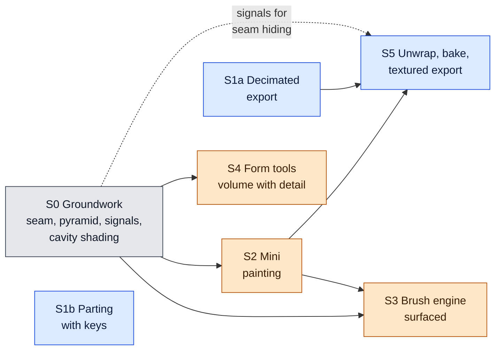

Grey is groundwork, blue is the print track (and upstream friendly, except S5),
orange is the surface track. S1a and S1b have no arrow into them from S0: they
can start on day one.

### 11.2 Why not painting first

It is the feature with the most words in the request, and it is ranked fourth.
Three reasons:

1. **It cannot start without S0**, and S1a and S1b can. They are useful weeks
   that are otherwise idle.
2. **S1 is where the risk is lowest and the proof is cheapest.** Decimation and
   parting are verified by counting edges and measuring millimetres. Painting
   is verified by looking, which this repository has learned to be careful
   about (`CONTRIBUTING.md`, "a green-but-dead interaction twice").
3. **S1 is the part upstream might take.** Landing it first, cleanly, on new
   files, keeps that door open and keeps the fork's diff small while the larger
   work is still moving.

If the preference is the headline first, S2 moves up to rank 2 and nothing else
changes; the dependency graph allows it.

### 11.3 The first three increments

1. **The brush engine, held to the brush.** *Done, 2026-11-22.* Every stamping
   kind, falloff, pattern, direction, pressure, mask state and mirror through
   both paths, same field and same undo entry bit for bit; eight mutations of
   the engine run against the test, six caught and two shown to be equivalent.
   A recorded hash was the first idea and was dropped: the patterns take roots,
   so a hash is a statement about one machine.
2. **The form pyramid, the cavity signal and crease shading.** *Done,
   2026-11-22* (sections 5.2 to 5.4). The pyramid is distance fields rather
   than coverage; the cavity signal is measured at mesh time and cached
   nowhere; *show creases* is the first thing in this plan a user can see.
3. **Decimation phase 0:** measure what export costs today (triangles, bytes,
   seconds, slicer load time) at three voxel sizes, so the milestone's claims
   have a baseline.

---

## 12. What this plan deliberately does not do

Each with the reason, and the trigger that would reopen it.

- **Paint layers.** A full coverage layer costs as much memory as the geometry
  it sits on (+100% of the field, section 8.2), so a six layer stack on a real
  model is past the ceiling. The first version is one buffer, as a real
  miniature is, with a deep undo. *Trigger:* a measured compact paint brick
  (surface cells only, estimated at 20x smaller) makes layers affordable.
- **Sculpt layers.** Still out, for the build spec's reasons.
- **A paint lattice finer than the field.** Section 8.6. *Trigger:* someone
  painting freehand detail on a body whose geometry does not need the voxels.
- **Adaptive extraction straight from the field** (octree dual contouring)
  instead of decimating a uniform mesh. It could recover the sharp edge of a
  cut that surface nets rounds. Crack free adaptive contouring is intricate,
  and decimation gets most of the triangle saving for a fraction of the risk.
  *Trigger:* cut edges that measure visibly rounded in a print.
- **Quad remeshing and edge flow.** Not what decimation is.
- **Pigment flow simulation.** Section 8.6.
- **Hollowing with drain holes.** It needs distances deeper than the band,
  which is a separate piece of machinery. Adjacent to parting and worth doing;
  not in this plan.
- **Insert mesh brushes.** Alphas and drag rect cover stamped surface detail.
  Stamped *solids* stay out.
- **Radial symmetry, GPU compute for edits, tablet builds.** Unrelated to the
  six asks.

---

## 13. The branch, and living beside upstream

**Severed, 2026-11-26.** The maintainer: *"Stop worry about upstream. I am
gonna sever the repos"*, and then *"we can merge to main"*. HaniSculpt is
its own repository (`DanielJoyce/hanisculpt`), no longer a fork, and
`feature/studio` was merged into `main` the same day. Later that day the
maintainer moved the work to `main`: *"Let's switch to main trunk
development. Studio branch can be retired going forward."* Pull requests
go into `main` from then on, and `feature/studio` takes nothing more. What
follows is how the branch lived beside upstream until then, kept as the
record.

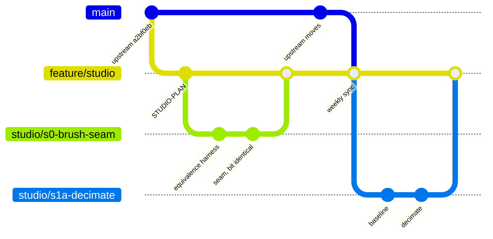

- **`main` mirrored upstream** (`MakerViking/brokkrsculpt`) and carried nothing
  of this plan, until the repositories were severed on 2026-11-26.
- **`feature/studio` is the long-lived integration branch.** It is merged into,
  never rebased, because it is published and other branches hang off it.
- **Each increment is a topic branch** (`studio/<milestone>-<name>`, or a
  session branch) merged into `feature/studio` by pull request.
- **`main` is merged into `feature/studio` weekly.** Small and often: a fork
  that syncs monthly does not sync.

**CI.** `ci.yml` runs on pull requests and on pushes to `main`
(`.github/workflows/ci.yml:4-7`), so a pull request into `feature/studio` is
checked with no change. `release.yml` fires only on `main`
(`.github/workflows/release.yml:28-30`), so this branch can never publish a
build to the beta channel by accident.

**Keeping the diff mergeable (D6), as rules:**

- New features are new files: `export/decimate.rs`, `part.rs`, `paint.rs`,
  `pyramid.rs`, `signals.rs`, `sparse.rs`, `uv.rs`, `bake.rs`, and in the
  application `app/paint.rs`, `app/part.rs`, `app/export_panel.rs`.
- `app.rs`, `volume.rs` and `brush.rs` take the smallest hooks that work.
  Where a hook into a hot upstream file is unavoidable (paint must be read by
  `mesh_brick`; the sweep through `rotated`, `shifted`, `warped`), it is one
  call into a new module.
- No reformatting, renaming or refactoring of upstream code for taste.
- House conventions hold: SPDX header on every new file, no em-dashes in
  prose, fish for any shell command, warnings before command blocks.

### How it is tested, from 2026-11-23

Decided by the maintainer on that day, in these words: *"let's move off
mutation testing it seems to eat a lot of time and this isn't aerospace
software. Let's go with integration testing, property testing where needed,
and debug/test time contracts (use contracts crate)."*

Up to and including the painting engine's brush (section 15.9, P3), each
stage was mutation tested by hand, and its account says so. That stopped
there. It found real gaps, and it cost hours of machine time a stage. From
here a stage is held by three things, and its account says which it used:

1. **Contracts**, on the function they are about. What it requires of its
   caller and what it promises, as `#[debug_requires]`, `#[debug_ensures]`
   and `#[debug_invariant]` from the `contracts` crate. Checked in every
   debug build and so in every test run that is not asked to be a release
   one, and compiled out of a release build entirely: a stamp costs what
   it cost. `#[test_ensures]` for a promise too dear to check outside a
   test. A contract is for what must be true whoever calls: an index in
   range, a result in its range, a count that only grows, paint stored the
   way paint is stored.
2. **Property tests**, with `proptest`, where there is a rule that holds
   for every input and a hand-picked case would be the author's own idea of
   the input twice over: a file that comes back as it went in, a move and
   its inverse, a stroke that does not care what order its stamps came in,
   an undo. Not everywhere. A thing with three cases gets three cases.
3. **Integration tests**: the thing done the way a user does it and the
   result looked at where a user would see it. Messages and pointer events
   through the application, a file written and opened again, a frame
   rendered and its pixels read. These were always here, and are now the
   main thing.

Unit tests on worked fixtures stay where they say something the other
three do not, which is mostly "this number, for this reason".

What a stage runs before it is merged: `cargo fmt`, clippy with warnings
as errors, the core suite in the **dev** profile (a minute, with every
contract and debug assertion live) and again in release, the gpu suite and
the app suite.

### Seeing it run without a screen

Every panel on this branch was built and tested without anybody seeing it,
which is how a preset's name came to have 74 pixels to wrap in. On
2026-11-23 the application was run on a virtual display and looked at, and
this is how, for whoever next works on it from a machine with no screen:

```text
Xvfb :99 -screen 0 1500x950x24 &
DISPLAY=:99 WAYLAND_DISPLAY= HOME=<a scratch directory> ./target/debug/hanisculpt &
DISPLAY=:99 xdotool mousemove 935 388 click 1        # press a button
DISPLAY=:99 import -window root shot.png              # look
```

It wants `libxkbcommon-x11` installed (winit panics without it), a software
Vulkan (lavapipe), and `show_on_startup = false` in the scratch home's
`hanisculpt/welcome.conf` to get past the welcome screen. A scratch
`HOME` keeps it off anybody's real config. Keys do not arrive, there being
no window manager to give the window focus; the pointer and the wheel do.
File dialogs do not open, so export was not driven this way.

**What looking found.** Two faults of layout, both fixed: a button to
forget each preset left the names too narrow, so there is one *Forget* for
the lit preset; and "Drybrush" ran into the edge of a quarter of a row, so
the four touches share the row by the length of their names. And one limit,
now in 8.6: fill on features a voxel or two tall. Everything else did what
its tests said: the row of rivets follows the drag and faces along it, a
wash pools round each rivet, a fill stops at a rivet's bevel, a preset
lights when the brush matches it.

---

## 14. Risks and open questions

| Risk | Likelihood | What contains it |
|---|---|---|
| The brush seam costs the stamp budget | Medium | Equivalence and the benchmark gate land before anything depends on the seam. If it cannot hold 4 ms it is redesigned, not waved through |
| Paint memory surprises a user on a large model | High | Demand predicted and refused by name before every global operation; priming is free; the limit is documented |
| The paint sweep misses one transform and silently drops colour | Medium | One failing-without-it test per transform, the discipline `colour.rs` already records |
| Trilinear blur makes the form tools disappointing | Medium | Measured first in S4; cubic sampler is the planned fallback |
| Upstream refactors `app.rs` or `brush.rs` under the branch | Certain, eventually | Weekly sync, additive files, thin hooks |
| The shader preview and the CPU bake of a wash disagree | Medium | One table driven test evaluating both |
| Unwrap quality is poor on organic shapes | Medium | It only has to be good enough for a bake nobody edits by hand; a library is evaluated first |
| The plan's estimates are wrong | Certain | Each milestone opens with a phased plan and a measured baseline that replaces them |

**Questions for the maintainer of this fork.** None blocks S0; the plan
proceeds on the stated default for each.

1. **Upstream.** Offer S1 (and later S4) to `MakerViking/brokkrsculpt` as pull
   requests, or keep everything on the fork? *Default: build them so they could
   be offered, and decide when S1a is done.* **Answered 2026-11-26:** neither;
   the repositories were severed and HaniSculpt is its own project.
2. **Order.** Print track first, as ranked, or painting first (section 11.2)?
   *Default: as ranked.*
3. **Build or depend** for decimation and unwrapping. *Default: in house, with
   an external crate as a test oracle only.*
4. **One paint buffer, no layers, in the first version.** *Default: yes.*
5. **Paint resolution tied to the voxel size in the first version.** *Default:
   yes.*
6. **Names.** `feature/studio`, milestones S0 to S6, "Studio" for the effort.
   *Default: as written; all three are one search and replace.*

---

## 15. The painting engine (milestone P)

Decided on 2026-11-23, by the maintainer, in one line: *"Don't worry about
filament painting. Pull that out if it simplifies things. I want a real
painting engine."*

### 15.1 Why section 8 is not one

Section 8 was built on upstream's filament painting, because the north star
was a printer with a handful of spools. A voxel there holds a **slot**: one
byte that names one of a few recipes, and the recipe holds the colour, the
wash and the highlight (section 8.2). That gets a miniature painted quickly,
and it is the wrong shape for a painting tool:

- There is no colour under the brush. There is a rack, and the brush picks
  from it. Painting a new colour means mixing a new paint first.
- Nothing blends. A voxel is in one slot or another, so there is no soft
  edge, no opacity, no thin coat over a thick one.
- A wash or a highlight belongs to the recipe and covers everything in the
  slot. It cannot be put where the brush goes and nowhere else.
- A stroke cannot be half strength. Section 8.3's *Loaded*, *Drybrush* and
  *Sponge* are gates on whether a voxel changes slot, and no more.

### 15.2 What a voxel holds now

Four bytes: a colour, sRGB, and a **coverage**. Coverage 0 is bare clay and
is always stored as four zeroes, whatever colour it was last given, so that
"is this painted" is one comparison and a wiped body compares equal to one
never painted. Coverage 255 hides the clay entirely. Between the two the
clay shows through, which is what a thin coat is.

Straight alpha, not premultiplied: an eyedropper reads back the colour that
was painted, at any coverage, and eight bits of colour are not lost at low
coverage.

It lives in a `PaintField` beside the mask and the slots, in the same sparse
bricks (`paint/field.rs`). A brick that is one value throughout is 4 bytes; a
brick with a different paint in every voxel is 131,072 (32,768 voxels of 4
bytes). Only voxels in the narrow band can be painted, as with the slots, so
a painted ball costs its shell and not its volume.

Upstream's slot field is left exactly as it is. It is upstream's code, under
upstream's tests and golden files, and it is what a 3MF's `paint_color`
reads. Section 15.7 says what becomes of the recipes built on top of it.

### 15.3 A stroke is a layer, laid once

The brush does not blend into the surface at each stamp. A stroke that did
would compound: where two stamps overlap the paint would go on twice, a slow
stroke would be darker than a fast one, and at 8 bits a soft stroke of a
hundred stamps is a hundred roundings.

Instead, when a stroke begins the paint it is about to touch is **locked**
(copied aside, brick by brick, as the Move brush already locks the field).
Through the stroke each voxel keeps only a **coverage**: the most any stamp
has given it. What the voxel holds is then always

    blend(what it held when the stroke began, the brush's colour,
          coverage x opacity, the mode)

computed from the locked paint, not from the last stamp's result. Going over
the same place twice in one stroke changes nothing. Going over it in a second
stroke adds a second coat. That is how a real brush with one load of paint
behaves, and it is how every painting program worth using does it.

*Changed 2026-11-25.* The most alone left a paler seam between a pass and
a return laid beside it, and a pale wedge inside a turn, seen by the
maintainer: each is reached only by the brush's soft edges, and the most of
two soft edges is less than either middle. The coverage is now the larger
of the most and what the stroke has deposited as it travelled (each stamp
its reach times the distance moved, a straight pass's middle line being one
coat), held to one coat. A click is still the falloff; going back over
paint in the same stroke still never passes a coat, and now fills the soft
edges where the passes overlap. See `paint/stroke.rs`.

The blend is done in linear light and stored back as sRGB: red over green at
half coverage is the olive it would be on a palette, not the brown that
averaging the bytes gives.

### 15.4 The modes

One brush, one colour, an opacity, and a mode. The gates of section 8.3 are
kept, because they were the good part, and they now scale coverage and no
longer decide a slot.

| Mode | What it does | How |
|---|---|---|
| **Paint** | Covers | Colour over what is there, by coverage |
| **Glaze** | Tints without hiding | Multiplies what is there by the colour, as a transparent film does. Leaves bare clay tinted |
| **Wash** | A glaze that runs into the recesses | A glaze whose coverage is scaled by the fine cavity signal (section 5.3): full in a crease, little on a flat, none on a ridge |
| **Drybrush** | Catches the raised edges only | Paint whose coverage is scaled by the ridge side of the same signal |
| **Sponge** | Stipples | Paint whose coverage is cut by a cellular noise in object space |
| **Erase** | Back to clay | Coverage down, colour kept |

And an **eyedropper**: the colour under the pointer becomes the brush's.

### 15.5 Seeing it

The mesh already carries a slot for each vertex. It carries the four bytes of
paint as well (`BrickMesh::paint`, filled at mesh time and free for a body
with no paint). The shader lays the paint over the clay, or over the slot's
recipe where there is one, by its coverage. Interpolated across a triangle,
which is the softness the slots could never have: a slot is flat-shaded by
necessity, because the number between slot 2 and slot 3 means nothing.

### 15.6 Getting it out

The bake of section 10.2 samples the paint field at each texel and each
vertex, trilinearly, so a PLY, an OBJ with a picture and a GLB all carry
what was painted. For a 3MF, which can only name a filament, each vertex
that is at least half covered takes the nearest of the loaded filaments.
(This said the export would also report how far off the worst of them was.
It does not, and nobody has missed it yet.)

### 15.7 What becomes of the recipes

They are retired, in the last stage and not before the brush that replaces
them is in hand. A document saved with recipes opens with each slot's own
colour, wash and highlight laid into the paint field, voxel by voxel, by the
same arithmetic that drew them, so nothing that was painted is lost. The
*Mix paints* editor goes. The rack stays as what it should have been: a
palette of colours to pick from, and the list of filaments for a 3MF.

### 15.8 The limits

- **A voxel is the smallest thing that can be painted.** At 0.1 mm that is
  finer than a nozzle and coarser than a texture painter expects. Tying paint
  to the lattice is what makes it survive every edit for free.
- **Paint does not follow a sculpting stroke** that grows new surface: the new
  surface is bare. It follows the Move brush, a bulk, and every transform of
  a whole body. Sculpt, then paint. The slots have always had this limit.
- **Nearest, not blended, under a warp or a change of voxel size.** A blended
  sample would smear the edge between paint and bare clay into a halo of
  half-covered voxels each time.
- **No layers.** One coat of paint for each body. The stroke-as-a-layer of
  section 15.3 is within a stroke only.

### 15.9 The stages

| Stage | What | State |
|---|---|---|
| P1 | The storage: the field, every edit that must carry it, undo, the file | **Built**, 2026-11-23 (below) |
| P2 | The view: paint on the vertices, composited in the shader | **Built**, 2026-11-23 (below) |
| P3 | The brush: the locked stroke, the modes, the colour picker, the eyedropper, the fill | **Built**, 2026-11-23 (below) |
| P4 | The exports: bake, PLY, OBJ, GLB, and the nearest filament for 3MF | **Built**, 2026-11-23 (below) |
| P5 | Retire the recipes: convert old documents, remove the editor | Not begun, and waiting on a word from the maintainer (below) |

#### Built, 2026-11-23 (P1): the storage

`paint/field.rs` and `paint/file.rs`, and one or two lines in each upstream
file that has to know.

**The field.** `PaintField`, `PaintBrick`, and `Volume::edit_paint`, which
offers each voxel of the narrow band in a box, with its world position, what
it holds and the protection there, and stores what it is handed back. A
saturated brick is never opened. A stroke that leaves a brick as it found it
leaves no brick.

**Everything that moves a body moves its paint.** One test for each, each
failing without its line: duplicate, shift by whole bricks and by a part of
one, the 24 turns, a warp, a change of voxel size, a split by mask and into
islands, a merge, the Move brush, and a bulk (section 9). A merge takes the
incoming paint only where the incoming body has material; a split gives each
half only the paint on its own surface.

**Undo.** A fourth record in the open stroke, beside the field, the mask and
the slots: each paint brick as it was before the stroke first changed it. A
stroke that changes paint and nothing else is a stroke, and undoes and
redoes. Paint counts toward what a body weighs and toward what the history
holds.

**The file.** A tail of its own after the paint table's, `BRKRGBA1`: for each
body, each brick as one value, as runs of equal values, or whole, whichever
is smallest. The bytes do not depend on the order the bricks were made in. A
file with no paint gains no bytes, and a build from before this skips the
tail. Read on the same terms as the table: a tail that is cut short, claims a
length the file does not have, or will not decode costs the paint and never
the sculpt. Measured on the fixture, a 40 voxel ball with a flat coat on one
side and a different paint in every voxel of the other: 106,938
painted voxels in 32 bricks are 4,194,304 bytes in memory and 448,080 in the
file, about a ninth.

Fuzzed: 3,000 damaged copies of a real section (bytes changed, bits flipped,
cut short, bytes inserted, half of them aimed at the first 400 bytes where
the counts and kinds are), none of which may panic. The control is that both
ends of the reader were walked: more than 200 of them must still read, and
more than 200 must be refused.

**Mutation testing.** 95 mutants across the field, the file, and every hook
in a file that was already here. 65 were caught as first written. The 30
that were not each pointed at something: 22 at a fixture that could not see
the difference (a merge whose incoming bricks held no bare voxel beside a
painted one, a split whose pieces were too far apart for one's band to reach
the other's bricks, a lattice of 1 mm where millimetres and voxels are the
same number, a drag too short for half of it to be told from all of it, an
undo judged by what the stroke before it had marked), one at code that did
nothing (a merge collapsed bricks the end of the stroke collapses anyway,
which is gone), and 7 at the compiler, below. With the tests those asked
for, the 94 that remain are all caught.

**A thing found on the way: the release build can stall.** Seven of the
mutants, and then one ordinary edit, sent `rustc` into a single optimiser
thread for more than ten minutes on a build that takes forty seconds: LLVM's
InstCombine, on one function of the test crate, by a debugger's account of
the stuck thread. It depends on what gets inlined where and comes and goes
with unrelated edits. Nothing in the paint code causes it, and the whole
core suite builds and passes in release as committed. The mutation runs
moved to the dev profile, which does not stall, is quicker to build, and
also has the debug assertions on: two test fixtures of this stage merged
outside a stroke, which only a debug build refuses.

#### Built, 2026-11-23 (P2): the view

A vertex carries its paint to the GPU, and the shader lays it over what is
under it.

**The buffer.** The pool's attribute buffer goes from four bytes a vertex
to eight: the mask, the slot and the cavity as before, and then the paint
as it is stored. One buffer and one upload, so the two cannot be out of
step. It costs 44 MB more for each pair of buffers, 616 MB a pair where it
was 572, whether or not anything is painted. A buffer of its own, made
only when a body is first painted, would save that for people who never
paint and was not thought worth a second thing to keep in step.

**The shader.** The paint is turned into linear light and multiplied by its
coverage in the vertex stage, before it is interpolated. Bare is stored as
black with no coverage, so a triangle that runs from paint to bare would
otherwise fade out through a darkened version of the paint. By arithmetic
and not by measurement: half way across such a triangle, a paint at level
150 over its own colour would draw at 131. Then over the clay, or over the slot's recipe where there is one, by coverage.
Lit by the light on the clay under it, as a slot's colour is, and drawn
flat by the same switch. With the paint view off it is not drawn. A
thumbnail draws it whatever the view says, as it does a slot.

`a_bodys_paint_is_drawn_over_what_is_under_it_by_its_coverage` renders each
of those and reads the pixels back: a full coat is the colour painted to
within 4 levels of 255, and a dark one to within 2; half a coat over a
slot's blue is half way between the two in linear light, which is neither
colour and is not the average of their bytes; paint of the recipe's own
colour on half a ball is one colour all over, edge and all; lit paint is
the picture a filament of that colour gives, and the same picture whatever
slot is under it.

The decode is the engine's own curve, toe and all, held the way the cavity
decode is: the shader's lines, and those lines transcribed and run against
`paint::linear` for every byte. The toe cannot be held by a picture. At
eight bits it is within a level of the curve carried on down.

One thing tidied on the way: the slot's colour and the paint are lit by one
term, taken once from the clay, where the slot used to work its own out.

**Mutation testing.** 17 mutants: 13 against the shader and 4 against the
upload. 14 caught as first written. The other three were the toe and a
power of 2.2 in place of the curve, which got the test above and a dark
coat to judge by, and a paint lit by whatever is under it, which got the
picture of a coat over a slot. All 17 are caught.

#### Built, 2026-11-23 (P3, the engine of it): the brush

`paint/stroke.rs`. Not on the panel yet: that is the next thing, and until
then nothing in the application calls this.

**The stroke is a layer**, as section 15.3 said it would be. A
`PaintStroke` keeps one byte for each voxel it has touched: the most any
stamp of the stroke has given it. A stamp that would give a voxel no more
than it has leaves it alone. One that gives it more lays the pigment over
what the voxel held **before the stroke**, and not over what the last stamp
left.

What a voxel held before the stroke did not need keeping: the open undo
record already holds each brick as the stroke first found it.
`Volume::edit_paint_over` hands that to the edit beside what the voxel
holds now, and costs nothing that undo was not already paying.

**The arithmetic** is `laid(before, pigment, amount)`, in linear light,
straight alpha in and out.

| Mode | Colour | Coverage |
|---|---|---|
| Paint | The pigment over what is there, each by its share | Adds as two films do: `a + c(1 - a)` |
| Glaze | What is there times the pigment, by how much film there is. Over bare clay, a thin coat of the pigment itself, half of what paint would leave | Unchanged over paint |
| Erase | Kept | Down by the amount |

Nothing laid is what was there to the bit. That needs the round trip
through linear light to be exact, and it is: every byte comes back as
itself, which a test holds for all 256.

**What scales a stamp**: the brush's falloff, so a brush has a soft edge
for the first time; the pen's pressure; the mask, in proportion, where a
slot could only be held off or not; a pattern, as a weight where a slot
had a stencil; and what the brush catches.

**What the brush catches** is section 8.3's gates, kept, and made to answer
with how much and no longer with yes or no:

- *Wash*: the recesses. All of it in a full crease, 0.3 of it on a flat,
  none on a full edge. Measured on a slot cut into a cube: 0.8 or more at
  the foot of the walls, 0.3 on the floor, under 0.1 on the lips.
- *Drybrush*: what stands up into the brush, heaviest on the sharpest of it
  and fading down its sides, more on the side the brush comes at, in
  bristle lines, and running out along the stroke.
- *Sponge*: specks, at its density of a flat, each with a rim about a voxel
  wide.

As with the slots, a voxel takes what the surface under it takes, all the
way through the band, so sculpting a voxel deeper does not shuffle the
speckle; a mirrored stamp lays the mirror image, specks and bristles and
all; and stamps of one stroke agree about what they share.

**What it costs**, measured in release on one core of the build container
with `what_a_stamp_of_paint_costs`. Runs differ by about a fifth.

| Radius | Loaded, every voxel new | Loaded, along a stroke | Wash, drybrush or sponge |
|---|---|---|---|
| 12 voxels | 0.22 ms | 0.19 ms | 0.4 to 0.5 ms |
| 40 voxels | 2.7 ms | 1.2 ms | 5.8 to 6.7 ms |
| 50 voxels (5 mm at 0.1 mm) | 5.1 ms | 3.2 ms | 11 to 15 ms |

"Along a stroke" is twenty stamps a quarter of a radius apart, which is
what painting is: most of what a stamp covers, the one before it has
covered already, and is left alone. A brush that asks about the surface
costs what the same brush cost for a slot (section 8.3), and for the same
reason: the curvature under it.

Tried and kept, for a modest gain: the pigment made ready once a stamp, and
both ends of the sRGB curve from tables. The table that encodes is exact
and not approximate, held against the curve at every level's own threshold,
a step either side of it, and 800,000 values between. Tried and dropped
before it was committed: a copy of each brick for the undo record on every
stamp, where the first stamp to change a brick is the only one that needs
it.

**Not here yet**: a flood fill of colour (the slot's fill reads "the same
slot as where I clicked", which has no meaning for colours that blend), and
the eyedropper, which is one line and belongs with the panel.

**Mutation testing.** 58 mutants: against the arithmetic, the stamp, the
catches, and the edit that hands a stroke what was there before it. 48 of
the first 55 were caught as written. Six of the other seven each pointed at
something a test did not look at (an opacity over one, a stamp that lays
nothing still being counted, a voxel off the surface asked about itself and
not the surface under it, the specks changing through the band, every
stroke streaked with the same bristles, a crease counted as raised by a
slot's sponge) and got the test. The seventh was a check for a brush of no
size, which nothing is ever within, and is gone. Four more were written
when the edit moved, for the hooks that moved with it. All 58 are caught.

Mutants not written, because they change the time a stamp takes and
nothing else: the one early way out of a stamp, for a voxel outside the
brush or wholly protected, and the undo copy being taken for every stamp
where once a brick will do.

#### Built, 2026-11-23: contracts and properties on what is there

The first stage held the new way (section 13), and the engine built so far
brought under it.

**Contracts** on the functions of `paint/field.rs`, `file.rs`, `stroke.rs`
and `touch.rs`. Among them: paint is written as it is stored, and a voxel
written reads back; a box edited is inside its brick; a collapse leaves no
brick of nothing; a mesh gets one paint for each cell; a section read is a
field for each body or no fields; what is laid is stored as paint is, an
eraser adds no coverage and paint takes none off; a share of a wash, a
drybrush or a sponge is a share; and what a stroke has covered, it has
covered. One test breaks one on purpose and reads its name back, so that
the contracts being live is itself tested.

**Properties**, in `paint/properties.rs`, fifteen of them:

- Of the arithmetic: nothing laid changes nothing; coverage moves one way;
  more of a stroke is never less of its effect; a full coat is the colour;
  the opacity is a scale on the amount; a glaze never lightens.
- Of the file: any fields come back from their section as they went in and
  as the same bytes each time; no bytes at all make the reader do anything
  but answer, nor a real section with some of its bytes changed.
- Of moving a body: there and back is no move, a turn and its inverse is no
  turn for each of the 24, and after either every voxel holds what the
  voxel it came from held.
- Of a stroke: it is its stamps in any order and any of them laid twice,
  for any pigment over any paint and whatever the brush catches; and
  undone it is what was there, and done again it is the stroke.

All of it passed as first written, which after three stages of mutation
testing is what should happen. The whole core suite is 975 tests and a
minute in the dev profile.

#### Built, 2026-11-23 (P3, on the panel): the colour brush

`app/painting.rs`, and five small hooks in files that were there. The paint
brush now lays colour. Painting by filament slot is behind the second of
two buttons at the top of its block, *Filaments*, untouched, until the
exports read the paint and an old document's slots are laid into it (P4
and P5).

What the panel offers: *Paint*, *Glaze* or *Erase*; *Loaded*, *Wash*,
*Drybrush* or *Sponge*, with the drybrush's and the sponge's own settings as
they were; the colour in hand, from a range of 24, three sliders, or *Pick
from model*; its opacity; the brush's falloff, which a slot had no use for;
*flat colour, no light*; and *Coat the body*. Ctrl or alt takes paint off,
as it unpaints a slot. Taking a colour with the eyedropper paints nothing
and is not a step of the undo history.

**The footprint changed once it was seen on a screen.** As first built the
brush was a ball about each stamp. In the application a stroke came out
hatched at the scale of the lattice: a voxel a layer under the surface is
further from the middle of a ball than the one above it, takes a little
less, and neighbouring vertices of the mesh read from different layers. The
brush is now a disc pressed onto the surface and swept from each stamp to
the next (`stroke::Sweep`): how much of it a voxel is under is measured
across the surface, along the stamps' own normal, to the path between them.
Every voxel on a line through the band takes the same, to the bit, and a
fast stroke is a stripe and not a string of beads. The pen's pressure runs
evenly along each sweep where it stepped at each stamp.

**What the property test found.** "A path is the same paint whichever way
it is walked" failed three times while the sweep was being written, each
time shrunk to two stamps: a sweep took its pressure from the stamp it
arrived at, so the direction chose the pressure; a stamp that had not moved
took the pressure of whichever stamp came first; and on a curved surface
the path's ends were set down along the path's own axis, which is a
compromise between the two, and not along their own. All three are fixed,
and the third is why each stamp is set down square to the surface where it
is as well as swept to. A drybrush is left out of that property, and says
so: its bristles lie along the stroke, and a real one is the same.

**Held by**, in the way of section 13: contracts on the sweep (a brush of
some size, a distance, a pressure in its range); that property; and eight
integration tests that drive the application by messages and pointer
events and look at the body's paint afterwards. A drag lays the colour in
hand with a soft edge on the paint and on nothing else, and is one undo. A
stroke that goes over itself at half opacity leaves 128 of 255 at most, and
a second stroke 192. Ctrl and *Erase* take paint off and lay no colour.
The eyedropper takes a colour, paints nothing, and leaves the history as
it was. *Coat the body* goes by the opacity and the mask. The touch chosen
is the touch laid. *Filaments* paints slots as before. And every state of
the panel draws.

Looked at as well as tested: the picture in the README is the application,
painted with the pointer.

**What the sweep cost.** Measured again with `what_a_stamp_of_paint_costs`,
in release on one core, runs differing by about a fifth. The table under
the engine above is the ball it was first built as, and this is the brush
as it now is:

| Radius | Loaded, every voxel new | Loaded, along a stroke | Wash, drybrush or sponge |
|---|---|---|---|
| 12 voxels | 0.30 ms | 0.35 ms | 0.5 to 0.6 ms |
| 40 voxels | 4.1 ms | 2.3 ms | 7.9 to 9.9 ms |
| 50 voxels (5 mm at 0.1 mm) | 5.6 ms | 5.1 ms | 13 to 14 ms |

About twice what a ball cost along a stroke, where the footprint is most of
the work: each voxel is measured against the path and against the brush set
down at its end, and the box a stamp walks is longer by the step. A stamp
that has not moved is measured once. Paid for a stroke with no hatching in
it. The largest brush on the finest lattice is over the 4 ms a stamp is
meant to keep to, and that is owed.

**Not here yet**: a fill of colour, which the plan owes; and the exports,
which are P4. Until P4 the README says in bold that painted colour is not
in what is exported.

#### Built, 2026-11-23 (P4): the exports

Painted colour is in every file that carries colour. Three additions to
`paint/bake.rs` and one line in the application, because every export
already took its colours from the one bake.

- `PaintField::sample`: the paint at a point between voxels, blended from
  the eight round it, as light already multiplied by coverage, for the
  shader's reason: bare is stored as black, and a blend of straight
  colours across the edge of a patch would darken the paint on its way
  out.
- `Bake::over`: what a slot comes to, with that laid over it by its
  coverage. The shader's compositing line again. `surface_colour` (a
  texel) and `vertex_colours` (a PLY) both end in it, so an *OBJ+PNG*, a
  *GLB* and a PLY carry the paint. A body with no paint pays nothing.
- `Bake::printed_slots`: for a 3MF. A vertex at least half covered prints
  in the loaded filament nearest the colour it was painted, by the
  "redmean" distance the paints already use, and one less covered prints
  as its slot says. The nearest voxel's paint and not a blend, so that the
  rim of a patch is not sent to whichever filament is nearest the colour
  between. A glaze or a thin coat does not change what prints: a machine
  with four spools cannot print a tint.

**A hazard found on the way, and closed with a contract.** A test here laid
a stroke at 0.3 opacity and found vertices more than half covered. It had
not opened an undo stroke, and what a voxel held before the paint stroke is
read from the undo record: with none open there is no "before", and each
stamp laid over the last one's result. The application always opens one.
Nothing said a caller had to. `PaintStroke::stamp_symmetric` now requires
it (`debug_requires(volume.is_recording())`), a debug build refuses a stamp
laid outside one, and thirty-odd stamps in the tests were bracketed to
match.

**Held by**: contracts on the sample (a coverage in its range, a colour no
brighter than its coverage); two properties (asked at a voxel a sample is
the voxel, and between voxels its coverage is between theirs); a core test
that strokes one face of a cube and judges every vertex of the export by
how far it is from the stroke, for the colours and for the filaments, over
clay and over a slot, at full opacity and at 0.3; and an integration test
that paints in the application, exports a PLY, an OBJ with its picture and
a 3MF, and reads the colour back out of each file.

#### Built, 2026-11-23 (P3, the last of it): a fill of colour, and the machine's filaments

**The fill.** *Fill* is a touch of the colour brush as it is of a slot's:
a click pours the colour in hand over the surface until something stops
it. What stops it is what stopped a slot's fill, the model's own creases
and edges at the sharpness the panel sets, and one thing more.

A slot's fill runs over "the slot where I clicked", which is the same slot
or is not. A colour is more or less like another, so a fill of colour is
told how alike is alike: *Runs over paint within N levels*, 32 until it is
changed, an eighth of the way from black to white. Within that of the
paint where it began, in colour and in coverage, it runs on; at paint
further off than that it stops. Bare clay is like bare clay. So a click on
a red panel repaints the red panel and stops at the blue one beside it
with no line between them, and a click on a shaded panel takes the panel
and its shading together.

In the engine it is the slot's flood, which did not change: `fill.rs` was
split into the flood (`Volume::flooded`, which is told what "the same as
where it began" means) and what is laid on what the flood reached. What
it reaches takes the pigment as a stroke at full strength would lay it: by
its opacity, in its mode, less what the mask holds off. So there is a fill
of glaze, and a fill of eraser.

**The machine's filaments** are a row of swatches above the range. A
filament's own colour, painted at full strength, prints in that filament,
because the nearest filament to a filament's colour is itself. With that,
painting in colour does everything painting by slot did for a filament
printer, which is what P5 was waiting to be true.

**Seen on a screen**: five touches in one row cut the end off "Loaded".
They are three and two.

**Held by**: a contract on the likeness (a paint is like itself); a
property of it (alike goes both ways, more tolerance is never less alike,
at the most everything is alike, at none only the same paint is); four
core tests, the first of which holds a fill of colour on a bare body to
exactly the voxels a fill of a slot reaches from the same click, for four
clicks and four settings of the lines; and an integration test that
clicks in the application: on a bare ball, on a stroke of blue across it,
and with the likeness opened right up.

#### P5, and a question for the maintainer

The plan said the recipes would be retired once the brush that replaces
them was in hand. It is in hand. What P5 would take out:

- *Filaments* on the paint brush, and with it painting by filament slot.
- *Mix paints*: the rack, the recipe editor, washes and highlights as
  settings of a paint, the zenithal undercoat.
- About 2,400 lines of `app/paints.rs` and their tests, the paint table in
  the project file, and the shader's recipe block.

What it would put in their place: on opening a document painted the old
way, each slot's colour, wash and highlight laid into the paint as
colour, once.

It has not been begun, for one reason: it removes things that work, and
the maintainer's words were "pull that out if it simplifies things". It
would simplify the panel (one way to paint) and the code. It would also
lose the one thing the recipes do that colour does not: a wash or a
highlight that can be turned up or down after it is on the model. Kept
behind its button it costs nothing and is in nobody's way. So it waits for
a yes.

---

## 16. A brush is its settings (milestone B)

Asked for by the maintainer on 2026-11-23:

> Can we make the brush engine more generic? In ZBrush all the brushes are
> just combinations of basic settings, smoothing, strength, pinch/spread,
> whether or not they have a bitmap, whether or not they build up (clay),
> the stroke cross section profile (Rounded, plateau, etc), strokes or
> repeated stamps. Move isn't a brush of course. Can we get a brush palette
> going with some basic brushes, way to save presets, etc? Also saved app
> config, brushes, etc should go in appropriate home folder (dir_spec). The
> basic brushes would just become core presets.

### 16.1 Where this starts from

Section 6 built an engine in which a brush is parts: a tip, and an operator
chosen from a list. The list is the trouble. Draw, Clay, Smooth, Inflate,
Pinch, Flatten and Crease are seven kernels, a brush is exactly one of
them, and Crease had to be written as an eighth thing because it is Draw
and Pinch at once. A brush that pinches a little while it builds, or
smooths as it flattens, is another kernel each time.

### 16.2 The actions, and a brush as amounts of them

Looked at for what they do to the field, the seven are five actions:

| Action | What it does to a voxel | Whose it was |
|---|---|---|
| **Push** | Reads the field from behind along the stroke's normal, so the surface moves out, or in | Draw; the cut of Crease |
| **Inflate** | Offsets the level set, so the surface swells along its own normals | Inflate |
| **Pinch** | Reads the field from further from the brush's axis, so the surface is drawn toward it. Negative, it spreads | Pinch; the squeeze of Crease |
| **Smooth** | Blends toward the mean of the neighbours | Smooth |
| **Level** | Blends toward a plane: the one under the brush, or one held off it. Filling up to it only, cutting down to it only, or both | Flatten (both, on the surface); Clay (fill, held proud) |

A brush is an **amount of each**, a size and a strength. The two that read
the field from somewhere else add, as displacements, into one read. Then
the offset, then the two blends. One kernel, and Crease is `push -0.6,
pinch 1` with nothing written for it.

What the invert key does: it reverses what the brush builds (push,
inflate, and which side of the plane it fills). It reverses pinch only
when pinch is all the brush does, which is what the Pinch brush has always
done, and leaves the pinch of a crease a pinch, which is what Crease has
always done.

**The classic brushes are the oracle again.** A brush of one action at
full amount has to do what the classic kernel of that name does, to the
bit, over the same strokes the engine was first held to (section 6): the
arithmetic is arranged so that an amount of nothing adds exactly nothing
and an amount of one multiplies by exactly one. That is the test, and it
is why this can replace the list and not sit beside it.

### 16.3 The rest of what a brush is

- **Profile**: the cross-section of the stroke. A shape (smooth, linear,
  sharp, wide, and round, which is a dome) and a **plateau**: how much of
  the middle is flat before the shape begins. With no plateau the first
  four are the falloff curves upstream has, to the bit.
- **Bitmap**: an image across the tip, one more factor on the weight, laid
  out along the stroke. The six that come with the application or any
  picture, as the stamp has them now.
- **Pattern**: as now.
- **Stroke**: *freehand*, stamps a fraction of a radius apart that read as
  one line; *dots*, stamps a radius or more apart that read as separate
  marks; and for an image pressed to its full height, the *stamp* and the
  *row of stamps* section 6.3 built, which are gestures and stay as they
  are.
- **Build-up**: on, every pass adds to the last, as now. Off, a stroke
  lays one layer however often it crosses itself, on the terms the paint
  brush's coat is laid (section 15.3) and by the same means: what each
  voxel held before the stroke, read back from the undo record, and the
  most any stamp has given it.

Move is not a brush and stays a tool. Paint is its own engine (section 15)
and stays one.

### 16.4 The palette

The Draw to Flatten buttons become a palette of brushes, and each of those
six is a core preset of the generic brush, with a few more that cost only
their settings: Spread, Scrape, Fill, Polish, Crease, Bead, Band. The
user's own brushes follow them. A brush in hand can be changed on the
panel, kept under a name, and forgotten again. A core preset cannot be
forgotten, and one that has been changed can be put back as it came.

### 16.5 Where the files go

Three kinds of file in three places, asked of the operating system through
the `dir_spec` crate:

| | What | Linux | macOS | Windows |
|---|---|---|---|---|
| Settings | The printer, the slicer, the puck, the welcome screen | `~/.config` | `~/Library/Application Support` | `%APPDATA%` |
| Data | Brushes | `~/.local/share` | `~/Library/Application Support` | `%APPDATA%` |
| State | The autosave, the recent files | `~/.local/state` | `~/Library/Application Support` | `%LOCALAPPDATA%` |

each in a `hanisculpt` directory. A brush is data and not a setting: it
is made, and it is worth handing to somebody else.

### 16.6 The stages

| Stage | What | State |
|---|---|---|
| B1 | Where the files go | **Built**, 2026-11-23 (below) |
| B2 | The generic brush in the core, held to the classic kernels | **Built**, 2026-11-23 (below) |
| B3 | The palette, the core presets, and a brush's settings on the panel | **Built**, 2026-11-23 (below) |
| B4 | Build-up on or off, a bitmap for a brush's tip, and a line or dabs | **Built**, 2026-11-23 (below) |
| B5 | Brushes that stamp a shape and not a height: an implicit surface, or a vector displacement map | Later. Asked for as a later stage, and written down here so that it is not lost |

#### Built, 2026-11-23 (B1): where the files go

`paths.rs` asks `dir_spec` where it used to work the answer out by hand.
The answers are the same on Linux and Windows, so nobody's settings
moved. On macOS the three `XDG_` variables are honoured where they were
not.

One thing the crate is not asked. Settings and state have to be different
directories, or an autosave beside the settings reads as a document
somebody chose to keep, and on macOS the platform's answer to all three
questions is one directory. So state and data each go in a directory of
their own inside it there, and wherever an environment points two of the
variables at one place.

Brushes moved from the settings directory to the data directory. A
`brushes.conf` still in the old place is read when the new place has none,
and the next change is written to the new one.

**Held by**: tests that the three kinds are three places, that each is
absolute and under the application's name, that a kind which would share
the settings' directory is put inside it, that on Linux they are where the
specification says, and that brushes in the old place are still found.

#### Built, 2026-11-23 (B2): the generic brush

`brush/compound.rs`. Nothing in the application uses it yet: the palette is
B3.

`Actions` is the five amounts of section 16.2 (push, inflate, pinch, smooth,
level) with the plane a levelling brush works to: how far off the surface
it is held, and whether the brush fills up to it, cuts down to it, or
both. `Profile` is a shape and a plateau. `Compound` is the two of them
with a size, a strength and a pattern, and `Compound::apply` is one kernel
for all of it, with an image across the tip as one more factor when it is
handed one.

**Held to the classic brushes, bit for bit.**
`one_action_is_the_classic_brush_of_that_name` runs each of the six
classic operators and the compound of its one action through the same
stroke, over every falloff, pattern, direction, pressure and mask: 1,728
pairs. Each pair has to leave the same field, the same bricks stored the
same way, and the same undo entry. A second test does it mirrored and at a
radius that has whole bricks of solid under the brush, which is the only
place the decision to skip a brick is exercised. Both passed as first
written, which is what arranging the arithmetic for it was for.

A crease is the classic Crease to within 0.0001 of a voxel and not to the
bit: the classic multiplies its depth in at another place in the product.

**What is new, and held by its own tests**: two actions at once do what
neither does alone; half a push moves the surface less than a whole one
and a negative one cuts; a scraper takes off what stands proud of its
plane and fills nothing; a profile is flat on its plateau, its shape
beyond it and never rises outward; a dome is a dome; and an image across
the tip is nothing where the image is nothing and turns with the stroke.

**Properties**: any amounts at all are brought to what a brush can be, and
legal ones are left exactly as they were; a profile gives a share whatever
it is asked; and whatever a brush is made of, three stamps of it leave
every value within the band, change nothing outside its radius, and get
nothing under a mask that protects everything.

**One rule the amounts keep that a slider would not**: the push and the
inflation together are no more than one stamp may move the surface, a
voxel. Asked for more, both are brought down in proportion. Two actions
that each move the surface a voxel would be two.

**What one kernel for everything cost, and what was done about it.**
Measured with `what_a_generic_stamp_costs_beside_a_classic_one` (ignored,
run by hand in release): a stamp of each classic brush against the generic
brush of the same one action, on the ball the brush tests use, at radii of
8 and of 24 voxels, on the four cores of the build container. It is a
comparison on one machine and not a number for any other.

| The generic brush as | Slower than the classic kernel by |
|---|---|
| First written: each action asked about at each voxel | 24% to 90% |
| One loop compiled for each set of actions, chosen once a stamp | 16% to 72% |
| And for a tip with an image or without, and the profile's division done once a stamp | 0% to 20% |

The last row by brush, at 8 voxels and at 24: Draw 8% and 0%, Clay 20% and
13%, Smooth 3% and 14%, Inflate 8% and 4%, Pinch 10% and 9%, Flatten 10%
and 6%. Runs of the same measurement differ by several percent, so the
small ones are not distinguishable from nothing. The bit-for-bit tests
passed unchanged after each step.

#### Built, 2026-11-23 (B3): the palette

`app/presets.rs` and `app/studio.rs`. Upstream's files changed in three
places: the arm for a falloff curve chosen in `app.rs`, and in `panel.rs`
the palette put over the brush's block and the profile put where the
falloff row was.

**BRUSHES**, over the brush's own block: eighteen that come with the
application, three to a row, and the user's own under them, two to a row.
The one that is the brush in hand is lit.

| Brush | What it is |
|---|---|
| Draw, Clay, Inflate, Pinch, Smooth, Flatten | Upstream's six, each as nothing but itself |
| Spread | A pinch turned round |
| Scrape | Cuts down to a plane held 0.15 of a radius under the surface, and fills nothing |
| Fill | Fills up to the plane through the surface under the brush, and cuts nothing |
| Polish | Half a smooth and half a level |
| Crease | A push in of 0.6 and a pinch |
| Bead | Draw, with the cross-section of a ball |
| Band | Draw, flat across six tenths of its width |
| Fine crease, Long line | A crease and a draw, small and on a lazy lead |
| Rivets, Rivet row, Scales | The stamp: one sized by the drag, and two rows |

Crease was a button of its own with a kernel of its own. It is now a brush
on the palette like the rest and the kernel is not called.

**What it does**, put away until asked for: a slider for each of the five
amounts, and for a brush that levels, where its plane is held and which
side of it the brush works. Moving one changes the brush in hand, which is
then lit on the palette only if it has become another brush that is
there. The push and the inflation share the one voxel a stamp may move:
the slider being moved takes what it is given and the other gives way.

**Profile**, where upstream's row of four falloff curves was: the four,
*Round*, and how much of the middle is flat. The four are still
upstream's setting.

**Keep** writes the brush in hand under the name typed, size and strength
and all. It and *Import* are behind **+ Add a brush** at the top of the
palette since 2026-11-24: they were two rows under all thirty-six brushes,
and the maintainer, looking for a way to add one, did not find a button.
The block says nothing but its controls: a line above each row saying what
it was for, and a line under them saying where the files are kept, were
taken out the same day at the maintainer's word (*"Keep ui clean"*), and
what they said is to go in a help page (issue 69).
**Forget** takes away the one that is lit, if it is the user's, and is a
button under the palette only while such a brush is lit.
A brush kept under the name of one that came with the application stands
where that one stood, marked with a star, and its button reads *Restore*.

**A brush still goes by a classic brush.** A great deal of upstream's
`app.rs` asks its brush enum questions: which digit key, which remembered
strength, whether the invert key does anything. Rather than change every
place that asks, a brush with amounts of its own goes by the classic brush
they are nearest, its *family*: Draw if it pushes, then Inflate, then
Pinch, and of those that only smooth or level, Smooth, Flatten, or Clay
if its plane is off the surface or it works one side. The family of a
brush with no opposite is a classic brush with no opposite, which is the
one thing about it that has to be right, and a property test holds it to
the kernel: for any amounts of smoothing and levelling to the plane under
the brush, a stamp with the invert key and one without leave the same
field to the bit.

**Upstream's kernels still run upstream's brushes.** The brush in hand
that is a classic brush with a classic curve is stamped by upstream's
code, called and not copied, as before. The generic brush gives the same
result to the bit and costs up to a fifth more (above), so there was
nothing to gain by routing them through it. Anything else is the generic
brush.

**The files.** One file a brush, `<name>.brush`, in `brushes/` in the data
directory, so that handing somebody a brush is copying a file. The line
inside is the old `brushes.conf` line with the amounts added:

```
Fine crease = brush:Draw, push:-0.6, pinch:1, falloff:Smooth, size:1.5, strength:0.3, lazy:12
```

`brush:` names the classic brush the settings start from and the amounts
after it are what differs, so a line written by hand that says only
`brush:Clay, plane:0.8` is Clay with its plane held further off. A line
with no `size` or `strength` is a brush that leaves those as they are in
hand, which is how the ones that come with the application are. A file
may hold several lines, a pack, and a file somebody else made is read
whatever it is called. `brushes.conf`, in either place it has been, is
read while there is no `brushes/` directory and what it holds is written
out as files; the old file is left where it is. Its `studio:Crease` still
reads as a crease.

**Found by the tests while it was built:**

* A scraper with its plane through the surface under the pointer did
  nothing to a ball, to a ridge run along, or to a ridge run beside. Nothing
  stands proud of a plane that touches a ball; the top of a ridge is the
  plane; and beside a low ridge a ball falls away from the plane faster
  than the ridge rises to it. So Scrape holds its plane under the surface,
  as Clay holds its proud.
* The side of a stroke is lower than its middle even with a profile that
  is flat right across, at a probe beside where the stroke began: the
  later stamps are further from it. Measured, 0.83 of the middle with
  seven tenths flat, against 0.46 for the classic curve. The test asks
  for the difference between those and not for "flat".

**Held by**: contracts (a preset settled is a preset that needs no
settling; the user's brushes stay in the order of their names; a family
is a brush on the field); property tests (any brush at all settles, and
comes back from its file the same brush; amounts are held one way; every
brush has a family, with an opposite exactly when it moves the surface
one way; a family with no opposite has none in the kernel); and
integration tests through messages and pointer events: every brush on the
palette does something to the model and is one undo; upstream's six
chosen on the palette or by upstream's button are the same brush and
leave the same field to the bit; what a brush is made of is what its
stroke does; the profile is the cross-section of the stroke; a brush is
kept, comes back, is changed and is forgotten; one that came can be
changed and put back and not forgotten; the mask tool's strength and a
brush's stay apart; a brush is a file of its own, packs and all; a
damaged file reads without a panic and into range; and the old file is
moved.

**Not done, and known:**

* The palette is names on buttons. A picture of each brush's stroke would
  say more, and wants a renderer for one.
* A brush's size and strength are kept when it is kept. There is no way
  yet to keep a brush that leaves them alone, other than writing its
  file by hand without them.
* The digit keys are still upstream's eight.
* Bead at a high strength shows its stamps as ribs along the stroke
  (`docs/images/studio-brush-palette.png`, second stroke down, at a
  strength of 0.37). A ball's cross-section is upright at its rim, and
  stamps spaced for a curve that tapers do not blend there. Wants the
  spacing to follow the profile.
* A file named for a device on Windows (`CON.brush`) would not be
  written. A brush would have to be called exactly that.

#### Built, 2026-11-23 (B4): a picture across the tip, one layer, dabs

Three settings of a brush on the field, on the panel under its profile,
kept in a preset and in its file (`tip:`, `buildup:off`, `dabs:`), and
three brushes on the palette that are made of them: *Layer*, *Clay
strips* and *Stitches*. Twenty-one come with the application now.

**Picture across the tip.** The picture in hand, which is the one the
stamp presses: one of the six that come with the application or any
picture. Where it is bright the brush works, with its top along the
stroke. The kernel took a picture from B2; this is the button for it.

**Set down** as a line, or every so many of the brush's own widths: the
user's "strokes or repeated stamps". A line is upstream's spacing, a
quarter of a radius. Smooth under shift is a line whatever is in hand.

**Builds up, or one layer.** `brush/compound/layer.rs`, and it is most of
this stage.

A brush builds up: every stamp works on what the last one left, so a
stroke that dwells or crosses itself is taller there. With build-up off a
stroke lays one layer, as section 16.3 said and by the two means it said:

* every stamp works from the field **as it was before the stroke**, which
  is the stroke's own undo record read back (`Volume::snapshot_before`);
* each voxel keeps **the most any stamp has given it**, and a stamp writes
  a voxel only when it gives it more.

Four things section 16.3 did not say, each found by a test or on a
screen:

1. **How tall a layer is.** A stamp that builds up moves the surface a
   voxel at most, because stamps compound. A layer is laid once from a
   clean field, so that is not its limit, and at that limit a layer would
   be too thin to see. A push at full strength moves the surface half the
   brush's radius. A blend toward the plane or the mean, and a pinch, are
   worth four stamps, which is how many a stroke at upstream's spacing
   lays across any one point: the weights of the stamps that reach a
   point on the line, with upstream's smooth falloff, are 1, and 0.844,
   0.5 and 0.156 from the three either side, which is arithmetic and
   comes to four. An inflation is an offset of the level set and is held
   to two voxels, because the field is only kept three either side of the
   surface.
2. **A layer's footprint is measured across the surface.** Weighed by
   distance from the stamp's centre in any direction, as a brush that
   builds up is, a layer of 2.5 voxels came out 2.19: its top is that far
   from the centre however near the axis it is. Found by the first test
   of how tall a layer is. A layer weighs a voxel by how far it is from
   the stamp's axis.
3. **A line is one footprint, swept.** Keeping the most any stamp gives
   each voxel leaves ribs along a line, a little lower half way between
   two stamps than at one: the paint brush found the same (section 15).
   Seen on a screen. Each stamp of a line is the brush swept from where
   the last was put down. Dabs are not joined, which is what makes them
   dabs.
4. **A layer has to be aimed at the surface as it was.** A ray from the
   pointer lands on what the stroke has already built, facing the way
   that faces. Clay's plane is held off the surface and faces the way the
   stamp does, so three passes of clay with build-up off were a strip of
   rubble: seen on a screen. Putting each stamp back along its normal
   (built first) was wrong on the sloping end of a strip, where the
   normal is not the way down. Working out in the core which way the
   surface used to face (built second) meant taking any difference
   between the stamp's normal and the surface as it is now for a pen's
   lean, and a second pass was then steered by the first. What is right
   is for the application, which knows where the pointer is, to aim the
   stamp along the pointer's own ray at the surface as it was and to face
   it the way that faces (`Hani::layer_aim`, `Hani::stamp_facing`,
   two changed lines in upstream's stroke). The core still puts back
   along its normal a stamp that is off that surface, which is all it can
   do without the pointer.

**What "one layer" promises.** A brush that dwells, and dabs set down
over the same ground in any order, leave the field the same to the bit.
A line scrubbed back over itself is one layer too and no taller, but not
to the bit: a step of the line is measured across the way its later end
faces, and walked the other way that is the other end.

**What a layer costs.** Measured with `what_a_layer_costs` (ignored, run
by hand in release), forty stamps along a stroke on a ball of sixty
voxels, on the four cores of the build container. A comparison on one
machine.

| Brush, radius | A stamp that builds up | A stamp of a layer | |
|---|---|---|---|
| Draw, 8 voxels | 0.14 ms | 0.28 ms | 1.9 times |
| Draw, 24 voxels | 1.33 ms | 2.10 ms | 1.6 times |
| Clay, 8 voxels | 0.06 ms | 0.16 ms | 2.9 times |
| Clay, 24 voxels | 0.46 ms | 1.23 ms | 2.7 times |

Where the difference goes was not measured. What a layer's stamp does
that the other does not: it copies the field before the stroke over its
whole box, where Clay with build-up on copies nothing; its box is 1.41
times as wide each way, to hold a layer above and below the brush; and it
asks about each action at each voxel, where the generic brush has a loop
for each set of them. **Owed**: the largest brush on the finest lattice
(a radius of 80 voxels) was not measured, and at 1.6 times Draw's cost
there a layer's stamp would be over the 4 ms a stamp is given.

**Held by.** In the core: a layer is as tall as its strength says and no
taller for dwelling, bit for bit, where build-up is; a line has no ribs
and dabs do; a stamp off the surface as it was is put back on it; clay
with build-up off is a strip as thick as its plane is proud, three passes
or one, where clay with build-up on is taller for each; a layer is one
undo, honours a mask, and mirrors; a layer laid with no stroke open is
refused by a contract; and a property: whatever the brush is made of, its
dabs set down twice are its dabs set down once to the bit, what it leaves
is a field, and nothing changes out of its reach. In the application,
through pointer events: Layer scrubbed three times is as tall as scrubbed
once and as tall as strength times radius times a half says, where Draw is
taller for each pass; Clay strips likewise against Clay; one undo; a
stamp mid-stroke is aimed under what the stroke built, at the surface as
it was, facing as it faced; a brush set down in dabs lays as many
separate marks as the drag has room for, and a bar across its tip makes
each narrower; a picture across the tip moves less of the surface than a
plain one, which picture matters, and Smooth under shift does not have
it.

**Not done, and known:**

* A pen's lean still steers a layer, but from the surface as it was.
* A tip's picture is laid out from each stamp's own centre, so a line
  with a picture across its tip is the picture dragged, not the picture
  tiled. Tiling it along the stroke wants the distance travelled.
* The Stamp gesture ("Along the stroke") and a brush set down in dabs
  with a picture across its tip now overlap. The stamp presses the
  picture to a height of its own and sizes it by the drag; the brush lays
  it a layer deep at the brush's size. They have not been made one.
* Smoothing with build-up off is one pass of the smoothing kernel at
  most, which is little. Smoothing is the one action that is its
  repetition.

---

## 17. Reading sizes off the screen

Asked for by the maintainer on 2026-11-23, while section 16 was being
built: *"some kind of on screen size display, like how maps show a
distance that changes as you zoom, and maybe a quick way to get the
distance between two clicked points."*

#### Built, 2026-11-23

`app/measure.rs`. One field, one message arm and two lines of the pointer
handler in `app.rs`; one arm of the view in `panel.rs`.

**A scale bar** in the bottom left of the viewport: a bar with a tick at
each end and the round number of millimetres it stands for, which is the
longest of 1, 2 or 5 times a power of ten that is no more than 140 pixels
at the zoom in hand. On the starting ball it reads 10 mm, and 5 mm three
clicks of the wheel in.

Under a perspective view a millimetre is not one size everywhere on the
screen. The bar stands for its length **at the point the view turns
about**, across the view, which is where the model being looked at is and
the one direction in which a length there is not foreshortened. It says
"at the middle of the view" under it, so that nobody takes it for more
than that.

**Measure**, a button under the bar: the next two left clicks on the model
are the two ends of a line and not strokes. With one down, the loose end
follows the pointer with a running length. With both down the line stays,
with its length on it and beside the button, until *Clear* or the next
measurement, and the pointer is the brush's again. The right and middle
buttons still turn and pan the view between the two clicks, which on a
model of any size is how the second point is reached. The length is the
straight line between the two points in the model's own millimetres,
whatever the view.

**Drawn by the application and not by the renderer.** The renderer's
overlay is tested against the model's depth, and the straight line
between two points on a ball is inside the ball. What is wanted is a line
across the screen, always in front, with words on it: one transparent
canvas over the viewport, which the icons already cost. It takes no
pointer events, so a drag begun on top of the scale bar still sculpts:
tried on a screen.

**Seen on a screen and changed**: zoomed in, the corner of the viewport is
over the model, the model is pale, and the bar could not be read. It and
the Measure button's words are on dark plates.

**Held by**: two clicks measure the distance between the two points the
pick finds under them, sculpt nothing and leave nothing to undo, and the
next click sculpts; a click off the model is no point; the other buttons
are not the measure's; a measurement put away with one point down leaves
no half of a line; the bar stands for less as the view is zoomed in and
more as it is zoomed out; and two properties: whatever the zoom, the bar
is a round length that fits and is the longest that does; and a point
along the ray through a pixel is drawn at that pixel, which holds the
drawing to the camera's own ray.

**Not done:**

* The measure is a straight line through space. A length along the
  surface, an angle, or the size of the whole model on each axis are
  each a small thing more.
* A measurement is of two points in space and stays where it was put
  when the model under it is sculpted or moved.
* It is not saved with the document.
* Escape does not put a measurement away; the button does.

---

## 18. Brushes to hand, and brushes that add (milestone C)

Asked for by the maintainer on 2026-11-24, with the palette of section 16
in front of them: how is the palette reached, is there a palette at the
pointer, how are brushes loaded and managed, what of brushes that insert
a mesh or lay a cable between two ends, kept as a body of their own or
baked into the one in hand, and a place to design a brush and try it on
a ball that does not matter.

| Stage | What | State |
|---|---|---|
| C1 | The palette at the pointer, on `b`; brush files taken in and read again | **Built**, 2026-11-24 (below) |
| C2 | Insert brushes: a shape set down on the surface by a drag, as a body of its own or baked into the one in hand | **Built**, 2026-11-24 (below) |
| C3 | The cable: a tube laid along a stroke or hung between two points, with a choice of ends | **Built**, 2026-11-24 (below) |
| C4 | The workbench: a ball to try a brush on, apart from the document | **Built**, 2026-11-24 (below) |
| C5 | Vector displacement maps, read from a file | **Built** as C10, 2026-11-24 (below) |
| C6 | The brushes that add, on the palette and in a brush file | **Built**, 2026-11-24 (below) |
| C7 | A picture of its stroke on each brush's button | **Built**, 2026-11-24 (below) |
| C8 | A true pinch and its opposite: the gather | **Built**, 2026-11-24 (below) |
| C9 | A join as wide as is wanted: the fillet where an insert meets the body | **Built**, 2026-11-24 (below) |
| C10 | Vector displacement brushes: a map stamped, three that come with it, and OpenEXR files read | **Built**, 2026-11-24 (below) |

**What a vector displacement brush is here.** In a mesh sculptor a
vector displacement map is how a brush stamps a shape with an overhang,
an ear or a horn, which a height cannot say. This is a sculptor of
distances and not of a mesh, and the thing itself, a shape with any
overhang set into the surface and blended, is what an insert brush does
(C2) with no map in between. Reading the map FILES other programs write
was a separate thing and was not planned when this was written: they
are 32-bit EXR, and the `image` crate's EXR reader is one of the
dependencies this project turned down by name
(`crates/hani-app/Cargo.toml`). It is built now: stage C10, below.

**Materials.** There is no library of them. A document's paints are in
its paint rack and saved with it (section 8), and the machine's
filaments are a settings file. A paint rack that can be kept and taken
into another document, as a brush can, is the same idea and is not
built.

#### Built, 2026-11-24 (C1): the palette at the pointer, and brush files

**`b`** brings the palette up under the pointer: every brush, three to a
row, a short move from where the hand is. ZBrush's key for the same
thing. Choosing a brush takes it up and puts the palette away; so does
`b` again, Escape, or a press anywhere else, which is then not a stroke.
For a hand on a pen and not on a keyboard, *At the pointer* beside the
BRUSHES heading does the same and brings it up in the middle of the view.
Opened near an edge it is kept on the screen.

**Import** takes brush files in: each brush of each file picked is kept
as if it had been kept here, in a file of its own in the brushes
directory, in place of one of the same name. **Read again** reads that
directory again, for files put there by hand while the application was
running. The panel says where the directory is.

Escape also puts away a measurement that is being taken (section 17
listed that as not done).

**Seen on a screen and changed**: with the right-click menu up, the
scale bar and the Measure button were not drawn, because they had been
added to one arm of the view and not the others. They are under every
arm now.

**Held by**: `b` and `B` mean the palette; it comes up at the pointer,
or in the middle of the view when the pointer is off it; a brush chosen
there is the brush in hand; `b`, Escape and a press elsewhere put it
away, and that press sculpts nothing; wherever it is asked for it is all
on the screen; files taken in are brushes kept, a pack's among them, a
file with no brush in it is said and is not fatal, and one too big to be
a brush is refused before it is read.

**Not done**: the key could not be pressed on the build container's
screen, which passes no keys; the palette was seen there by its button
and the key is held by a test of what the key means. *Read again* is
not under test: it reads the directory of whoever runs the tests.

#### Built, 2026-11-24 (C2 and C3): brushes that add

`hani-core/src/solid.rs` and `hani-app/src/app/adding.rs`. An ADD
block on the panel, under the palette.

A body here is a field of distances, so a shape that can say how far any
point is from it is joined to a body by keeping, at each voxel, the
nearer of the two surfaces. No weld and no seam, and an overhang costs
nothing, which is what a vector displacement brush is for.

| In hand | The gesture | What is set down |
|---|---|---|
| Ball, Box, Cylinder, Cone, Ring | Press where it goes, drag to size it and to turn it | The shape, its axis along the surface's normal |
| A copy of a body | The same | Any body of the document, sized to the drag. An imported mesh is a body, so this is the insert-mesh brush |
| Cable | Drag along the model | A tube as thick as the brush, following the surface under the pointer |
| Hung cable | Press at one end, drag to the other | A tube between the two points, sagging by a share of its span |

**Baked in, or its own body.** Baked in, it is part of the body in hand
from then on, joined softly (a fillet of up to two voxels then, and of
up to eight since C9) or plainly,
and the invert key takes the shape OUT of the body: a socket, a groove.
As a body of its own it is shown on the body in hand while it is dragged,
and when the button comes up that body is put back exactly as it was and
the shape is a new body under it in the list, to be moved, turned, and
merged or not. Either way it is one undo.

**Held off the surface**: from sunk to its top, through half proud, to
resting on it. **A cable's ends**: Round, Collar, Ball or Flange, chosen
for each end. With the mirror on, everything is added on both sides, and
as a body of its own both sides are the one body.

**Four things found by a test or on a screen:**

1. **The runs of a cable must not be filleted to each other.** A soft
   join is a smooth minimum, and done for each run against the field as
   it then stands, each run is rounded into the last and where two
   overlap that is a bulge. Each piece is joined softly to the body **as
   it was before the stroke** (the undo record read back, as the layer
   brush of section 16 does) and plainly to what the stroke has added.
   The same means lets a shape being dragged out be set down again on
   every move without the tries piling up.
2. **A cable has to be aimed at the model as it was.** The pointer's ray
   lands on the cable just laid, and a cable whose next point is on top
   of its last climbs toward the eye: one drag across the ball filled the
   view. Each point is found along the pointer's ray on the surface
   before the stroke, as a layer's stamps are.
3. **A shallow cylinder is not a cylinder squeezed.** The flange and the
   collar were first made by squeezing the cylinder's frame, and a
   distance that has been squeezed is six times too steep along a
   flange's axis: the three voxels the field keeps were half a voxel and
   the flange came out in steps. A cylinder has a depth of its own now,
   and a property holds every form's distance to being one.
4. **A body's box is not the box of its bricks.** A lent body sized and
   centred by the box of its bricks came out the wrong size and off the
   pointer by up to a brick. It is sized by the box of its surface, less
   the band kept round it, found once when the body is chosen.

**How soft a join can be.** Two voxels. The field is kept three voxels
either side of the surface; a smooth minimum reads both distances
wherever they are within its width of each other, and where one is a
clamp and not a distance it rounds off something that is not there. A
wider fillet is a pass of the Smooth brush afterwards.

**Held by.** In the core: each form is a unit shape and its distance is a
distance (a property, for a cylinder of any depth too); a placed form is
inside the box it claims (a property); a solid joined is part of the
body and only where it is, taken out is a hollow, under a mask is
neither, and is one undo; a soft join eases the corner and moves nothing
else; a shape set again leaves no trace of the one before; the runs of a
cable meet without a bulge; a cable hangs as told; a body lent at twice
the size is twice the size and round the point it was set on; and a
property over any form, size, lift, join and direction: what is left is
a field, joining only adds and cutting only takes, and nothing changes
far from the solid. In the application, through pointer events: a shape
is set down where the press was at the size of the drag, out and back in
is the size it ended at, the invert key takes it out, one undo; as a
body of its own the body in hand is bit for bit as it was and one undo
removes the new one; a body is lent to itself; a laid cable is on the
model from end to end and nowhere further from it than its own
thickness; a hung cable is at both ends and sags to where its sag says;
the mirror adds on both sides; and one thing is in hand at a time.

**Not done, and known:**

* These are not on the palette or in a brush file yet: they are chosen
  from the ADD block, and their settings are not kept between runs.
* A hung cable hangs down in the model's own space, between two points
  of one body. Between two bodies it can only start and end on the one
  in hand.
* A cable is round. A strap or a braid is a profile and a pattern more.
* A lent body is a copy taken when it is chosen: change the body and it
  has to be chosen again.
* A body of its own is built dense where it is solid through, where the
  primitives store such bricks as one value: more memory than it needs,
  until it is next edited.
* How long a stamp of these takes was not measured.

#### Built, 2026-11-24 (C4): the workbench

`hani-app/src/app/workbench.rs`. A WORKBENCH block on the panel:
*Try on a ball*, or *On a copy of this*.

A brush is made by changing its settings and seeing what a stroke of it
does, and the only thing there was to stroke was the work. On the
workbench the document is set aside, whole, and a piece that does not
matter takes its place: a ball the size a new sculpt starts at, at the
document's own voxel size so that a brush behaves on it as it will on the
model; or a copy of the body in hand, for a brush being made for that
body's kind of surface. Everything works there as it does anywhere: the
palette, a brush's settings, *Keep*, undo. A line across the top of the
viewport says that this is the workbench and that nothing on it is kept,
with *A fresh piece* and *Back to the model* beside it.

Leaving puts the document back exactly as it was, and the brush that was
made comes back in hand.

**The document is set aside, and not edited and undone.** Trying a brush
on the model and undoing it is what a user does without this, and it
costs them their redo and a place in an undo history that has an end. So
the document, its undo history, where it is saved, whether it has unsaved
work and the view of it are lifted out of the application, held, and put
back on the way out. The test piece has an undo history of its own, which
begins empty and is thrown away with it.

**Nothing that is for keeping happens there.** Saving, exporting,
opening, importing, a new sculpt and closing the window are about the
document, and with a test piece standing in its place they would save the
test piece under the document's name, or ask whether to discard work that
is not the work. Each of them first leaves the workbench and then does
what it does. The crash net is not written while the workbench is up.

**Held by**, through messages and pointer events: from a document of two
bodies with strokes, unsaved work, something to undo and a view of its
own, the workbench holds one untouched ball with nothing to undo; strokes
there change the piece, and undo there undoes them and no more; a fresh
piece is fresh; back at the model its bodies are bit for bit as they
were, with the same undo history, the same unsaved work and the same
view, and the brush chosen on the bench is in hand at the strength it was
given there; the document's own undo then undoes the document. A copy of
the body in hand is that body, seen from where it was, and is tried on
without being touched. And a save begun from the workbench finds the
document, with its unsaved work, and not the piece.

**Seen on a screen and changed**: the line across the top ran under the
view cube, and was shortened.

**Not done, and known:**

* It is the ordinary panel on a piece that does not matter, and not a
  designer with a picture of the brush's stroke as it is changed. That
  picture (a profile curve, a sample stroke) is what would make it a
  brush creator in full.
* The piece is a ball or the body in hand. A test piece with a hollow, an
  edge and a flat on it would show more of a brush than a ball does.
* What the application remembers about rows by their number (which is
  hidden, which is open in the list) is the document's, and is not set
  aside with it: the piece has one row, numbered as the document's first
  is.
* Brushes that add (C2, C3) are not yet brushes on the palette, so one
  cannot be made on the workbench and kept.

#### Built, 2026-11-24 (C6): the brushes that add, on the palette

Listed as not done under C2, C3 and C4, and done here: a brush that adds
is a brush like the rest. Nine come with the application, which makes
thirty: *Ball* (a dome, its middle on the surface), *Knob* (a ball
nearly resting on it), *Box*, *Cylinder*, *Cone*, *Ring*, *Cable*,
*Pipe* (a cable resting on the surface with a flange at each end) and
*Hung cable*. They are on the palette at the pointer too, and the one in
hand is lit.

One set up by hand on the ADD block is kept under a name like any other
brush, with *Keep*, and so can be made on the workbench and brought back.
Its file line names what it adds and how:

```
Pipe = brush:Draw, add:Cable, join:1, lift:1, start:Flange, end:Flange
Washing line = brush:Draw, add:Hung cable, as:body, lift:1, start:Ball, end:Collar, sag:0.4, size:1.25
```

`add` is the shape or the cable; `as:body` leaves it a body of its own;
`join` is how soft the join is, in voxels; `lift` how far off the
surface it is held; `start` and `end` a cable's ends; `sag` a hung
cable's. A brush that adds is that and nothing else: its line's other
settings, a tip or a lead, are dropped, and only its `size` is kept,
which is a cable's thickness. The settings that mean nothing to its
kind are held at nothing, so that two lines that are the same brush read
as the same brush.

**A copy of a body cannot be kept as a brush.** The body is a
document's, and a brush file is not. Asked to, the application says so.
It is still chosen from the ADD block.

**Found by a test**: asked for a brush that is not on the palette, the
application put away the adding brush in hand before finding there was
nothing to take up in its place. It now looks first.

**Held by**: the properties of a brush file (any brush settles, and
comes back from its file the same brush) now cover a brush that adds, of
every kind a file can name, with its numbers in and out of range; every
kind and every end can be named in a file, in any order, and a line of
settings with no `add` is no brush that adds; every brush on the
palette, these nine among them, does something to the model when it is
dragged across it and is one undo; taken up from the palette a brush
that adds is set up as it says and is lit; one made by hand is kept and
comes back as it was made, its thickness with it; and a copy of a body
is refused.

**Grouped, the same day.** Thirty names in one block were a lot of
names to read, so the palette, on the panel and at the pointer, has a
heading for each kind of work: *Sculpt* (fifteen: upstream's six and the
ones that are their settings changed, Layer and Clay strips among
them), *Lines and stamps* (six) and *Add* (nine), and *Yours* over the
user's own. Each group fills its rows of three, and a test holds that
every brush is in one group, once.

The pictures that were not done here are stage C7, below.

#### Built, 2026-11-24 (C7): a picture of its stroke on each brush

`hani-app/src/app/swatch.rs`. Every button on the palette, on the panel
and at the pointer, has a picture of a stroke of its brush over its name.

**The picture is made by the brush.** Not drawn by hand and not a diagram
of the settings: a small slab is made (72 by 28 voxels, a voxel a
pixel), the brush is run along it by the engine that runs it on a model,
and the slab is looked at from above with a light on it. So a brush a
user makes and keeps has a picture the moment it is kept, a brush that is
changed has a picture that changes, and a picture cannot say something
the brush does not do. A stroke is an S across the slab; a stamp is
pressed in its middle, or in a row; a shape is set down in its middle; a
cable is laid along the S, or hung across the top.

Three things in a picture are not as the brush is set, so that it can be
read:

* It is drawn harder than it is set, at a strength of no less than 0.5.
  A stroke at upstream's 0.15 raises the surface half a voxel. The
  picture is of the shape of the stroke and not of how tall it is.
* Its size is the picture's, a little bigger or smaller for a brush that
  says how big it is.
* A brush with nothing to do on a flat slab is given something: one that
  only smooths or levels is drawn on low ripples, and one that only
  pinches or spreads on a ridge along the stroke's line.

**Made once.** A picture is made the first time its brush is drawn, and
kept by the brush's settings for as long as the application runs, so
that two brushes that are the same brush under two names share one.
Measured with `what_the_pictures_cost` (ignored, run by hand, the test
profile, the build container's four cores): the thirty that come with
the application take 285 ms between them, the slowest 54 ms. That is
paid once, the first time the palette is drawn.

**Seen on a screen and changed**: the ripples were first tall and close,
and were all that could be seen, so that seven brushes had one picture
of stripes; they are low and wide now, and a brush that works on what is
there is given eight passes at it. Stamps in a row were too small to be
made out as rivets, and are drawn bigger.

**What the pictures found about upstream's Pinch.** A picture of Pinch
on a ridge was written to show the ridge gathered, and its test failed,
because that is not what the kernel does. It reads the field from nearer
the brush's axis, so a ridge under the brush keeps its top and is
BROADER, with steeper sides: measured on the slab, 7.7 voxels wide at
half its height before and over 12 after. Turned round, which is the
invert key and the brush here called Spread, it reads from further off
and wears the ridge down to a quarter of its height. Upstream's one test
of Pinch asks only that it move a point beside the stroke the other way
from Smooth on a ball, which this does. So Pinch sharpens the SIDES of
what is under it and does not narrow it, and Spread is nearer a brush
that wears a feature away than one that opens it. The kernel is
upstream's and is not changed. The pictures show what the two do, a test
holds them to it as found. The maintainer's answer, the same day: *"Add
true pinch and inverse."* That is stage C8, below.

**Held by**: every brush that comes with the application has a picture
of the right size with no hole in it, that is not the slab it was run
along, and no two have the same picture; Band keeps more of its height
half way out than Draw does, Crease is a groove, a row of rivets is
separate rivets, Smooth takes the ripples out where it went, and Pinch
and Spread do to a ridge what was measured; a picture is the same
however often it is asked for, is made once, is shared by the same brush
under another name, and is another picture for a brush that is changed;
and a property: whatever a brush file says, the brush it makes has a
picture, made without a panic.

**Not done:**

* The picture is from above and of one stroke. It does not show a
  brush's lead (a lazy stroke) or what pressure does to it.
* A stamp or a tip that uses the picture in hand is drawn with a dome,
  because the picture in hand is the application's and not the brush's.
* The first draw of the palette waits for all the pictures at once. They
  could be made a few a frame.

#### Built, 2026-11-24 (C8): a true pinch and its opposite

Asked for by the maintainer when the brush pictures showed what
upstream's Pinch does to a ridge (C7): *"Add true pinch and inverse."*

**A sixth action, the gather** (`Actions::gather`, in
`brush/compound.rs`). It reads the field from further off the stroke's
line by **a share of how far off the line the voxel is**, and that share
is the whole of what makes it a pinch. Upstream's pinch reads from a
fixed step away however near the axis the voxel is, so a voxel beside
the axis reads from most of a voxel off, and the top of a ridge is
smeared flat or lost. A step that is a share of the distance is nothing
ON the line and grows away from it, which squeezes everything toward the
line: a ridge is narrower, and its top, on the line, is where it was.
Negative, it reads from nearer the line by the same share and the ridge
is wider and as tall. The share is 0.2 at full strength and weight, no
more than a half at any voxel so that a spread cannot read from across
the line, and the step is no more than upstream's pinch's 0.85 of a
voxel.

It draws toward the stroke's LINE, where the stroke has a way it is
going, and not toward the brush's axis as upstream's does: a stamp's
pull along the stroke is not wanted, and with only the pull across it a
stroke along a ridge leaves the ridge's length alone. The invert key
turns a gather round when it is all the brush does, as it turns
upstream's pinch round. A stroke that lays one layer (section 16) has it
too.

**Four brushes**, which makes thirty-three:

| Brush | What it is |
|---|---|
| Gather | A true pinch: a ridge under the stroke is narrower and as tall |
| Spread | The gather turned round: wider and as tall |
| Wear down | Upstream's pinch turned round, by what it does. It was called Spread until the pictures showed what it did |
| Ridge | A push of 0.6 and a gather: a ridge with an edge on it, as Crease is a groove with one |

**Pinch is still upstream's Pinch**, with its key and its button, and its
picture shows what it does. *What it does* has a slider for each: *Gather
together or apart*, and *Pinch steeper sided or worn down*, which is the
slider that used to say together or apart. A brush file's line has
`gather:`.

**The palette at the pointer is five across.** At three, thirty-three
brushes were taller than a window of 600 pixels, which a test of exactly
that caught.

**Held by**: in the core, on a slab with a ridge drawn along it, a
gather leaves the ridge under three quarters as wide and within a tenth
as tall, a spread more than a fifth wider and within a tenth as tall,
the invert key turns the one into the other, upstream's pinch on the
same ridge leaves it broader, and a gather on flat ground moves nothing;
the six classic brushes are still their kernels bit for bit, which adding
an action could have disturbed and did not; the properties of the
generic brush and of a layer now include a gather of any amount. In the
application: the four brushes do in their pictures what the table says;
a brush file round-trips a gather; and every brush on the palette still
does something and is one undo.

**Not done:**

* A gather conserves a ridge's height and not its volume: narrower and
  as tall is less material. A pinch that raised what it narrowed would
  be a push as well, which Ridge is by hand.
* Crease is still upstream's push and pinch, held to upstream's kernel.
  A crease made with a gather might be the better crease, and was not
  tried.

#### Built, 2026-11-24 (C9): a join as wide as is wanted

Asked for by the maintainer: *"insert brushes should support adding
smoothing after insert to make things look a bit better."* Until now a
soft join was a fillet of two voxels at most, and anything wider was a
stroke of the Smooth brush by hand.

**The Soft join slider goes to eight voxels**, and a fillet of three is
what a brush that adds has until it is set otherwise (it was one). The
shapes, a copy of a body, and both cables have it; a brush file's
`join:` takes it. `hani-core/src/solid/wide.rs`.

**Why it stopped at two, and what is different.** A soft join is a
smooth minimum of two distances, the body's and the shape's. The body's
field is a distance for three voxels either side of its surface and a
clamp past that, and a smooth minimum read from a clamp rounds off
something that is not there. So for a join wider than two voxels the
body's distance is now WORKED OUT further than it is kept: from the
voxels near the surface, which know where the surface is, a front moves
out a voxel at a time, each voxel handing on the nearest point of the
surface it has heard of. Only where the shape is near, only as far as
the join can reach (three voxels and one and a quarter times its width,
which is arithmetic from the smooth minimum's formula), and only
band-deep on the side that cannot change. A copy of a body has the same
trouble with its own distance, says so, and has it worked out the same
way. The join itself is the same formula at any width, so there is no
step where the narrow one ends and the wide one begins.

**Tried first, and dropped: a blur.** The first build of this stage did
what the request says in so many words, and smoothed after the insert:
it blurred the field along the line where the two surfaces cross. A
blur is even-handed. It fills a crease and wears down a corner alike,
and an insert is all corners. Measured in the core's test fixture, a
ball of radius 30 voxels with a knob of radius 10 on it, by where the
surface was along the line that halves the crease:

| Half-width of the blur, voxels | 0 | 1 | 2 | 3 | 4 | 6 | 8 |
|---|---|---|---|---|---|---|---|
| The crease filled by, voxels | 0.35 | 0.80 | 1.10 | 1.30 | 1.25 | 0.70 | -0.65 |

At its best it filled the crease by a voxel, and at its widest the knob
had melted and the crease was LOWER than the ball had been. A fillet
adds in the crease and nowhere else, at any width: the same fixture,
joined over eight voxels, is filled by between two and four (held by a
test), with the top of the knob and the far side of the ball where they
were to a fiftieth of a voxel.

**What it costs**, measured in the development build the tests and the
build container's screen run in, one run each, on the same fixture:

| Joined | over 2 | over 3 | over 4 | over 6 | over 8 |
|---|---|---|---|---|---|
| A knob of radius 10 voxels | 1.4 ms | 12 ms | 13 ms | 23 ms | 34 ms |
| A knob of radius 25 | 6 ms | 30 ms | 37 ms | 56 ms | 79 ms |
| A hung cable of 24 runs, a run at a time | 2 ms | | 139 ms | | 429 ms |
| The same cable, its runs together | 3 ms | | 29 ms | | 58 ms |

Those are as it was built. It has been made faster since, and a crash at
big sizes found and mended on the way: a ball of 40 voxels joined over
three, 18.7 ms a move to 8.8 on every core. What was done and what it
measured are in [`PERFORMANCE.md`](PERFORMANCE.md), under "A shape's
set-down, profiled at last".

Two things were built and thrown away on the way to those. Sweeping the
whole box about the shape from each of its corners, which is how this
kind of distance is usually worked out, took 83 ms for the small knob
over three voxels, 333 ms over eight, and a second for the cable over
four, on every move of the pointer: nearly all of such a box is far
from one surface or the other. And a front that was let run along the
body's surface to find the rest of it ran along all of it. The last row
is why a shape still being dragged is now set down with all its pieces
TOGETHER (`Join::set`, the `Together` solid): the smooth minimum of the
body with the nearest of several solids is the nearest of its smooth
minima with each, so it is the same join worked out once.

**Seen on a screen**: three balls set down side by side with joins of
nothing, two and six voxels, a box, a cable laid in a zigzag and a hung
cable. The plain join's crease is a ragged line, the two-voxel one is
clean, and the six-voxel one is a fillet that can be seen from across
the model. The cable is webbed to the body along its length.

**Held by**: in the core, a distance worked out is the distance to 0.15
of a voxel on a ball as far as thirteen voxels from it; the wider the
join the more of the crease is filled, and the top of the knob and the
far side of the ball do not move; a wide join takes up where a narrow
one leaves off; a shape taken out has its rim rounded and nothing
added; set again it leaves no trace, and one undo takes the shape and
its join; the runs of a cable joined widely meet without a rib; a body
lent as a shape is joined as a shape is, and the body away from it does
not swell (which a join read from a clamp does); solids set together
are joined as they are one by one; and for any shape, size, lift, width
and direction the field stays in its band, only gains (or, cutting,
only loses), changes nothing further off than a join of that width
reaches, and clears to the body as it was. In the application: a shape
dragged out with the widest join fills more than with the old widest,
leaves no trace of where it was dragged, and is one undo.

**Not done:**

* A join wider than something is thick reaches over the top of it: a
  smooth minimum raises both surfaces wherever they are within its
  width of each other, by up to a quarter of the width. A thin cable
  joined widely is a little thicker for it, evenly along its length.
  That is what this kind of join is, and a fillet that left the cable
  alone would be a different formula.
* The worked-out distance is thrown away after each shape. Over one
  stroke the body it is measured from does not change, so it could be
  kept and a drag would cost less on every move after the first.
* A shape so big that the box about it is more than twelve million
  voxels is joined over two voxels and no wider, silently.
* Not timed in a release build.

#### Built, 2026-11-24 (C10): vector displacement brushes

Asked for by the maintainer three times, the last: *"Vector displacement
brushes would be good to."* `hani-core/src/solid/relief.rs` and
`hani-app/src/app/maps.rs`.

A stamp image is a height at each point of a square. A vector
displacement map is three numbers at each point: the surface there goes
across, up the square and out of it by so much, so it can lean over
itself. A horn that curls, a stud with a neck, a scale with an undercut.

**What a user has.** Three brushes on the palette, in Add, which makes
thirty-six: *Stud*, *Horn* and *Shingle*, each worked out from a
formula and each leaning over itself somewhere. In the ADD block, *A
displacement map* lists them and the maps that have been taken in, and
*Take in a map…* reads an OpenEXR file. The gesture is a shape's: press
where it goes, drag to size and turn it. Ctrl or alt turns the map
inside out, so that what it raises is dug. Baked in or a body of its
own, mirrored by symmetry, one undo. A brush kept with a map in hand
names it (`add:Map, map:<name>`), and a map taken in is copied into a
`maps` directory beside `brushes`, so a brush and its map can both be
handed to somebody else.

**A map is made a shape, once.** There are no vertices here for a map
to move. The surface the map describes is built as a grid of points,
each moved by its displacement, closed underneath with a skirt and a
floor, and handed to the voxeliser an imported model goes through. What
comes back is a body: the map's shape standing on a flat plate. It is
built at three sizes (32, 64 and 128 voxels across the square), and a
stamp reads the finest that is no finer than itself, so that what it
reads is a distance for as far as the model's own field is one.

**Draped on the surface.** The plate is flat and a model is not. The
surface under the stamp is measured first, on a grid of 24 cells across
the square, and the shape is read at a point's height above THAT and
not above the stamp's plane.

**A difference, and not a shape.** A stamp adds to the body's own field
the difference between the shape's field and the field of the flat
plate alone, which is what the map DOES to a flat surface. Where the
map does nothing that difference is nothing, and the body is left
exactly as it was.

**What was built first and dropped**, each found by a test or a screen:

1. *The shape joined to the body as a solid, and the air over it taken
   out as another.* The first stamp stood nothing on the ball: a join
   that takes a solid out put back the body as it was wherever it came
   near, which is right in a stroke that only takes out and erased what
   this one had just added. That is fixed in the join whatever a stamp
   does (`taken_out` in `solid.rs`), and is to the last bit what it was
   for a stroke that only takes out.
2. *The same, working.* Seen on a screen: every stamp left a faint
   dotted outline of its square. Where the map does nothing the shape's
   top and the body's surface are the same surface said twice, by two
   fields that do not agree to the last fraction of a voxel.
3. *The two solids held back from the surface by three quarters of a
   voxel where they are level with it.* It hid the outline and thinned
   every low part of every map, and a test of the rim still counted
   voxels changed where the map does nothing.
4. *The difference*, as built. Two more things the same test found on
   the way: the plate's own side was within the band of the square's
   edge, so the plate now goes six voxels past the square; and its
   floor was near enough that two and a half voxels down the plate's
   field was the distance to the floor, so the floor is deeper.

**Reading the files.** OpenEXR, the first layer with red, green and
blue: red across the square, green up it, blue out of it, in
half-widths of the square, which is how Blender's vector displacement
brushes are baked. A file of up to 512 megabytes, read at no more than
512 pixels a side. Read by the `exr` crate at first; since 2026-11-27 by
a reader of our own (`hani-app/src/openexr.rs`, on `miniz_oxide`), which
reads uncompressed, RLE, ZIPS and ZIP, scanline or tiled, and refuses PIZ,
PXR24, B44 and DWA by name. See proposal 6 in `docs/DEPENDENCIES.md`.

**What it costs**, in the development build, one run each: making a map
a shape at its three sizes, 210 to 230 ms, once for as long as the
application runs; a stamp 64 voxels across on the core's fixture ball,
12 to 18 ms.

**Seen on a screen**: two studs, two horns (one turned by the drag), a
shingle and a leaning dome read from an OpenEXR file written for the
purpose, on the starting ball. Each overhangs as its map says, and no
edge of a square can be found. `docs/images/studio-vector-displacement.png`.

**Held by**: in the core, a map is read the way a picture is laid, with
its first row the top of the square, and what is not a map is refused;
each of the three that come with it has air with the shape over it and
the plate under it; a stud stamped on a ball that curves away by more
than ten voxels under its square stands as high as the map says, has
air under its cap, and leaves every voxel past 0.93 of the way to the
rim exactly as it was, to the bit; a map that digs, digs to the depth
it says, and turned inside out raises by as much; cleared it leaves no
trace. In the application: an OpenEXR file is read as it was written,
one bigger than a map may be is read smaller, and what is not one is
said; a map taken in is kept under a name a file can have and is there
to be read again, and one that displaces nothing, or would hide one
that comes with the application, is refused; a brush file names its map
on either side of `add:`; and a map is stamped by a drag, is one undo,
leaves no trace of where it was dragged, digs with the invert key, and
as a body of its own leaves the body in hand as it was.

**Not done:**

* **Not tried on a map made by another program.** The maintainer asked
  for public maps, ears and noses, to test with. What was found: packs
  that are sold or need an account (Superhive, which was Blender
  Market, BlendKit, CGTrader, Gumroad), and one open research set, GenVDM (CVPR 2025), whose
  code repository says it carries `.exr` results and whose data is on
  Hugging Face. The build container's network refused Hugging Face, and
  attaching the repository to the session was refused by its permission
  rules, so none was fetched. The reader is held by files written here.
* Only the one convention of axes. ZBrush's maps can have their axes
  flipped and swapped, and there is no control for that.
* A stamp is not joined softly, and is not held off the surface: the
  Soft join and the lift are not offered for it.
* A map whose displacement is not nothing at its edge is read as
  nothing over its outermost ring of pixels, as a stamp image is.
* Where a stamp's square runs off the edge of the model there is no
  surface to drape on, and the stamp there is as the search leaves it.
* A map cannot be made here, from a sculpt on the workbench.
* A map's shape is built when it is first taken up, which is a pause
  of a fifth of a second.

