<!-- SPDX-License-Identifier: AGPL-3.0-only -->

# BrokkrSculpt: the Studio plan

Status: **proposed, 2026-11-22.** Nothing in here is built. This is the design
for the long-lived `feature/studio` branch, written before any code, in the
manner of [`CUT-TOOL-PLAN.md`](CUT-TOOL-PLAN.md).

## Where it stands

Kept current as milestones land. Each row links to the section that says what
was built and what was measured.

| Milestone | State | What a user gets |
|---|---|---|
| S0 Groundwork | **Done**, 2026-11-22 (sections 5 and 6) | *show creases* in the viewport. The rest is foundations |
| S1a Decimated export | **Done**, 2026-11-22 (section 7.1) | A *Detail* choice on export: Full, Fine, Standard, Draft |
| S1b Parting with keys | **Done but for a preview**, 2026-11-22 (section 7.2) | Cut tool with **alt** held: the body becomes two, with pegs and sockets |
| S2 Mini painting | **Done but for broad occlusion and zenithal**, 2026-11-22 (section 8), which wait for S4 | Paint brush: *Mix paints*, then a rack of paints, each with a wash and an edge highlight; *Loaded*, *Drybrush*, *Sponge* and *Fill*; a flat view; export as PLY in colour, and 3MF by the filament each paint prints in |
| S3 Brush engine, surfaced | **Mostly done**, 2026-11-23 (section 6.3). A textured tip and the gesture warps remain | A STUDIO block under the brush: *Crease*, *Stamp* with six images or any picture, one at a time or in a row *Along the stroke*, *Lazy*, *Size from pressure*; and PRESETS, a brush kept under a name |
| S4 Form tools | **Begun**, 2026-11-23 (section 9): bulk the body and the detail gain. The bulk brush, form smooth and posing remain | A FORM block: thicken or thin a body by millimetres, soften or exaggerate its detail, with the surface texture kept |
| S5 Unwrap and bake | **Done but for the other maps**, 2026-11-23 (sections 10.4 and 10.5): unwrap, the base colour bake, OBJ with a picture, and GLB. Normal, occlusion and finish maps remain | Export as *OBJ+PNG* or *GLB*: the paint, washes and all, as a texture that stays sharp however far the mesh is decimated |

On numbers: every figure is either **sourced** (a `file:line` in this
repository, or the README's measured tables) or explicitly labelled
**estimate**. Estimates are there to be replaced by measurements, and each
milestone starts with the measurement that replaces them.

---

## 1. The ask

Extend BrokkrSculpt from "a sculpting tool for people who print what they make"
into a full sculpt and paint application in the ZBrush mould. Six things were
named:

1. Texture unwrapping.
2. A flexible brush engine.
3. Export with feature preserving mesh decimation.
4. Parting: break a model into pieces that register with keys.
5. Adjusting volumes while preserving fine detail, *if the engine can do it*.
6. A "mini painting mode": washes (speed and contrast paint, borrowing from
   ambient occlusion), drybrush, sponge chop, and detail paint.

The short answers, before the long ones:

| Ask | Verdict | Where the engine helps | Where it fights |
|---|---|---|---|
| Decimated export | Yes, and better than a mesh tool can | The field is an O(1) oracle for "how far is this vertex from the real surface" | Nothing structural |
| Parting with keys | Yes, nearly free | `max` and `min` are exact booleans; an offset field is an exact clearance | Peak memory is 2x, as for every split |
| Mini painting | Yes | Cavity and occlusion fall out of the field; paint survives every sculpt edit | Paint resolution is tied to voxel size; a voxel holds one paint, so no soft blends (section 8.2) |
| Flexible brushes | Yes | Every brush is already "weight times kernel" | The stamp loop is the hottest code in the project and is gated by a benchmark |
| Volume with detail | **Yes.** See section 9 | Domain warps carry detail by construction, and the engine already prefers them | Each warp is one lossy resample; one gesture is bounded by invertibility |
| UV unwrapping | Yes, as an **export artefact only** | Baking needs no cage and no ray casts | It is the newest mathematics here, and the upstream spec forbids it |

### The north star, stated by the maintainer on 2026-11-22

> *"I still want it to be a 3d printing app but I want the sculpting and
> painting to be improved. This will then drive improvements to the printing
> part (full color printing, slicing etc.)."*

This stays a printing application. Sculpting and painting are being improved
**so that there is more worth printing**, and each improvement is expected to
pull a printing capability after it:

| Studio work | The printing work it drives |
|---|---|
| Paints (S2) | Full colour output: each paint names the filament it prints in (done), and a PLY with a colour a vertex for full colour processes (done); a textured file follows in S5 |
| Decimation (S1a) | Files a slicer loads in seconds; later, handing a slicer geometry sized to the process |
| Parting and keys (S1b) | Parts sized to a bed and oriented to print without support |
| Detail gain (S4) | Detail exaggerated to survive a given nozzle or layer height |
| Unwrap and bake (S5) | Textured output for full colour processes that take an atlas: OBJ with a picture (done), GLB (done) |

When a design choice is between a better picture on screen and a better object
off the printer, the object wins. Slicing itself stays out of this plan: the
application hands off to slicers (`README.md`, "Printing"), and whether it
should ever slice is a decision to take once full colour output shows what the
existing slicers cannot be told.

---

## 2. What is already here

Read from the code on 2026-11-22, at `a2bf0eb`.

**The field.** A sparse map of 32³ bricks (`brick.rs:12`) of `f32` signed
distance in voxel units, clamped to a band of 3 voxels either side of the
surface (`brick.rs:30`). One voxel size per document; every body shares one
lattice, so a boolean between two bodies is a brick by brick `min` or `max`
with no resampling (`body.rs`, module header). Solid interior and empty space
cost one value per brick.

**Two byte fields beside it.** A mask (`mask.rs`, 8 bits of protection) and a
filament slot (`colour.rs`, a slot index, deliberately not a colour). Both are
sparse maps *inside* `Volume` and *outside* `Brick`, each with its own undo
recorder (`volume.rs:428`), and both module headers argue that placement at
length. Those arguments are accepted here unchanged.

**Brushes.** `Brush { kind, radius, strength, falloff, pattern }`
(`brush.rs:706`) with eight hard coded kinds (`brush.rs:279`). Three blend
toward a legal target (smooth, flatten, clay); the rest are domain warps that
read the field from a shifted position, because anything with gain above one
"turns its own rounding error into visible crust" (`brush.rs:36-42`). Move is a
gesture rather than a stamp: it locks the field at the press and re-warps from
the *total* drag (`brush.rs:1851`).

**Booleans and cuts.** Plane and convex cuts as `max(field, cutter)`
(`clip.rs:647`, `clip.rs:671`); merge as `min` (`merge.rs:196`); split into
loose parts (`split.rs:677`) and split by mask (`split.rs:753`).

**Resample, warp, redistance.** `Volume::resampled` (`resample.rs:86`),
`Volume::warped` (`transform.rs:194`), and a narrow band fast sweeping pass that
restores the distance property (`redistance.rs:162`), already run after every
gizmo bake (`app.rs:3018`).

**Meshing and display.** Surface nets per brick with a one voxel apron
(`volume.rs:842`), 24 byte vertices plus one `Unorm8x4` attribute per vertex
with the mask in byte 0, the slot in byte 1, and **two bytes still free**
(`mesh_pool.rs:263`, `sculpt.wgsl:69-83`). Shading is one matcap. A painted
slot already swaps the clay albedo for a filament colour while keeping the
matcap lighting (`sculpt.wgsl:105-112`).

**Export.** A welded, validated mesh (`export.rs:333`) at full voxel density
to STL, OBJ and 3MF. No simplification of any kind: the README's 60 mm ball at
a 0.055 mm voxel is **11,216,268 triangles** (`README.md:409`).

### What is missing, stated as defects rather than wishes

1. **Export density is the voxel density.** A flat cut face is meshed at one
   vertex per voxel. Slicers do not need eleven million triangles and several
   refuse them.
2. **There is no way to make two parts that fit.** Cut discards one side; split
   keeps both but gives them a flush face and nothing to register on.
3. **Colour is a slot index.** That is correct for filament and useless for
   paint.
4. **A new brush is a new arm in one long function** (`Brush::stamp`,
   `brush.rs:1226`). There is no stamp image,
   no stroke mode but spaced dots, no way to gate a brush on geometry, and no
   preset a user can save.
5. **Inflate destroys detail.** It offsets every level set along its own
   normal, so grooves close and bumps fatten. There is no "low subdivision
   level" to step down to.
6. **Nothing knows where the crevices are except one mask recipe**
   (`generate.rs:127`), and nothing displays them.

---

## 3. The decisions

Seven decisions carry the whole plan. Each is argued in its own section; they
are collected here so that disagreeing with one is cheap.

**D1. UVs are an export artefact, never working state.** No brush, pattern or
paint operation ever consults a UV. Unwrapping happens to the *decimated export
mesh*, once, at export, and the atlas is thrown away afterwards. This is what
keeps `pattern.rs:28`'s promise (patterns are world space, no unwrap needed)
true, and it is why unwrapping cannot destabilise sculpting.

**D2. Paint is volumetric and lives in the band, as a paint number a voxel
and a table of recipes a document.** The number is the slot byte upstream
already has; the recipe is a base coat, a wash and a highlight. Paint
therefore survives every cut, merge, move, warp and resample, which no UV or
vertex scheme does when the topology changes under it, and it does so
through code that already exists and is already tested. (First drawn as an
RGB field of its own; section 8.2 says why that was dropped before it was
built.)

**D3. One derived structure, the form pyramid, serves three features.** The
same solid at two, four, eight times the voxel size gives depth below the form
for washes, smooth base normals for detail preserving volume tools, and seam
hiding for the unwrapper. One piece of work, three customers. (First drawn as
a pyramid of coverage; see section 5.2 for why it is distance fields.)

**D4. The mini painting techniques are not special tools. They are the brush
engine with geometry gates.** A wash is a multiply brush whose deposit follows
occlusion. A drybrush is an opaque brush gated on convexity and stroke
direction. Building the gates once pays for requirements 2 and 6 together.

**D5. The field is the oracle for everything downstream of it.** Decimation
accepts a collapse by sampling the field at the new vertex. Baking finds the
true surface from a low polygon texel with one Newton step. Neither needs a
second mesh to compare against.

**D6. Add, do not modify.** This is a long-lived branch on a fork of a moving
upstream. New code goes in new modules; `app.rs` (24,047 lines) receives
dispatch hooks only; no upstream file is reformatted or refactored for taste.

**D7. Every gate upstream holds stays held.** `cargo fmt`, clippy with
`-D warnings`, the full suite, and the budget benchmark that exits non-zero.
Each milestone begins with a baseline measurement and each new byte parser
ships a fuzz with a control (`CONTRIBUTING.md`).

### What this does to the build spec

`docs/BUILD-SPEC.md:36-42` lists what the project will not build. This plan
deliberately crosses three of those lines on this branch:

| Spec entry | This plan | Why it is not the thing the entry feared |
|---|---|---|
| UV unwrapping | S5 | Export only (D1). The entry exists to keep a UV dependency out of the sculpt loop, and it still is. |
| Polypaint or vertex colours | S2 | Crossed, and more narrowly than first drawn: no colour is stored per voxel or per vertex. The slot byte upstream already has names a paint recipe (section 8.2). |
| Sculpt layers | Not built | Paint layers are deferred (section 12); recorded sculpt deltas remain out. |
| IMM / insert mesh | Not built | Keys are closed form solids, not a mesh library. |
| Auto retopology | Not built | Decimation reduces triangles; it does not produce quads or edge flow. |

Decimation, parting and the volume tools cross none of them and are candidates
to offer upstream. Painting and unwrapping are fork scope unless upstream
changes its mind.

---

## 4. The architecture, in one picture

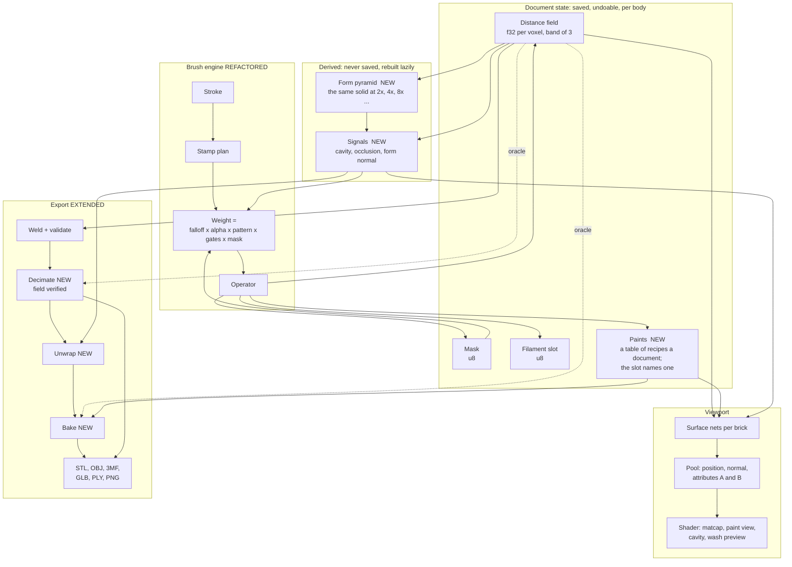

The crate boundary does not move. Everything above except `VIEW` lives in
`brokkr-core`, which stays free of UI, windowing and GPU dependencies.

---

## 5. Shared groundwork (milestone S0)

Three pieces that every later milestone stands on. None changes what the
application does; all are proven by equivalence or measurement before anything
is built on them.

### 5.1 `SparseField<T>`

`mask.rs` (2,075 lines) and `colour.rs` (985 lines) are the same sparse map
written twice by hand: absent means default, a `Uniform` tile costs no heap, a
dense brick is `32³ x size_of::<T>()`. The first draft of painting would have
made a third and a fourth copy. The recipe design of section 8.2 needs
neither, so this is not built until something needs a new field.

A generic `SparseField<T: Pod>` is written **for the new fields only**. The
existing two are left exactly as they are (D6); folding them in is a refactor
to offer upstream, not one to carry on a fork.

### 5.2 The form pyramid

**Built 2026-11-22, and not as first drawn.** This section originally
described a pyramid of *coverage*: one byte a cell holding the fraction of it
that is solid. That was worked through before any of it was written and
dropped, for a defect on the simplest input there is. On a flat face the solid
fraction is a ramp across one cell, and a trilinear read of that ramp at the
face is not one half: it swings 0.0625 either side as the face moves across
the lattice, which is 0.125 of occlusion against about 0.5 for a real crease.
A wash painted from it would have drawn the voxel grid on every incline.

What is built instead, in `pyramid.rs`: **each level is a complete distance
field of the same solid at twice the voxel size of the one below.** The
distance to a plane is linear and trilinear interpolation reproduces a linear
function exactly, so a flat face reads zero at every level whatever its phase.

The distance band is 3 voxels deep (`brick.rs:30`), so the field alone cannot
answer any question at a scale wider than that. The cavity mask already hits
this wall: it reads curvature from a 7 point Laplacian (`generate.rs:29`),
which sees crevices a voxel or two wide and nothing broader. Level `k` of the
pyramid has its own 3 voxel band, which reaches `3 * 2^k` voxels of the
original.

- **A level is made** by taking each coarse voxel as the tent weighted mean of
  the 27 fine voxels round it (centred, so every level shares the document's
  lattice origin; exact on a plane; a low pass, so a groove narrower than the
  level is bridged instead of aliased). `redistance` then rebuilds the band
  outward, and the voxels the mean got exactly right are put back afterwards.
- **Solid interior stays one value per brick** and empty space stays absent,
  as in the field.

Three things are read from it:

| Signal | Definition | Customer |
|---|---|---|
| Relief at level `k` | The level's distance at a point on the fine surface: negative in a recess the level bridges, positive on a protrusion, zero on a flat | Washes, zenithal, seam placement |
| Form normal at level `k` | The level's gradient | Volume tools (section 9) |
| Base surface at level `k` | The level's zero set | Detail gain (section 9) |

**Measured, release build, a shared four core container:**

| | |
|---|---|
| Relief on a flat face, worst over four tilts and five phases | 0.020 voxels of the level (the coverage design: 0.125 by construction) |
| A slot 4 voxels wide and 12 deep, read at its floor | 0.0, -0.6, -3.6, -9.6 mm at levels of 2, 4, 8 and 16 voxels |
| Memory, six levels | **36% of the field** (the estimate here was 8%, for bytes; these are `f32`) |
| Build, 1,154 brick ball | 1.7 s |

The memory figure is four times the estimate and is recorded in the module with
the two ways down from it: store a built level as one byte a voxel, or drop the
first level's storage once the second has been derived from it. Neither is
taken yet.

**Freshness.** The pyramid is derived, never saved and never in an undo entry.
It is rebuilt whole by whoever needs it (entering paint mode, pressing a form
brush, exporting), never in the per-frame path. Rebuilding only what an edit
touched is the obvious next step and is not built.

### 5.3 The fine cavity signal

**Built 2026-11-22**, in `signals.rs`. The Laplacian divided by the gradient
length, as `generate.rs` computes it, made available per mesh vertex.

The open question this section used to end on is settled, and by neither of
the two answers it offered. The signal is **computed at mesh time and cached
nowhere**, at the centre of each vertex's lattice cell: the mean of the
stencil over the cell's eight corners, which comes out as a compact form over
the 4x4x4 block round the cell. Nearly all of that block is in the apron the
mesher has already gathered. Where it overhangs, by one voxel on the cells
along a brick's faces, the missing samples are read from the volume. Both
bricks either side of a seam therefore evaluate one expression over the same
32 stored values, and a test holds them to the same byte.

It costs 32 reads a vertex, so it is **off unless asked for**:
`Document::mesh_dirty_with_cavity` sits beside `mesh_dirty` and a mesh made
without it carries an empty run that every reader takes as flat.

One byte, 128 for flat, on a square root curve so that the nearly flat part of
the range, which is most of a real surface, gets most of the levels.

Brushes will evaluate the same measurement per voxel from the stamp snapshot,
which is already grown by one voxel for this purpose (`region.rs:12`). That
arrives with the first brush that gates on it.

### 5.4 The first visible payoff: crease shading

**Built 2026-11-22.** A view toggle, *show creases*, that darkens creases and
lifts edges, the way ZBrush's cavity matcaps and Blender's viewport cavity do.
It is a view, like the mask tint: it changes nothing a stroke does, no voxel,
no undo entry, and it does not dirty the document.

- The cavity byte travels in byte 2 of the per-vertex attribute, which was
  free. Byte 3 is still free, and is where the broad relief from the pyramid
  goes when paint mode needs it.
- The setting is a feature size in millimetres (1.0, the finest thing a
  filament printer resolves), so it means the same thing at every voxel size.
- Switching it on or off remeshes every body, because the signal is in the
  mesh. That is the one way it differs from the mask and paint toggles, which
  are a uniform write.
- An offscreen pixel test holds it: creases darker, edges lighter, flats
  unchanged, strength zero byte for byte the picture without it. Six shader
  mutations were run against that test; two survived its first version (the
  sign of the curvature backwards, and the strength ignored) and the test was
  strengthened until both were caught.

### 5.5 The brush seam

The engine of section 6, landed with **no new behaviour**: the six stamping
kinds implemented a second time in `brush/engine.rs` and pinned bit for bit
against the untouched original, in the idiom `Skipping::On` against
`Skipping::Off` already uses (`brush.rs:1221-1225`). A ratio benchmark,
`benches/engine.rs`, is the second gate: the engine may not be slower than the
brush it stands beside.

**Amended 2026-11-22, when this was built.** The first draft of this section
said the existing kinds would be *routed through* the new pipeline. They are
not, and that is deliberate. `brush.rs` is left exactly as upstream wrote it,
apart from one line declaring the child module, and the old stamp path is the
**live oracle** the new one is compared against. Two things follow. Upstream
changes to `brush.rs` merge without conflict (D6). And when upstream changes
what a brush does, the equivalence test fails and names the brush, which is the
moment to bring the engine back into step on purpose. The application keeps
calling `Brush` for the classic brushes; new operators, gates and tips exist
only in the engine. Move and Paint have no engine form: Move is a gesture, and
Paint writes another channel that arrives with S2.

---

## 6. The brush engine (S0 seam, S3 surface)

### 6.1 The shape

Today a brush is an enum variant. In ZBrush a brush is a *composition*, and the
composition is the flexibility. The same split, in this engine's terms:

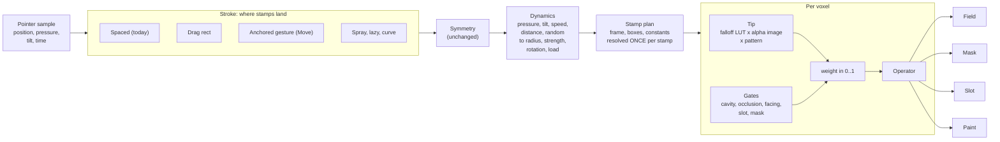

```rust
/// A brush as data. Serialisable, user-saveable, composed of orthogonal parts.
pub struct BrushDef {
    pub stroke: StrokeMode,   // how stamps are placed along the gesture
    pub tip: Tip,             // falloff curve, optional alpha image, pattern
    pub op: Operator,         // what one weighted voxel does, and to which channel
    pub dynamics: Dynamics,   // input to parameter curves, resolved per stamp
    pub gates: Gates,         // geometry and channel conditions on the weight
    pub scale: FormScale,     // Detail, or Form { sigma_mm }: see section 9
}
```

The existing `Brush` struct stays as it is and converts into a `BrushDef`. The
application, the benchmarks and every test in the 5,568 line `brush.rs` keep
calling what they call today.

### 6.2 The rules new operators must obey

These are `brush.rs`'s own, restated because every new operator is a chance to
break them:

1. **The weight stays in 0..=1** (`pattern.rs:12`). Gates and alphas multiply; nothing adds.
2. **A field operator either blends toward a legal distance or warps where the
   field is read from.** Nothing multiplies a difference from a local average
   inside a stamp loop.
3. **One stamp moves the surface at most one voxel** (`brush.rs:89`).
4. **Read reach is declared**, because a read outside the snapshot clamps
   silently instead of failing (`brush.rs:44-55`).
5. **Dispatch happens once per stamp, not per voxel.** The operator is a
   generic parameter of the inner loop, so the loop monomorphises exactly as
   the match arms do now.

### 6.3 What gets added, in order of value

| Part | Addition | Notes |
|---|---|---|
| Gates | Cavity range, occlusion range, facing, slot filter | Built in S0 with the signals; the paint brushes of S2 are the first customers |
| Operator | Paint operators (section 8) | S2 |
| Operator | Crease (pinch plus inverted draw in one warp) | **Built** (S3.1). Scrape and Fill were listed here too and are not needed: upstream's Clay blends toward a plane held just off the surface and keeps only the half that adds, and inverted it is a plane just under the surface keeping only the half that removes. That is a fill and a scrape already |
| Tip | Alpha image: a greyscale stamp, bilinear sampled in the stamp frame | The image type and its reading are **built** (S3.2), decoded in `brokkr-app` and handed to core as heights. As a tip on ordinary strokes it is not wired yet |
| Stroke | Drag rect: one stamp placed at the press, sized and turned by the drag | **Built** (S3.2), as a gesture |
| Operator | Displace: draw whose depth is the alpha's value | **Built** (S3.2), inside the gesture and not as a kernel: a kernel is held to one voxel a stamp |
| Dynamics | Curves from pressure, tilt, speed and stroke distance to radius, strength, rotation | Pressure to radius **built** (S3.1), as one share. Pressure to strength and tilt to lean were upstream's already. The rest follows the alpha, which is what rotation is for |
| Stroke | Lazy (stabilised), spray (jittered), curve (along a drawn spline) | Lazy **built** (S3.1). A row of stamps along the stroke **built** (S3.4) |
| Operator | Gesture warps on the `MoveStroke` machinery: twist, elastic grab (regularised Kelvinlets) | Volume preserving by construction |
| Operator | Layer: draw capped at a fixed height above the stroke's starting surface | Needs a stroke long locked region; memory to be measured first |
| Presets | One flat `key = value` file per brush under the config directory | **Built** (S3.3), as one file with a line a brush. The format `palette.rs` and `printer.rs` already use |

The digit keys keep meaning the classic brushes in the order they have always
had (`brush.rs:344`, "Appended and never reordered").

#### Built, 2026-11-23 (S3.4): the stamp, along the stroke

With the stamp up, *Along the stroke* turns one stamp sized by the drag
into a row of them at the brush's size: rivets down a seam, stitches,
scales, the links of a chain. A slider sets how far apart, from half a
stamp's width (overlapping, a rope) to four.

This is the "alpha as a tip on ordinary strokes" of the table above, done
the other way round. An image multiplied into a brush that stamps every
quarter radius is a smear of that image. What a row of rivets wants is the
image whole, at intervals, facing the way the row runs, and the stamp
gesture already presses an image whole. So a row is that gesture, begun
and ended once for each stamp, and the core did not change.

- **A stamp is laid a step behind the pointer**, because until the pointer
  has gone a step on there is no telling which way the stamp should face.
  The first is at the press, and a press with no drag lays nothing.
- **Where a step ends is looked for on the screen and not in space.** The
  straight line from one stamp toward the pointer cuts under a curved
  surface: by 3 mm for a 12 mm step on the starting ball. The first
  version stepped along that line and dropped the point back onto the
  surface down the field's gradient, and a test of a long step found that
  it cannot: three voxels under the surface the field is flat and has no
  gradient to follow. What is always on the surface is whatever is under a
  pixel. So the next stamp's place is the point under the line the pointer
  drew, from the last stamp's pixel to where the pointer is now, that is
  one step from the last stamp, found by halving. On the test's ball the
  second stamp of a 12 mm step lands 12.15 mm round it where 12.08 is
  exact, and is as tall as the first.
- **A row is a stroke**: it can be led by the lazy brush, it mirrors, it
  engraves when inverted, and it is one undo.
- A preset holds the spacing (`along:1.5`), and *Rivet row* is one of the
  starting five.

Tested by cutting a profile through the model along the drag and counting
the bumps: as many as the drag is steps long, a step apart, the brush's
size, and for a bar (which is longer one way than the other) the same
length along a row dragged up the view as along one dragged across it.

#### Built, 2026-11-23 (S3.3): presets

`brokkr-app/src/app/presets.rs`, and a PRESETS block above the STUDIO one:
a button for each brush kept, a small one beside it that forgets it, and a
box to name the brush in hand and keep it.

A brush here is a dozen settings in two places: the classic brush's (which
brush, how big, how hard, which falloff) and the studio block's (an
operator or the stamp, the lazy stroke, size from pressure). A preset is
all of them at once. A machine with no file starts with five, which are
there to show what the studio block is for: *Fine crease*, *Long line*,
*Rivets*, *Rivet row* and *Clay build*.

**The file** is `brushes.conf` in the config directory:

```text
Fine crease = brush:Draw, size:1.5, strength:0.3, falloff:Smooth, studio:Crease, lazy:12
Rivets = brush:Draw, size:3, strength:0.15, falloff:Smooth, stamp:Rivet, height:0.35
```

Those are two of the starting five as the application writes them. A line
written by hand may leave out whatever it does not care about.

One file with a line a brush, where the table above said a file a brush:
a line is a brush already, and one file is one thing to copy to another
machine. It is the user's to edit, so it is read forgivingly. A setting
that makes no sense is left at its default and the rest of the line kept,
a number out of range is brought into it, and a name is made one the file
can hold (no `=`, no `#`, no line ends) by dropping what it cannot.

**Taking a preset goes through the doors the panel's own controls use**,
and the one that mattered is strength. Each brush remembers its own, and
with the mask tool up the strength in hand is the mask's. A preset taken
then puts its strength in the brush's own slot, where it waits until the
mask is put down, and a preset kept then keeps the brush's and not the
mask's.

**What a preset does not hold:** a stamp picture read from a file (the
preset says "the stamp, with the picture in hand"), a surface pattern, and
the paint brush's touch, which belongs to the paint rack.

#### Built, 2026-11-23 (S3.2): the stamp

`brokkr-core/src/brush/alpha.rs` and `brush/stamp.rs`. A *Stamp* button in
the STUDIO block. With it up, a drag on the model presses one image into the
surface: press where it goes, drag to size it and to turn it, let go. The
top of the image points along the drag. Inverted, it engraves. Six images
come with it (dome, rivet, bolt, scale, star, bar) and any PNG or JPEG can
be one, its brightness read as height, sixteen bits of it where the file has
them.

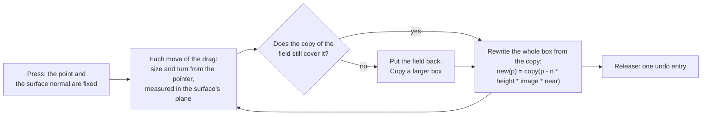

**It is a gesture and not a stroke**, on the terms upstream's Move sets out.
A stroke's stamps each move the surface by no more than a voxel because they
overlap and compound. A rivet is one image as tall as it is, so every event
of the drag is worked out from the surface as it was at the press, and a
stamp dragged out and back in is the stamp it ended as, to the bit.

**Only the near side moves.** The plain warp shifts the whole column under a
texel, all the way through the model: a rivet on a breastplate would dent
the inside by as much as it raised the outside. So the shift is whole down
to a band under the surface, where it is exact, and then fades to nothing
over twice the stamp's height. A plate's far side is untouched to the bit
when the plate is thicker than that. Thinner, it is not, and cannot be: the
material has to come from somewhere.

**Mirrors** each have their own copy, and where two overlap across the plane
both take the higher stamp at every voxel, so the order they are written in
does not show. A mirror image's `right` is reflected and not recomputed,
because a cross product turns a left hand back into a right and would press
the image the wrong way round on the far side.

**Limits.** A stamp's box is at most 320 voxels a side, which at a quarter
millimetre is a stamp about 25 mm across; larger is refused and the field
put back. The side of a stamp is steeper than the field's gradient is
supposed to be, as after a Move, until the field is redistanced. And the
image is not yet a tip for ordinary strokes: a textured brush is the same
image as one more factor on the weight, and is the next thing here.

#### Built, 2026-11-22 (S3.1): the engine, where a user can reach it

Under the classic brush's own controls, a STUDIO block:

- **Crease.** A groove cut and pinched in one stamp, or inverted a pinched
  ridge. Its kernel is Pinch's warp and Draw's shift, the other way round,
  in one read of the field: 60% of Draw's depth, so a groove is cut over a
  few stamps and can be stopped part way. It has no upstream brush to be held
  to, so it is held to a slow reference written from its definition, a hash
  lookup a sample with no snapshot and no plan, and to the kernel rules: one
  stamp moves the field no more than a voxel, nothing outside the brush
  moves by a bit, nothing under full protection moves.
- **Lazy.** The brush trails the pointer on a lead of up to 80 pixels. Inside
  the lead nothing moves; past it the brush is pulled straight toward the
  pointer and stops a lead short. For panel lines, seams and lettering, and
  it leads the paint brush and the Fill as well as the sculpt brushes.
- **Size from pressure.** One share from 0 to 1: at 1 a pen at half pressure
  is half the brush. A mouse reports full pressure and is not affected.

**A studio operator borrows a classic brush's settings.** Upstream's brushes
are an enum with a digit key each, a remembered strength each and a button
each. An operator added to that enum is a change to upstream's hottest file
and to every `match` on it. So Crease is chosen BESIDE the classic brush: the
radius, strength, falloff and pattern are still the classic brush's, and the
operator replaces only what one weighted voxel does. Choosing any classic
brush puts it away, and shift still smooths. The panel's heading says
CREASE; the tool strip still lights the classic brush, which is the honest
picture of whose settings are in use and is also the part most likely to
want revisiting.

Upstream's files took one field, one message arm, one line in the brush
chooser, and four changed lines in the two strokes.

**Drift.** More operators means more gradient drift. `redistance` is band
restricted and gates on measured drift (`redistance.rs:137`), so S3 measures
running it at stroke end on the touched bricks only, and adopts it if the
budget allows.

---

## 7. Print pipeline (milestone S1)

Two independent features that cross no line in the build spec and could go
upstream as they are.

### 7.1 Decimated export

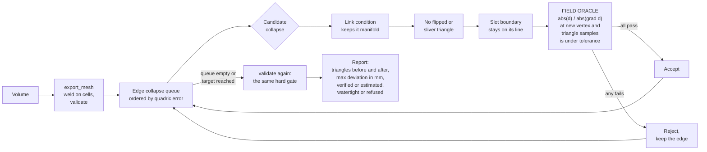

**The control is a tolerance in millimetres, not a percentage.** "No point of
this file is more than 0.02 mm from what you sculpted" is a statement about a
print; "keep 6%" is not. Presets are named for the process: resin, 0.4 mm
nozzle, draft. A target triangle count is the secondary control, for people
exporting to a renderer.

**Why the field makes this better than a mesh tool can do it.** A mesh
decimator has to estimate deviation by accumulating quadrics, because its only
reference is the mesh it is destroying. This engine can simply *ask*: the
distance from a proposed vertex to the true surface is one trilinear sample.
Quadrics order the queue; the field accepts or rejects. Dividing by the
gradient length corrects for brush drift in the same way `generate.rs` already
does.

**The honest limit:** the oracle is only valid inside the band, so a verified
tolerance cannot exceed about 2 voxels. Looser than that, the decimator falls
back to accumulated quadric error and **the report says "estimated" instead of
"verified"**.

**What "feature preserving" means here, concretely:**

- Sharp edges survive because a quadric built from two differently oriented
  plane sets is steep across the edge and flat along it. That is the algorithm,
  not an add-on.
- Flat regions collapse to almost nothing. A cut face goes from one vertex per
  voxel to a handful of triangles.
- **Filament slot boundaries do not move.** A painted boundary is already cut
  exactly by `split_paint_boundaries` (`mesh.rs:255`). Its edges get boundary
  quadrics and its vertices may only collapse along it. A slot is an index:
  a boundary that drifts prints in the wrong filament.
- No collapse may create a degenerate or flipped triangle. The build spec names
  this failure from SindriCAD's history (`BUILD-SPEC.md:177`) and the
  post-decimation `validate` is the gate that proves it did not recur.

**Build or depend.** In house, in `brokkr-core/src/export/decimate.rs`,
**estimated at 800 to 1,200 lines with tests.** The algorithm is thirty years
old and well documented; the two things that make this version worth having
(the field oracle and the slot constraint) are not available in any library's
API. Candidates that exist and are **unverified by this plan**:
`meshopt` (C++ bindings), `meshopt-pure` and `baby_shark` (pure Rust). The
first day of the milestone evaluates one of them as a **dev-dependency used
only as a differential test oracle**, which costs the shipped binary nothing.

**Cost, estimate:** tens of seconds single threaded at eleven million
triangles. It runs in an iced `Task` with progress and cancel, never on the
drawing thread. If measurement says it must be faster, bricks give a natural
parallel pre-pass: decimate each brick's interior with its seam vertices
locked, then run one global pass over what is left.


#### Built, 2026-11-22, and what building it found

`brokkr-core/src/export/decimate.rs`, and a *Detail* choice in the export
panel: **Full** (every triangle, the default, and byte for byte what an export
was), **Fine** (0.01 mm), **Standard** (0.03 mm), **Draft** (0.1 mm).

**Measured**, release build, one thread, a 60 mm ball:

| voxel | full mesh | at 0.01 mm | at 0.03 mm | at 0.1 mm | time |
|---|---|---|---|---|---|
| 0.5 | 135,324 | 24,464 | 8,146 | 2,466 | about 2 s |
| 0.25 | 542,556 | 24,830 | 8,520 | 2,658 | about 7 s |
| 0.125 | 2,170,860 | 26,632 | 9,294 | 2,788 | 30 s |

The result barely depends on the voxel size, which is the claim that the
tolerance belongs to the shape and the print. A cube of 18,252 triangles comes
back as the 12 triangles of a cube, with every corner nearer its true place
than the full mesh has it.

Five things in the design above turned out wrong or incomplete, each found by a
test and each recorded in the module:

1. **The field can judge one direction only.** "The new surface is near the
   sculpt" does not imply "the sculpt is near the new surface", and the
   difference is a corner: the first version took a cube to 12 triangles with
   one corner 0.84 of a voxel out and every check passing. Each collapse is now
   held the other way too, through four witness points per vertex.
2. **The mesher and the field disagree about where the surface is**, by up to
   a third of a voxel (surface nets averages; the field interpolates). Every
   vertex is stood on the field before anything is collapsed, or a tight
   tolerance could collapse nothing.
3. **A triangle has to be sampled densely.** Its middle and the middles of its
   edges are enough when it is a voxel across and not when it is twenty. An
   independent reading found results 16% past the tolerance until triangles
   were sampled every half voxel.
4. **The distance correction for brush drift may only go one way.** Dividing by
   a slope above one flatters the result; two estimates of such a slope
   disagreed by 60% at a kink.
5. **It is not fast.** About 14 microseconds a triangle of input, almost all
   of it item 3: the eleven million triangle case would take two and a half
   minutes. The estimate above said tens of seconds. Parallelising over bricks
   is the next thing to do to it.

Taking the witness check OUT again was also tried, when a cube and two balls
said it had stopped mattering. A cone said otherwise: without it a sharp tip
lost up to 156% of the tolerance.

Every check in the decimator has a test that fails without it: fifteen
mutations were run against the suite, and the suite was extended until all
fifteen were caught. Halving the witnesses to save memory let three of those
checks be deleted unnoticed, which is how the tests' slack came down from a
twentieth to a fiftieth.

**Still to do here:** the export runs on the update thread, as every export
already did, so a large decimation freezes the window for its length. Moving
exports to a task is its own piece of work and is the first thing owed.

### 7.2 Parting with keys

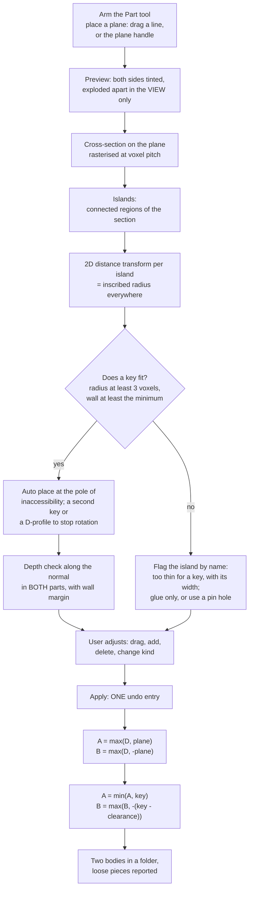

**The split.** Both halves, from one plane: `A = max(D, plane)` and
`B = max(D, -plane)`. Exact, closed, and flat faced as a property of the
arithmetic, which is `clip.rs`'s whole argument.

**The keys.** A key is a closed form solid: a tapered cylinder, a D-cut or hex
profile for anti-rotation, a magnet pocket, a pin hole. Closed form distance
functions are 1-Lipschitz, so the brick classification `primitive.rs:14-29`
uses carries over, and no interior brick is promoted dense.

- The peg is a union: `A = min(A, key)`.
- The socket is a subtraction of the **offset** key:
  `B = max(B, -(key - clearance))`. Subtracting a constant from a true distance
  function *is* the exact offset solid, so the clearance is correct everywhere
  including round the chamfer, with no second modelling step.
- Magnet pockets and pin holes subtract from both.

| Key kind | Parts | For |
|---|---|---|
| Peg and socket | Male on A, female on B | The default. Tapered so it prints without support and self-centres |
| D-profile or hex peg | Same | A single key on an island too small for two |
| Pin hole | Hole in both | Pinning with rod or a filament offcut, the miniature painter's habit |
| Magnet pocket | Pocket in both | Swappable parts. Sized by magnet diameter and height |

**Clearance** is per side, in millimetres, and belongs to the printer rather
than the model, so it is stored the way `palette.rs` stores filaments.
Defaults (estimates from common practice, to be tuned): 0.2 mm for filament,
0.08 mm for resin. A later increment generates a **tolerance coupon**: one
printable strip of pegs and sockets at five clearances, so the user measures
their own printer instead of trusting a default.

**What the lattice can and cannot hold.** A surface position is sub-voxel, so
a clearance of 0.4 voxels on a flat or gently curved face is represented
accurately. A sharp edge is not: it rounds at about a voxel. Keys are therefore
chamfered by design, and the tool **refuses a key narrower than 3 voxels**
(the same floor `README.md:365` gives brushes) and names the voxel size that
would allow it.

**New core surface.** One generalisation: `clip` currently takes planes. It
gains a `Cutter` trait (a distance function plus a Lipschitz bound), so a
plane, a convex set of planes and an oriented key are the same classified
`max`. Union with a closed form solid is the mirror image. Both mark dirty by
voxel range grown by one, which is the trap `merge.rs:32-39` documents.

**Memory.** Two outputs while history holds the original is a 2x peak, as for
every split (`split.rs:97`, "The uncomfortable thing"). The existing guard
predicts it and refuses by name.

**The exploded preview is a view, not a transform.** `body.rs` is emphatic
that a body has no transform and that adding one gives away the lattice
property. The preview is a per-body offset uniform in the renderer, in the same
category as the mask tint.

#### Built, 2026-11-22

`brokkr-core/src/part.rs`, and one gesture: **the cut tool with alt held**.
The same straight drag as a cut, read at the release like ctrl and shift.
Instead of a side going, the active body becomes two bodies named A and B,
with pegs on the first and sockets in the second. The tool card reads
*PART, KEEP BOTH* while alt is down. One undo puts the body back.

What the engine does, each with a test:

- **Both halves**, closed and printable, whose volumes add up to the body's
  less the clearance round each socket.
- **The clearance is the clearance.** Measured as the gap between a peg's
  side and its socket's wall: within 0.3 of a voxel of what was asked.
- **Islands.** A plane through two separate masses finds two cut faces and
  keys each.
- **A second key** on any island with room for one well clear of the first,
  the same size as the first, to stop the parts turning.
- **A key is checked against the solid it lives in**, on its axis and round
  the rim of its socket's wall: shortened where the second part is thin, left
  out and the island named where it is too thin or too narrow.
- **Three kinds**: peg and socket, pin hole, magnet pocket.
- **The lattice floor**: a key narrower than 3 voxels is refused.

Thirteen mutations were run against its tests. Five survived the first pass
and each was answered with a test; one of those tests found a real fault. A
body parted under Mask All came back as **two whole copies of itself**,
because the call that was meant to take the mask off a half leaves an empty
mask *of the same polarity*, and an empty inverted mask protects everything.
No test had a masked fixture until a mutation that deleted the unmasking
turned out to change nothing.

**Owed, in the order it is worth doing:**

1. ~~Settings in the panel.~~ **Done.** Kind, radius, depth and clearance
   are in the EXPORT section, under *Parting keys*, and a test holds that
   they reach what gets cut.
2. **A preview before the release**: the cut faces, the keys, and what could
   not be keyed, drawn while the line is being dragged. Today the status line
   says it afterwards and undo is the way back.
3. **The exploded view**, as a view-only offset.
4. **The tolerance coupon.**

**Deferred:** freeform parting surfaces (through `split_masked`, which needs a
crisp boundary rather than a feathered one), dovetails, a "fit to bed"
assistant that proposes a grid of planes from the printer's bed
(`slicer.rs:329`), embossed part marks, and hollowing with drain holes.

---

## 8. Mini painting (milestone S2)

### 8.1 What a miniature painter actually does

The mode is modelled on the bench, not on Photoshop, because the bench
techniques are what was asked for and they are all *geometry driven*:

| Step at the bench | What the paint physically does | The signal that reproduces it |
|---|---|---|
| Prime, often zenithal (dark from below, light from above) | Spray lands where the nozzle can see | Normal against a direction, times directional occlusion |
| Basecoat | Opaque colour, area by area | Plain brush; later, a fill that stops at creases |
| Wash or shade | Thin pigment runs off high points and pools in recesses | Cavity and occlusion |
| Contrast or speed paint | The same, with enough pigment to tint the flats too | The same, with a stain term |
| Drybrush | A nearly dry brush catches only raised edges, in streaks along the stroke | Convexity, facing against the stroke, streak noise, a load that runs out |
| Sponge or stipple | Random speckle, heavier on exposed edges | Per-stamp cellular noise, optional convexity bias |
| Edge highlight | A fine light line on sharp edges | Strong fine convexity |
| Detail | Small opaque marks | Plain brush at small radius, stabilised |

"Slapchop" (prime black, drybrush grey then white, contrast paint over the
top) becomes three clicks and a few strokes, which is the point of the mode.

### 8.2 Storage: a paint is a recipe, and a voxel names one

**This section was first written as a second field of four bytes a voxel:**
red, green, blue and a finish, deposited by brushes. It was redrawn on
2026-11-22, before any of it was built, once the engine had been read with
that field in mind. Three things were against it.

- **The slot field is woven through everything.** Rotating, shifting,
  resampling, warping, merging, splitting, the Move brush, undo and the
  project file each carry it, and each has a test that fails without it:
  about 350 mentions across 17 files (counted with `grep` over
  `crates/brokkr-core/src`). A second field is that sweep again, in
  upstream's hottest files, on a fork that has to keep merging them. It is
  the opposite of D6.
- **It doubles the memory of a painted model.** +100% of the field
  (`colour.rs:8`), against the +25% a slot costs, which `colour.rs` gives as
  the reason a slot is an index in the first place.
- **A wash painted into colour is dead the moment it lands.** It is right for
  the surface as it was. Sculpt a fold deeper afterwards and the shadow stays
  where the old fold used to be.

What was built instead is in `brokkr-core/src/paint.rs`:

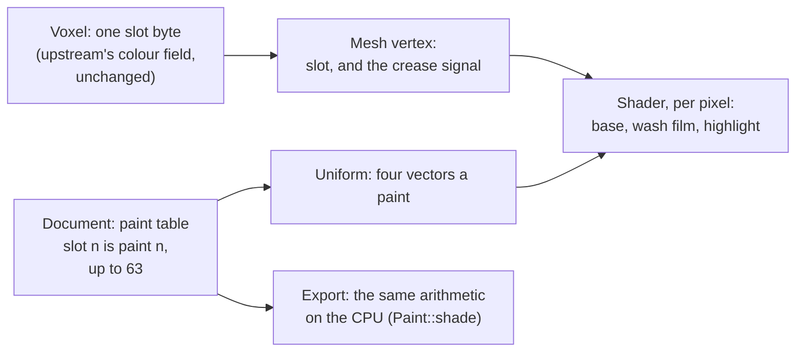

A **paint** is a base coat, a wash and a highlight:

| Part | What it holds | What it does |
|---|---|---|
| Base | sRGB colour, finish | The colour of the paint |
| Wash | pigment colour; `stain`, `flow`, `edge` | A film of thickness `T = stain + flow * recess - edge * edge_amount`, never below 0, that passes `pigment^T` of the light |
| Highlight | colour; `amount`, `start` | Mixed in on edges sharper than `start`, up to `amount` at a full edge |

`recess` and `edge_amount` are the two halves of the crease signal of section
5.3, scaled by the view's gain so that "a full crease" is a size in
millimetres whatever the voxel size.

**The wash is Beer-Lambert, and that one line is the whole "abuse of ambient
occlusion".** Where the film is thin (an edge, `T` near 0) the base shows
through nearly untouched: that is the highlight a contrast paint leaves by
itself. On a flat it passes about `pigment^stain`: the tint. In a crease (`T`
of 2 or 3) it passes `pigment^3`: darker *and more saturated*, which is how a
contrast paint behaves and what a multiply by a grey ramp gets wrong. A shade
wash and a contrast paint are the same recipe at two settings of `stain`.

**What this buys, beyond not doing the sweep:**

- **Nothing new per voxel.** A painted model costs what a filament-painted one
  costs today, and every transform, the undo and the project file already
  carry the byte without knowing what it now means.
- **Non-destructive, everywhere at once.** Changing a wash's colour or how far
  it flows recolours every voxel wearing that paint in the same frame, and
  touches no voxel. There is no "apply", so there is no preview that can
  disagree with the result.
- **Washes follow the sculpt.** The film is worked out from the surface each
  time the surface is drawn. A fold cut after painting gets its shadow.
- **The print bridge is short.** A paint can name the filament it prints in,
  and then the slot field already IS the multi-colour print instruction the
  3MF writer consumes.

**What it costs, and it is real:**

- **No blends.** A voxel is one paint or another, so the boundary between two
  paints is an edge and never a gradient. Speckle, stipple and a drybrush's
  broken edge are all things an index holds well. A soft airbrushed fade from
  one colour to another is not something it can hold at all. Section 8.6 has
  the way out if that turns out to matter.
- **63 paints a document**, because the shader is handed the whole table: four
  vectors a paint, 4 KiB of uniform.

**Saved** as an optional tagged trailer after the timeline keys: the eight
bytes `BRKPAINT`, a length, the table. Written only when the document has
paints, so a file without them is byte for byte what upstream writes and
`CONTAINER_VERSION` did not move. (Bumping it to 4 with a mandatory trailer
was tried first and broke 28 of upstream's project tests, which pin the
bytes.) The reader is forgiving in one direction only: a damaged paint table
gives back the sculpt with no paints, and never refuses the file. It has a
mutation fuzz with a control.

### 8.3 The techniques, as recipes and as gated strokes

Each row of the table in 8.1 lands in one of two places. If the technique is
"everywhere the geometry says", it is a term of the recipe and costs no
stroke. If it is "where I put the brush, and only on what the geometry says",
it is the paint brush with a gate from the brush engine (D4), writing a paint
number.

| Technique | Where it lives | State |
|---|---|---|
| Basecoat, detail | The paint brush, writing a slot | Built (upstream's brush, the rack on top) |
| Wash, shade | Recipe: the wash | **Built** |
| Contrast or speed paint | Recipe: the wash with a stain, over a pale base | **Built**, one click |
| Edge highlight, overall drybrush | Recipe: the highlight | **Built** |
| Drybrush as a stroke | Gated brush: writes the paint in hand only on what stands up, more on the side the brush comes at, in bristle streaks, until it runs out | **Built** (S2.2) |
| Sponge or stipple | Gated brush: a speckle covering a set share of the surface, optionally more on edges. With the eraser it chips paint off | **Built** (S2.2) |
| Zenithal prime | Recipe term: lighten by normal against a direction, times broad occlusion | After S4, which makes the pyramid incremental |
| Fill: by area, bounded by the model's creases and edges; the whole body | A flood on the surface shell, and one pass over the body | **Built** (S2.4) |

"Slapchop" is then a paint: pale base, contrast wash, a near-white highlight
with a low `start`. One click on *Contrast* and one slider.

**One stroke is one coat**, which the first draft needed a coverage buffer to
guarantee, is free for a loaded brush: writing a slot twice is writing it
once. For a gated brush it is a rule the gate has to keep. A voxel under a
stroke is under eight or so overlapping stamps, and if each rolled its own
dice a sponge set to cover a tenth of the surface would cover more than half.
So nothing in a gate is random per stamp: whether a voxel is caught is a
function of where it is, of the shape there, and of a seed fixed from the
press to the release. Two stamps over one voxel agree. A second stroke has a
second seed and adds to the first, as a second pass with a real sponge does.

### 8.4 The two copies of the arithmetic

`Paint::shade` on the CPU and `sculpt.wgsl` on the GPU compute the same
colour. One formula in two languages is a known hazard, and the repository's
remedy is used: `the_shader_shades_a_paint_the_way_the_engine_does` pins the
shader's lines and evaluates a Rust transcription of them against
`Paint::shade` over a table of paints and creases, in the manner of
`the_base_luma_the_shader_divides_by_is_the_clays`. An export bakes with the
CPU copy, so what is exported is what was on screen.

### 8.5 The paint view

- **Lit:** the paint's colour times the matcap's lighting term. This is the
  filament path that already existed, reading a recipe where there is one and
  the palette where there is not.
- **Flat** (built): the paint's colour alone, because a wash is shading and
  a painter has to be able to see it without the viewport's own light on
  top. A plain paint drawn flat is one colour over the whole body, to the
  byte.
- **Finish** (later): gloss and metallic read a second matcap. The finish is
  saved with a paint today so that paints mixed now keep it.
- **Thumbnails** draw a painted body with its washes, at the viewport's gain.

**The rack.** With the Paint brush chosen, the panel offers the filament
slots and a *Mix paints* button. Mixing makes one plain paint per filament
slot, in the filament's colour, so nothing already painted changes colour;
from then on the panel shows the rack and an editor for the paint in hand:
name, then one coat at a time (base, wash, highlight), each with a range of
24 starting colours, three channel sliders and its own amounts. The wash has
three ready-made kinds: None, Shade (the base's own hue, darker, in the
recesses) and Contrast (the colour moves into the wash over a pale
undercoat).

### 8.6 The honest limits

- **No blends**, as 8.2 says. The named way out is a second, optional field
  of blend weights between a voxel's paint and one neighbour paint, which is
  one more byte and not three, and is not built until a painter asks for it.
- **Paint resolution is the voxel size.** A 32 mm figure at 0.1 mm is 320
  paint cells tall. The boundary between two paints is cut at half-triangle
  precision by the mesher (`mesh.rs`), which is finer than the cells, and a
  wash is shaded per pixel from an interpolated signal, which is finer again.
- **Fill needs a line it can see, and so does the eye.** Seen on a screen on
  2026-11-23 (section 13): on rivets 3 mm in radius at a quarter millimetre
  a fill stops at each rivet's bevel and leaves it as a ring. On rivets
  1 mm in radius, which stand 1.4 voxels tall, the bevel is hardly a line
  at all and some fills come out with ragged, spilling edges. And the edge
  of any paint is stepped at the size of a voxel, which at a close zoom is
  several pixels. Detail at the limit of resolution is fragile under paint
  as under everything else; the cure is the same, a finer voxel.
- **The wash sees fine creases only.** It reads the fine cavity signal of
  section 5.3, a few voxels wide. The broad occlusion that darkens the inside
  of a cloak comes from the pyramid, through the one free attribute byte.
  That waits for S4, because the pyramid is rebuilt whole today and a wash
  that lagged a second behind every stroke would be worse than none.
- **No pigment flow simulation.** The wash is a transfer function of
  geometry, not a fluid. Gravity pooling is a possible extra term, not a
  solver.
- **Editing a paint is not in the undo history yet**, and a paint cannot be
  removed. Both are recorded in `brokkr-app/src/app/paints.rs` with the
  reason.

#### Built, 2026-11-22 (S2.4): fill, coat, and the flat view

`brokkr-core/src/paint/fill.rs`. A fourth touch beside Loaded, Drybrush and
Sponge: **Fill** pours the paint in hand where the pointer is, and it runs
until one of the model's own lines stops it. Two checkboxes say which lines
count, creases and edges, and a slider says how sharp a line has to be.

- Click a panel and the panel is painted, up to the middle of the lines
  round it.
- Click IN a groove and the fill runs along the groove and stays in it. That
  is panel lining, which at the bench is a fine brush and a steady hand.
- A fill replaces the paint it starts on and spreads only through that
  paint, and the mask stops it, as for every paint stamp.
- *Coat the body* paints all of the active body in one pass, for a model
  with no lines to stop at. *Flat colour* draws paint with no light on it,
  so a wash can be judged without the viewport's shading on top.

**Three versions, and what each one got wrong.** This was expected to be a
flood fill with a threshold, and it was the hardest thing in the milestone.

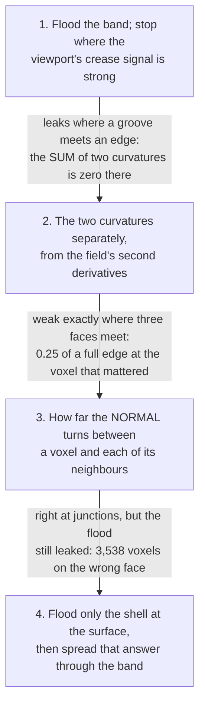

The last leak was not about the signal at all. Paint is in the whole band,
and inside a sharp convex edge NO voxel's nearest surface point is the edge:
those on one side of the diagonal are nearest one face and those on the
other the other. A flood through the band stepped from the first to the
second without ever meeting the line. So the flood runs in the shell, the
voxels within one of the surface, where a line is a row of voxels it has to
cross. Every other voxel of the band then takes the answer of the shell
voxel it leads down to.

Two smaller things the tests found: a field cut by a plane is flat along the
diagonal inside a concave corner, so "the face neighbour nearer the surface"
does not exist there and 242 voxels were left bare until all 26 neighbours
were asked; and along a straight edge three neighbours in a row are equally
near, and taking the first made a voxel beside the mask follow a masked one.

**Cost, measured** (release, one core): 66 ms to fill a ball of 43,290
voxels, about a microsecond and a half a voxel painted. One click is capped
at 150,000 voxels of surface, which is about a second and a half at worst.

**Limit.** A fill is only as good as the lines. A groove that fades out, or
a gap of a voxel in one, lets it through, and the answer is the sharpness
slider, the mask, or a brush. *Show creases* shows the lines it will read.

#### Built, 2026-11-22 (S2.3): a painted model in a file

A paint is worked out on screen and stored nowhere, and a file has to hold
something. There are two things it can hold, for two kinds of machine, and
`brokkr-core/src/paint/bake.rs` makes both for one export and throws them
away. Neither changes the document.

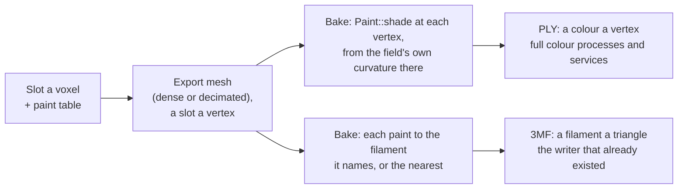

- **PLY, in colour** (`export/ply.rs`, the fourth export button). Binary,
  little endian, in the layout MeshLab writes. Each vertex is the engine's
  own `Paint::shade` of the curvature at that vertex, at the viewport's
  gain, so a wash pools in the file where it pooled on screen. A body
  painted by filament slot with no paints mixed is exported in its
  filaments' colours. Unpainted surface is a clay grey.
- **3MF, by filament.** A paint number is not a filament number, and with
  paints in use the 3MF writer was being handed paint numbers. Each paint
  now names the filament it prints in (*Prints in*, on the base coat), or
  names none and takes the loaded filament nearest its colour on a flat.
  Paints mixed from the filament slots name the slot they came from, so a
  model painted by slot prints exactly as it did. A document with no paints
  is not touched by any of this and writes the file it always wrote.

The paint table's format went to version 2 for the filament byte. Version 1
is still read.

**Limits.** A colour belongs to a vertex and is blended across a triangle,
so the edge between two paints is one triangle wide in a PLY where in a 3MF
it is exact. Doubling the vertices along it would keep it sharp and open the
mesh, which a print service checks first. And a decimated mesh has fewer
vertices to hold a wash in: for a wash in a PLY, export at *Full* until S5
bakes paint into a texture. A wash cannot survive a filament printer at all;
the machine has four colours.

#### Built, 2026-11-22 (S2.2): drybrush and sponge

`brokkr-core/src/paint/touch.rs`. Three buttons over the rack: *Loaded*,
*Drybrush*, *Sponge*, each of the last two with its sliders. They work on
filament slots too, without any paints mixed.

- **Loaded** is upstream's paint stamp, called and not copied.
- **Drybrush** catches a voxel when `raised * (0.5 + 0.5 * facing) * load`
  is more than `(1 - catch) + streak * (bristle - 0.5)`. `raised` is the
  crease signal's convex half at the viewport's gain, so the brush catches
  what *show creases* lights. `facing` is 1 where the surface faces into the
  stroke. `bristle` is noise sampled twelve times more slowly along the
  stroke than across it. `load` runs from 1 to 0 over a set distance. A flat
  is never caught, whatever the sliders say.
- **Sponge** catches where smooth noise falls under the density. The noise is
  passed through its own measured distribution first, so the density is a
  share of area: 30% asked for covers 30% of a flat, to within the 8 points
  the test allows on a patch of about 250 specks.

Three things building it found, each now a test:

- **Noise on a lattice plane is different noise.** A flat face along the
  world's axes can cut value noise exactly on one of its lattice planes,
  where it is a blend of four numbers and not eight. A sponge at 60% covered
  50% of the test cube's top. The texture is now turned by a fixed rotation
  before it is sampled.
- **"The cell above" is not mirror-symmetric.** The gate asks its question at
  the surface point nearest each voxel, in the cell that holds the point. A
  point exactly on a lattice plane is in two cells, on a lattice point in
  eight. Picking one made a mirrored drybrush differ from its twin by one
  voxel in 29 along a cube's edge. Such a point now takes the mean of every
  cell it is in, summed in sorted order because a mirror visits them in
  another.
- **The gate is asked at the surface, for the whole band.** Paint is written
  through the band so it survives the surface moving a voxel. Every voxel on
  a line through the band gets the answer of the surface point under it, so
  the speckle at depth is the same speckle.

**Cost, measured** (`what_a_gated_stamp_costs`, release, one core of the
build container): on a brush 12 voxels in radius, 0.4 ms a stamp against
0.04 ms loaded. On a brush 40 voxels in radius, 5.5 ms against 0.7 ms. That
is under one frame a stamp at any brush size a painter is likely to hold,
and over one for two or three stamps of the largest. It is all on the stroke
path, per voxel, single threaded, and has not been optimised.

#### Built, 2026-11-22 (S2.1)

- `brokkr-core/src/paint.rs`: `Paint`, `Wash`, `Highlight`, `PaintTable`,
  `Paint::shade`, the table's byte format and its reader.
- `brokkr-core/src/project.rs`: the optional `BRKPAINT` trailer. All 71
  project tests pass unchanged apart from eight fixtures that gained
  `..ProjectState::default()`.
- `brokkr-gpu/src/paints.rs`: `PaintBlock`, the table as the shader reads it.
  The uniform grew by 4,096 bytes.
- `sculpt.wgsl`: 14 lines in the paint branch.
- `brokkr-app/src/app/paints.rs`: the rack, the editor, the handlers. Upstream
  files received two fields, four message arms, two call sites and three
  one-line hooks.

**Measured in pixels, on the real shader** (`tests/offscreen.rs`, a cube with
a slot cut in it, drawn by lavapipe): a plain paint is a filament of its
colour to the byte; a shade with no stain darkens the slot's inside corner by
more than 10 levels of luma and leaves the flat and the edge exactly as they
were; a contrast paint's saturation falls in the order crease, flat, edge;
a highlight reaches the edge and neither the flat nor the crease.

---

## 9. Volume with detail preserved (milestone S4)

> *"Some way to adjust volumes while preserving fine details (is this possible
> with Brokkr's engine?)"*

**Yes.** And the reason is already written in `brush.rs`.

### 9.1 Why inflate loses detail and move does not

Inflate subtracts a constant from the field. Every level set moves along **its
own** normal, and a fine groove's two walls have normals that point at each
other, so they meet and the groove is gone. That is a morphological dilation,
and no parameter fixes it.

Move reads the field from a displaced position: `D'(p) = D(p - u(p))`. Whatever
was at `p - u` arrives at `p`, detail included, because nothing about the
detail is recomputed. `brush.rs:40` says it in one line: warping where the
field is read from "cannot introduce detail that was not there". It also cannot
remove any, provided the displacement field `u` is **smooth compared with the
detail**.

ZBrush gets the same effect by stepping down subdivision levels: edit the
coarse cage, and the fine displacement rides along. This engine has no levels.
It has something equivalent: **a displacement field computed from the form and
applied to everything.**

### 9.2 The mechanism

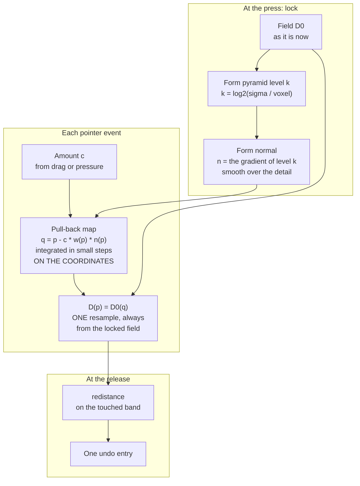

Three details in that picture are load bearing:

1. **The normal comes from the pyramid, not from the field.** `sigma` is the
   user's statement of what counts as detail, in millimetres: features smaller
   than it ride along, features larger than it are the form being changed. In
   millimetres, so it means the same thing at every voxel size, which is the
   argument `generate.rs:51-60` makes for the cavity slider.
2. **Large amounts are integrated on the coordinates, and the field is sampled
   once.** A warp stops being invertible when its gradient reaches one, which
   is why `Brush::max_drag` exists (`brush.rs:764`). Going further by repeating
   the warp would resample the field each time and blur it each time. Composing
   the *map* in small steps and reading the locked field once at the end costs
   vector arithmetic per voxel and exactly one interpolation.
3. **It is a gesture, locked at the press**, on the `MoveStroke` pattern.
   Thirty adjustments within one gesture cost one resample, which is the rule
   `transform.rs:45-52` already states for the gizmo.

### 9.3 The tools this gives

| Tool | What it does | Mechanism |
|---|---|---|
| **Bulk / Slim** | Thicken or thin a mass; scales, pores and wrinkles survive | The warp above, as a brush |
| **Bulk body** | The same over a whole body or everything unmasked | The warp above, global, with a millimetre amount |
| **Form smooth** | Relax the big shape, keep the surface texture | `D' = D + w * (smooth(B) - B)` where `B` is the base at scale `sigma`: a low frequency term added to the field. Blend type, no gain |
| **Posed transform** | Gizmo plus mask: rotate, move or scale the unmasked part, blended across the mask's feather | Per point blended similarity, inverse by fixed point iteration, one resample, then `redistance` as `app.rs:3018` does now |
| **Detail gain** | One slider: soften the detail and keep the form, or exaggerate the detail | `D' = B + g * (D - B)`, once, from a locked field |
| **Form scale on any brush** | The `FormScale` switch in `BrushDef` | Blend brushes apply their edit to `B` and add the difference; warp brushes take their direction from the form normal |

Detail gain above one looks like the thing `brush.rs` forbids (amplifying a
difference from an average). The prohibition is about doing it *per stamp*,
where rounding error compounds across a stroke. Done once from a locked field
it is a single linear operation, clamped and redistanced. It is also directly
useful for print: fine detail that a 0.4 mm nozzle would erase can be
exaggerated on purpose before export.

Posing is worth singling out: gizmo plus mask is how a ZBrush figure is posed,
and `mask.rs:53-54` already guarantees the precondition, since "every path
that writes the mask writes a feathered edge, never a step" was written to keep
exactly this kind of warp invertible.

#### Built, 2026-11-23 (S4.1): bulk the body, and the detail gain

`brokkr-core/src/form.rs`, and a FORM block on the panel: a detail size in
millimetres, a *Bulk* amount with its Apply, and a *Detail* multiplier with
its Apply. Both work on the whole of the active body, less what the mask
protects, and each is one undo entry.

**The measurement the plan said to make first**, on a ball 40 voxels in
radius with a ripple 8 voxels from crest to crest and 0.8 of a voxel high:

| | Surface moved | Ripple left |
|---|---|---|
| Bulk by 3 voxels | 2.999 | 96% |
| Bulk by 9 voxels | 8.995 | 98% |
| Thin by 6 voxels | 6.008 | 94% |
| Inflate by 3 voxels | 3.19 | 80% |
| Inflate by 6 voxels | 6.30 | 61% |
| Inflate by 9 voxels | 9.36 | 49% |

A bulk keeps the detail by about the same however far it goes, the few
percent being its one trilinear read. Offsetting the field loses it as it
goes. So the cubic sampler the plan thought might be needed for detail under
5 voxels is not needed at 8, and has not been measured below that.

**The detail gain** is `new = form + gain * (old - form)`, once, from a field
nobody is editing. At a gain of nothing the ripple is 13% of what it was, at
a half 55%, at two 1.97 times.

**The form of a ball is a smaller ball**, and this was the part that took
three goes. Smoothing pulls a surface toward its centre of curvature, so a
level of the pyramid sits inside every bulge, and scaling detail about it
would change the model's size too. On a ball 30 mm in radius at a quarter
millimetre, taking all the detail off moved the surface in by 0.05 mm on
average at a detail size of 2 mm and 0.22 mm at 4.

1. Estimating that from the next coarser level (Richardson) fixed the small
   test ball and made the real one worse at two sizes of four: the coarser
   level is the one least able to hold the model.
2. Smoothing the form itself again by the same steps and adding back what
   that took off is right on average to 0.008 mm, and bringing the form back
   to full resolution to do it cost 45 seconds at a detail size of 8 mm.
3. Bringing it back two halvings only, which is fifteen sixteenths of the
   smoothing, is what is built: under a second at every size, and the
   average within 0.013 mm up to a detail size of 4 mm.

The first measurement of the uncorrected form was along one axis and said
0.017 mm where 300 directions say 0.22. The lattice flatters its own axes.
The table in the module is the 300.

**Cost, measured** (release, the starting ball at a quarter millimetre): the
pyramid 0.5 s, a bulk of 1 mm 0.8 s, the redistance after it 0.5 s, a detail
gain 0.3 s. On the update thread, which is owed a task, as export is.

**One step, not many.** The plan drew the pull-back as a walk in small
steps, re-reading the form's normal at each. A mutant that took one step
where the code took three survived every test, and it was right to: the form
is a distance field, the lines its gradient follows are straight, and the
normal a point starts with is the normal all the way back. The walk is gone.

**And a NaN in the test fixture.** The rippled ball's centre voxel divided
nothing by nothing. Every surface measurement passed, because none of them
looked inside the ball, and the NaN was quietly switching off the
redistance the fixture was supposed to have had. A test that checked the
far field of a bulk, written to kill another mutant, read it.

**Not built yet from the table above:** the bulk as a brush, form smooth,
the posed transform, and the form scale on any brush.

### 9.4 The limits, stated before anyone finds them

- **Detail is carried, not regenerated.** Where a surface grows, its detail
  stretches with it. That is also what subdivision levels do.
- **One gesture is bounded** by the curvature radius of the form and the width
  of the falloff. The map integration extends the range; it does not remove
  the bound, and past it the surface stops following rather than tearing.
- **One warp is one trilinear resample**, and trilinear interpolation
  attenuates features near the voxel scale. **S4 begins by measuring that**:
  the amplitude of a 4 voxel ripple after one warp. If the loss is visible, the
  gesture warps get a cubic sampler. Estimate: it will be needed for detail
  under about 5 voxels.
- **Detail at the limit of resolution is fragile under anything**, here as in
  every other operation (`README.md:365`).

---

## 10. Unwrap, bake and textured export (milestone S5)

Last, because it needs decimation (S1) and paint (S2) to have anything to do.

### 10.1 Unwrap

On the **decimated** mesh, at export, and never anywhere else (D1).

- **Charts** by region growing over faces. The cost of adding a face to a
  chart is its normal deviation from the chart's proxy plane plus a
  compactness term, **minus a reward for ending the chart in a crevice**: the
  occlusion signal says where a seam will not be seen. Masked faces refuse
  seams, which gives the user ZBrush UV Master's "protect" with the tool they
  already have.
- **Flattening, first version:** orthographic projection onto the chart's
  proxy plane with the normal cone capped at 60 degrees, which bounds stretch
  at 2 with no solver at all. **Second version:** least squares conformal maps
  with an in-house conjugate gradient, which allows larger charts and fewer
  seams.
- **Packing** with a skyline packer at uniform texel density, with a gutter
  sized for the bake.

Texel density is derived, not chosen: one texel per voxel captures the paint
losslessly, and a 3,000 mm² miniature at 0.1 mm is 300,000 texels, which fits
a 1024 atlas with room for gutters. **(Estimate from area; measured in S5.)**

**Build or depend.** `xatlas` is the standard and is C++. A pure Rust crate in
its spirit, `uvunwrap`, exists and is **unverified by this plan**. The
milestone's first day evaluates it. The projection charts above are the
fallback, and they are small enough to be the differential oracle either way.

### 10.2 Bake

For each texel inside a chart triangle, take its world position `p` on the low
polygon triangle and step to the true surface:

```text
p* = p - d(p) * grad d(p) / |grad d(p)|^2
```

One or two steps, valid because decimation kept `p` inside the band. Then read:

| Map | Source at `p*` |
|---|---|
| Base colour | Paint field |
| Normal (tangent space) | Field gradient, in the triangle's frame |
| Occlusion | Occlusion signal |
| Height | `d(p)` itself, in millimetres, signed |
| Metallic and roughness | Finish byte |
| Slot id | Slot field |

**No cage, no ray casts, no "the rays missed" artefacts.** On a mesh pipeline
baking is its own craft. Here the question "where is the real surface from this
point" is the question the data structure exists to answer.

### 10.3 Formats

- **OBJ + MTL + PNG**, the lowest common denominator.
- **GLB** (binary glTF), with base colour, normal, occlusion and
  metallic-roughness. The JSON is small and `serde_json` is already in the
  graph (`Cargo.lock:3236`).
- **PLY with vertex colours**, which several full colour print services take,
  and which S2 can ship early since it needs no atlas.
- PNG writing through the `png` crate, already in the lockfile
  (`Cargo.lock:2779`). **To verify at implementation:** that naming it directly
  adds no new crate to the build, which is the bar `Cargo.toml`'s comments set.

The 3MF writer keeps writing filament slots. That is still the right contract
with a slicer.

### 10.4 Built, 2026-11-23 (S5.1): unwrap, base colour, and an OBJ with a picture

`brokkr-core/src/export/unwrap.rs`, `export/texture.rs` and
`export/textured.rs`, and a fifth format on the export panel, *OBJ+PNG*, with
a texture size of 1024, 2048 or 4096. It writes `model.obj`, `model.mtl`
beside it, and a PNG for each body.

**Unwrap.** The first version of 10.1, and plainer than it was drawn:

- A chart is every triangle within 60 degrees of the way its first triangle
  faces, reached across shared edges, and laid flat by looking along that
  way. No triangle is flipped, and stretch is bounded at 2, both by
  construction and both tested.
- Charts start from the flattest triangles. Started in index order, a chart
  on a bevelled cube began on a bevel and took half of each face either
  side of it. The flattest first is the nearest this comes to "end the chart
  in a crevice".
- **Facing the axis is not enough to keep a chart off itself**, which 10.1
  did not say. A ramp that winds round like a spiral stair faces up
  everywhere and lies over itself seen from above. A triangle is only taken
  if it does not overlap what the chart already holds. The first overlap
  test sampled points and let 64 texels of the ramp overlap; the one built
  is exact (separating axes), and so is the test that checks it.
- Packing is in rows, tallest first, at one scale for every chart, the
  largest at which they fit. A skyline packer would waste less. Rows waste
  little enough that the density below is already more than the paint has.

**Bake.** As 10.2 says: each texel's point on its triangle is stepped onto
the surface, once, and the colour is asked for there, which is the paint the
voxel holds shaded by the field's own curvature. The colours at chart edges
are then spread into the margin, so that a blurred lookup at a seam reads
the same colour from either side.

The test this milestone exists for: a ball with a wash in a groove,
decimated until the groove is narrower than the triangles across it. A
colour a vertex (the PLY) loses the groove. The texture has it.

**Measured** (release, a 24 mm cube at a quarter millimetre with a slot cut
in it and a ball let into one corner, decimated from 125,408 triangles to
10,004): 28 charts, the unwrap 10 ms, the bake at 1024 texels 0.46 s, 14
texels to the millimetre. The paint is one value a voxel, which is 4 to the
millimetre, so 1024 already holds it three times over on a model this size,
and the estimate in 10.1 stands. (The commit that built this, and its pull
request, call that model "the starting ball". It was not: the numbers are
right and the name was wrong.)

**Build or depend: built.** The evaluation of `uvunwrap` was not made. The
projection charts were the fallback and they turned out to be enough for a
picture nobody edits by hand, in under 800 lines with nothing new in the
build.
The PNG is written by the `image` crate, which the application already
used; the core has no picture format in it and gained none.

**Not built from this section:** seam hiding and the mask as "protect"
(seams are where they fall; the bake makes them not show), conformal
flattening, the maps other than base colour, and GLB, which is 10.5.

### 10.5 Built, 2026-11-23 (S5.2): GLB

`brokkr-core/src/export/glb.rs`, and a sixth format on the export panel.
The textured formats now sit in a row of their own under the texture size,
since six buttons were one row too wide and the size only means anything
to two of them.

One file: the mesh, and each body's picture inside it as the PNG the
application made. It shares the unwrap and the bake with the OBJ.

**Three things this format means that the others here do not**, each of
which is a line in the writer and a test:

- **Metres.** Everything else written here is millimetres. A glTF is
  metres by its specification, so positions are divided by a thousand. A
  model written in millimetres opens a thousand times too big and nothing
  says why.
- **Y up.** So is the sculpt. This is the one writer that does not turn
  the model.
- **A vertex is one position and one place on the picture.** A vertex on
  the edge of two charts has two places and is written twice.

**The JSON is written by hand**, where 10.3 said `serde_json` was already
in the graph. It is in the application's graph and not the core's, and the
core is where a writer belongs. It is forty lines of fixed shape with one
kind of string in it, the bodies' names, which are escaped and tested with
quotes, backslashes, line ends and a control character in them. The
application's test reads the file back with `serde_json`, so a parser that
is not this one has read it.

**Checked how.** By tests that follow the file's own indices from the
scene down to the bytes and compare them with what went in, for two bodies
with pictures of odd lengths so that the padding is exercised. **Not
checked** against the Khronos validator: it could not be run where this
was built. That is the first thing to do with a file from this writer
anywhere it can be.

**Size.** A ball 30 mm in radius at full detail (543,000 triangles) with a
1024 texture is 15 MB, of which the picture is 39 KB: the mesh is the file. *Detail* is the
control that matters here as everywhere.

**Not built:** the finish as a metal and roughness picture (every material
is the same matt non-metal), normal and occlusion maps, and compression of
the mesh.

---

## 11. Priorities

### 11.1 The order

Ranked by value to the sculpt, print, paint loop, times certainty, over cost,
subject to what depends on what. Sizes are **estimates in working weeks for one
person with AI assistance**, and each is replaced by a phased plan with
measured baselines when its milestone opens.

| Rank | Milestone | What ships | Size | Why here |
|---|---|---|---|---|
| 1 | **S0 Groundwork** | Brush engine (no behaviour change), `SparseField`, form pyramid, signals, cavity shading toggle, branch and CI hygiene | 2 to 3 | Everything stands on it. Zero user-facing risk. Cavity shading is a visible win by itself |
| 2 | **S1a Decimated export** | Tolerance in mm, field verified, slot boundaries held, report | 2 | Smallest, independent, fixes a pain that exists today, prerequisite for S5, upstream candidate |
| 3 | **S1b Parting with keys** | Plane part, four key kinds, auto placement, clearance, preview | 2 to 3 | Independent. The engine makes it nearly free. Upstream candidate |
| 4 | **S2 Mini painting** | Paint recipes and the rack (done), gated drybrush and sponge strokes, fills, zenithal and broad occlusion, paints to filaments, PLY | 5 to 7 | The headline. Largest. Needs S0's signals and gates |
| 5 | **S3 Brush engine, surfaced** | Alphas, drag rect, displace, dynamics curves, new operators, presets | 3 to 4 | The refactor is done in S0 and exercised by S2; this exposes it |
| 6 | **S4 Form tools** | Bulk and slim, form smooth, posed transform, detail gain | 3 | Needs the pyramid. High value, one real unknown (resample blur) |
| 7 | **S5 Unwrap and bake** | Charts, packing, bake, OBJ+PNG, GLB | 3 to 4 | Needs S1a and S2. Newest mathematics. Only matters once there is paint to carry |
| | **S6 Backlog** | Section 12 | | |

**About 21 to 26 weeks in sequence (estimate).** S1 and S2 do not depend on
each other, so with two streams of work the print track and the surface track
run side by side after S0.

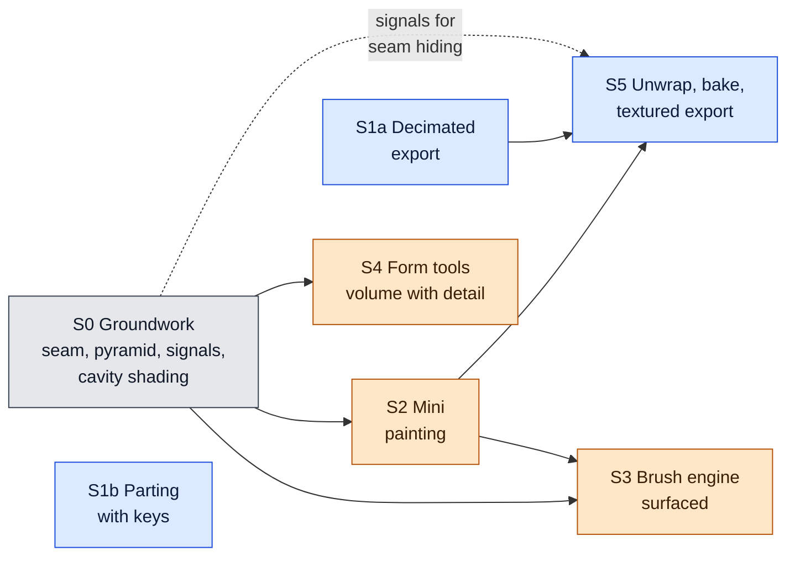

Grey is groundwork, blue is the print track (and upstream friendly, except S5),
orange is the surface track. S1a and S1b have no arrow into them from S0: they
can start on day one.

### 11.2 Why not painting first

It is the feature with the most words in the request, and it is ranked fourth.
Three reasons:

1. **It cannot start without S0**, and S1a and S1b can. They are useful weeks
   that are otherwise idle.
2. **S1 is where the risk is lowest and the proof is cheapest.** Decimation and
   parting are verified by counting edges and measuring millimetres. Painting
   is verified by looking, which this repository has learned to be careful
   about (`CONTRIBUTING.md`, "a green-but-dead interaction twice").
3. **S1 is the part upstream might take.** Landing it first, cleanly, on new
   files, keeps that door open and keeps the fork's diff small while the larger
   work is still moving.

If the preference is the headline first, S2 moves up to rank 2 and nothing else
changes; the dependency graph allows it.

### 11.3 The first three increments

1. **The brush engine, held to the brush.** *Done, 2026-11-22.* Every stamping
   kind, falloff, pattern, direction, pressure, mask state and mirror through
   both paths, same field and same undo entry bit for bit; eight mutations of
   the engine run against the test, six caught and two shown to be equivalent.
   A recorded hash was the first idea and was dropped: the patterns take roots,
   so a hash is a statement about one machine.
2. **The form pyramid, the cavity signal and crease shading.** *Done,
   2026-11-22* (sections 5.2 to 5.4). The pyramid is distance fields rather
   than coverage; the cavity signal is measured at mesh time and cached
   nowhere; *show creases* is the first thing in this plan a user can see.
3. **Decimation phase 0:** measure what export costs today (triangles, bytes,
   seconds, slicer load time) at three voxel sizes, so the milestone's claims
   have a baseline.

---

## 12. What this plan deliberately does not do

Each with the reason, and the trigger that would reopen it.

- **Paint layers.** A full coverage layer costs as much memory as the geometry
  it sits on (+100% of the field, section 8.2), so a six layer stack on a real
  model is past the ceiling. The first version is one buffer, as a real
  miniature is, with a deep undo. *Trigger:* a measured compact paint brick
  (surface cells only, estimated at 20x smaller) makes layers affordable.
- **Sculpt layers.** Still out, for the build spec's reasons.
- **A paint lattice finer than the field.** Section 8.6. *Trigger:* someone
  painting freehand detail on a body whose geometry does not need the voxels.
- **Adaptive extraction straight from the field** (octree dual contouring)
  instead of decimating a uniform mesh. It could recover the sharp edge of a
  cut that surface nets rounds. Crack free adaptive contouring is intricate,
  and decimation gets most of the triangle saving for a fraction of the risk.
  *Trigger:* cut edges that measure visibly rounded in a print.
- **Quad remeshing and edge flow.** Not what decimation is.
- **Pigment flow simulation.** Section 8.6.
- **Hollowing with drain holes.** It needs distances deeper than the band,
  which is a separate piece of machinery. Adjacent to parting and worth doing;
  not in this plan.
- **Insert mesh brushes.** Alphas and drag rect cover stamped surface detail.
  Stamped *solids* stay out.
- **Radial symmetry, GPU compute for edits, tablet builds.** Unrelated to the
  six asks.

---

## 13. The branch, and living beside upstream

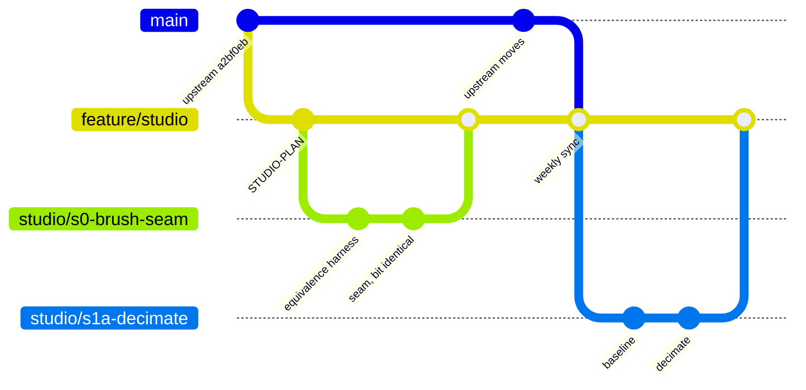

- **`main` mirrors upstream** (`MakerViking/brokkrsculpt`) and carries nothing
  of this plan.
- **`feature/studio` is the long-lived integration branch.** It is merged into,
  never rebased, because it is published and other branches hang off it.
- **Each increment is a topic branch** (`studio/<milestone>-<name>`, or a
  session branch) merged into `feature/studio` by pull request.
- **`main` is merged into `feature/studio` weekly.** Small and often: a fork
  that syncs monthly does not sync.

**CI.** `ci.yml` runs on pull requests and on pushes to `main`
(`.github/workflows/ci.yml:4-7`), so a pull request into `feature/studio` is
checked with no change. `release.yml` fires only on `main`
(`.github/workflows/release.yml:28-30`), so this branch can never publish a
build to the beta channel by accident.

**Keeping the diff mergeable (D6), as rules:**

- New features are new files: `export/decimate.rs`, `part.rs`, `paint.rs`,
  `pyramid.rs`, `signals.rs`, `sparse.rs`, `uv.rs`, `bake.rs`, and in the
  application `app/paint.rs`, `app/part.rs`, `app/export_panel.rs`.
- `app.rs`, `volume.rs` and `brush.rs` take the smallest hooks that work.
  Where a hook into a hot upstream file is unavoidable (paint must be read by
  `mesh_brick`; the sweep through `rotated`, `shifted`, `warped`), it is one
  call into a new module.
- No reformatting, renaming or refactoring of upstream code for taste.
- House conventions hold: SPDX header on every new file, no em-dashes in
  prose, fish for any shell command, warnings before command blocks.

### Seeing it run without a screen

Every panel on this branch was built and tested without anybody seeing it,
which is how a preset's name came to have 74 pixels to wrap in. On
2026-11-23 the application was run on a virtual display and looked at, and
this is how, for whoever next works on it from a machine with no screen:

```text
Xvfb :99 -screen 0 1500x950x24 &
DISPLAY=:99 WAYLAND_DISPLAY= HOME=<a scratch directory> ./target/debug/brokkrsculpt &
DISPLAY=:99 xdotool mousemove 935 388 click 1        # press a button
DISPLAY=:99 import -window root shot.png              # look
```

It wants `libxkbcommon-x11` installed (winit panics without it), a software
Vulkan (lavapipe), and `show_on_startup = false` in the scratch home's
`brokkrsculpt/welcome.conf` to get past the welcome screen. A scratch
`HOME` keeps it off anybody's real config. Keys do not arrive, there being
no window manager to give the window focus; the pointer and the wheel do.
File dialogs do not open, so export was not driven this way.

**What looking found.** Two faults of layout, both fixed: a button to
forget each preset left the names too narrow, so there is one *Forget* for
the lit preset; and "Drybrush" ran into the edge of a quarter of a row, so
the four touches share the row by the length of their names. And one limit,
now in 8.6: fill on features a voxel or two tall. Everything else did what
its tests said: the row of rivets follows the drag and faces along it, a
wash pools round each rivet, a fill stops at a rivet's bevel, a preset
lights when the brush matches it.

---

## 14. Risks and open questions

| Risk | Likelihood | What contains it |
|---|---|---|
| The brush seam costs the stamp budget | Medium | Equivalence and the benchmark gate land before anything depends on the seam. If it cannot hold 4 ms it is redesigned, not waved through |
| Paint memory surprises a user on a large model | High | Demand predicted and refused by name before every global operation; priming is free; the limit is documented |
| The paint sweep misses one transform and silently drops colour | Medium | One failing-without-it test per transform, the discipline `colour.rs` already records |
| Trilinear blur makes the form tools disappointing | Medium | Measured first in S4; cubic sampler is the planned fallback |
| Upstream refactors `app.rs` or `brush.rs` under the branch | Certain, eventually | Weekly sync, additive files, thin hooks |
| The shader preview and the CPU bake of a wash disagree | Medium | One table driven test evaluating both |
| Unwrap quality is poor on organic shapes | Medium | It only has to be good enough for a bake nobody edits by hand; a library is evaluated first |
| The plan's estimates are wrong | Certain | Each milestone opens with a phased plan and a measured baseline that replaces them |

**Questions for the maintainer of this fork.** None blocks S0; the plan
proceeds on the stated default for each.

1. **Upstream.** Offer S1 (and later S4) to `MakerViking/brokkrsculpt` as pull
   requests, or keep everything on the fork? *Default: build them so they could
   be offered, and decide when S1a is done.*
2. **Order.** Print track first, as ranked, or painting first (section 11.2)?
   *Default: as ranked.*
3. **Build or depend** for decimation and unwrapping. *Default: in house, with
   an external crate as a test oracle only.*
4. **One paint buffer, no layers, in the first version.** *Default: yes.*
5. **Paint resolution tied to the voxel size in the first version.** *Default:
   yes.*
6. **Names.** `feature/studio`, milestones S0 to S6, "Studio" for the effort.
   *Default: as written; all three are one search and replace.*
